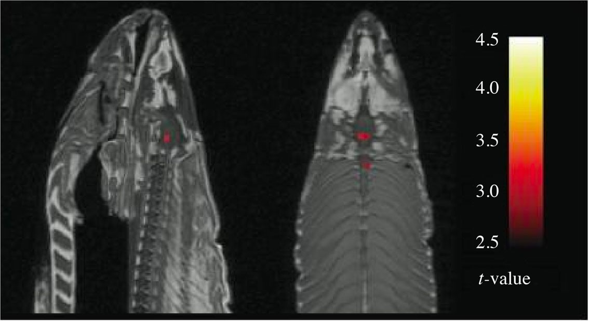

## Statistical inference {.title-slide}

Week 6

How uncertain is our estimate — and how should we make decisions from data?

::: {.notes}
Week 5 gave us sampling distributions. Week 6 uses that machinery for estimation and decision-making. The entire lecture follows one randomized blood-pressure trial so the abstractions stay anchored.
:::

## We did everything correctly... right? {.motivation-slide}

Opening case

1<strong>Randomize</strong><small>placebo vs experimental</small>

→

2<strong>Blind</strong><small>reduce expectation bias</small>

→

3<strong>Measure</strong><small>systolic BP after treatment</small>

→

4<strong>Clean</strong><small>check data carefully</small>

::: {.fragment .fade-up}

Now we have numbers. What decision can they support?

:::

## The observed result {.concept-slide}

A randomized two-arm trial

::: {.fragment .fade-up}

"Suppose we investigate new Drug $\text{A}$ as antihypertensive agent."

:::

arm

$n$

mean SBP

SD

SE

placebo

80

<strong>138.8</strong> mmHg

14.0

1.57

experimental

80

<strong>133.0</strong> mmHg

14.2

1.59

::: {.fragment .fade-up}

Observed difference: <strong>$\hat\Delta = 133.0-138.8=-5.8$ mmHg</strong>

:::

::: {.notes}
The endpoint is deliberately incomplete: we are showing post-treatment BP without baseline BP. We return to that later.
:::

## Description is not yet inference {.concept-slide}

The transition

What we observed

$-5.8$

sample difference

What could vary

$?$

another random sample

What we want

$\Delta$

population treatment effect

::: {.fragment .fade-up}

Inference connects a noisy statistic to an unknown population quantity.

:::

## And then someone asks for a yes/no answer {.motivation-slide}

The decision problem

data

→

uncertainty

→

action

Should this result change what we do? (In this case market new Drug $\text{A}$)

::: {.fragment .fade-up}

Important

Statistics can quantify evidence and uncertainty. It cannot decide clinical value, ethics, benefit–risk, or regulatory policy by itself.

:::

## Decision theory: data, actions, consequences {.concept-slide}

A minimal vocabulary

<strong>State of nature</strong>what is actually true

<strong>Data</strong>what the experiment reveals

<strong>Decision rule</strong>how evidence maps to an action

<strong>Loss / consequence</strong>what errors cost us

::: {.fragment .fade-up}

A statistical rule is useful only in the context of consequences.

:::

  

  
Abraham Wald

  
  

  

  
Jerzy Neyman

  
  

  

  
Egon Pearson

  
  

## Confidence interval {.section-break}

Part II

The confidence interval

We now see how we can quantify the uncertainty of an estimate.

## First: quantify uncertainty around an estimate {.section-slide}

Confidence intervals

estimate $\pm$ uncertainty

::: {.fragment .fade-up}

Week 5 already gave us the engine.

:::

<strong>sample mean</strong>$\bar X$ changes from sample to sample

→

<strong>sampling distribution</strong>$\mathrm{SE}(\bar X)=\sigma/\sqrt n$

→

<strong>population mean</strong>centered at $\mu$

::: {.fragment .fade-up}

Confidence interval

A procedure that uses the sampling distribution to construct a range of parameter values compatible with the observed estimate.

:::

## The familiar 95% interval {.concept-slide}

Normal-model intuition

$\bar x$

$\pm$

$1.96$

$\times$

$\mathrm{SE}(\bar X)$

::: {.fragment .fade-up}

For a Normal model with known $\sigma$, this procedure covers $\mu$ in 95% of repeated samples.

:::

::: {.notes}
More generally, critical values and standard errors depend on the model. Week 7 introduces t-based intervals and other specific tests.
:::

## Try it: confidence interval coverage {.exercise-slide}

Repeated-sampling laboratory · Normal population

<label class="w6-control">population $\mu$ = <strong id="ciMuValue">0.0</strong><input id="ciMu" type="range" min="-5" max="5" value="0" step="0.5"></label>
<label class="w6-control">population $\sigma$ = <strong id="ciSigmaValue">2.0</strong><input id="ciSigma" type="range" min="0.5" max="5" value="2" step="0.5"></label>
<label class="w6-control">sample size $n$ = <strong id="ciNValue">20</strong><input id="ciN" type="range" min="5" max="200" value="20" step="5"></label>
<label class="w6-control">confidence = <strong id="ciLevelValue">95%</strong><input id="ciLevel" type="range" min="80" max="100" value="95" step="1"></label>
<label class="w6-control">interval type<select id="ciType"><option value="two">two-sided</option><option value="lower">lower bound</option><option value="upper">upper bound</option></select></label>
<label class="w6-control">repeated samples<select id="ciK"><option value="100">100</option><option value="500">500</option><option value="1000">1000</option></select></label>
<button id="ciRedraw" class="w6-button" type="button">Draw new samples</button>

empirical coverage<strong id="ciCoverage">—</strong>

<svg id="ciMeanSvg" class="w6-lab-svg ci-mean-svg" style="height:15em" viewBox="0 0 900 610" aria-label="Repeated confidence intervals and coverage"></svg>

## What should you notice? {.concept-slide}

Coverage laboratory

Increase $n$

intervals get shorter because SE decreases

Keep 95%

long-run coverage remains near 95%

Change $\sigma$

more variable populations need wider intervals

::: {.fragment .fade-up}

Why no 100% confidence can be chosen?

For an unbounded Normal mean, guaranteed 100% coverage would require an interval extending without bound.

:::

::: {.fragment .fade-up}

What does “95% confidence” mean?

:::

::: {.fragment .fade-up}

Not this:

After the interval is calculated, the fixed population parameter is not “95% likely” to be inside this particular interval.

:::

::: {.fragment .fade-up}

The 95% belongs to the long-run performance of the <strong>procedure</strong>.

:::

## One-sided intervals use the same probability geometry {.concept-slide}

Middle vs tail probability

two-sided

<svg id="tailTwoSvg" class="tail-svg" style="height: 10em" viewBox="0 0 240 120" preserveAspectRatio="xMidYMid meet"></svg>

central $1-\alpha$

lower bound

<svg id="tailLowerSvg" class="tail-svg" style="height: 10em" viewBox="0 0 240 120" preserveAspectRatio="xMidYMid meet"></svg>

protect against values below $L$

upper bound

<svg id="tailUpperSvg" class="tail-svg" style="height: 10em" viewBox="0 0 240 120" preserveAspectRatio="xMidYMid meet"></svg>

protect against values above $U$

## Proportions need intervals too {.concept-slide}

Binary outcomes

Observed proportion

$\hat p=x/n$

e.g. response, toxicity, remission

Sampling uncertainty

interval

must respect the $0$ to $1$ boundary

::: {.fragment .fade-up}

Same inferential idea; a different sampling model and interval formula.

:::

## Try it: proportion confidence intervals {.exercise-slide}

Repeated-sampling laboratory · binary outcome

<label class="w6-control">population $p$ = <strong id="propPValue">0.30</strong><input id="propP" type="range" min="0.02" max="0.98" value="0.30" step="0.02"></label>
<label class="w6-control">sample size $n$ = <strong id="propNValue">40</strong><input id="propN" type="range" min="10" max="300" value="40" step="10"></label>
<label class="w6-control">confidence = <strong id="propLevelValue">95%</strong><input id="propLevel" type="range" min="80" max="99" value="95" step="1"></label>
<label class="w6-control">repeated samples<select id="propK"><option value="100">100</option><option value="500">500</option><option value="1000">1000</option></select></label>
<button id="propRedraw" class="w6-button" type="button">Draw new samples</button>

empirical coverage<strong id="propCoverage">—</strong>

<svg id="ciPropSvg" class="w6-lab-svg ci-prop-svg" style="height:15em" viewBox="0 0 900 610" aria-label="Repeated confidence intervals for a proportion"></svg>

::: {.notes}
The widget uses the Wilson interval. The method name is not the teaching target; the target is that binary sampling needs an interval suited to proportions, especially near 0 or 1.
:::

## Back to our trial: which interval matters? {.concept-slide}

Two groups

placebo
<i style="left:42%;width:34%;"></i><b style="left:59%;"></b>
138.8

experimental
<i style="left:14%;width:35%;"></i><b style="left:31%;"></b>
133.0

::: {.fragment .fade-up}

Do not test a difference by eyeballing two separate CIs

Overlap of the two group intervals is not the formal criterion for whether the group means differ.

:::

## Estimate the treatment effect directly {.concept-slide}

The contrast is the target

  
$\hat\Delta=-5.8$ mmHg · 95% CI approximately $[-10.2,-1.4]$

  

  

  

  

  

  
−12−8−404

::: {.fragment .fade-up}

The interval asks the right question: which population differences are compatible with the observed difference?

:::

## Significant is not the same as important {.concept-slide}

Two different judgments

Statistical
<strong>Is the result difficult to explain by sampling variation under a reference model?</strong>statistics can help

Clinical / practical
<strong>Is the magnitude large enough to matter for patients and decisions?</strong>requires domain context

::: {.fragment .fade-up}

A tiny effect can be statistically clear. A clinically valuable effect can remain uncertain in a small study.

:::

## Hypothesis tests {.section-break}

Part III

Hypothesis tests

We now see how we can devise a decision rule.

## Now turn estimation into a decision rule {.section-slide}

Hypothesis testing

assume a reference world → ask how unusual our statistic is

## Scientific hypothesis ≠ statistical hypothesis {.concept-slide}

Do not confuse the levels

Scientific question<strong>Does the treatment improve cardiovascular health?</strong>

↓ operationalize

Clinical endpoint<strong>systolic blood pressure after treatment</strong>

↓ formalize

Statistical hypothesis<strong>$H_0:\Delta=0$ versus an alternative</strong>

::: {.notes}
The statistical hypothesis is narrower than the scientific claim. Rejecting a BP null hypothesis does not prove the full clinical hypothesis.
:::

## Step 1: define the null reference {.concept-slide}

A specific parameter statement

Null<strong>$H_0:\Delta=0$</strong><small>no population mean difference in this example</small>

Alternative<strong>$H_1:\Delta\ne0$</strong><small>population means differ</small>

::: {.fragment .fade-up}

Not always “no difference”

Equivalence and non-inferiority questions use different null hypotheses. We meet them next week.

:::

## Step 2: choose the direction before seeing the result {.concept-slide}

Alternative hypotheses

$\Delta\ne0$
<strong>two-sided</strong>either direction matters

$\Delta<0$
<strong>lower-tail</strong>only sufficiently lower values count

$\Delta>0$
<strong>upper-tail</strong>only sufficiently higher values count

::: {.fragment .fade-up}

Direction is a design choice, not something to choose after inspecting the data.

:::

## Step 3: standardize the observed discrepancy {.concept-slide}

Test statistic

observed effect − null effect

standard error

$=\;z$

::: {.fragment .fade-up}

A good test statistic transforms the problem into a reference distribution we understand.

:::

## The null world is a counterfactual model {.concept-slide}

If $H_0$ were true...

<svg
  id="nullWorldSvg"
  viewBox="0 0 820 310"
  class="null-svg"
  preserveAspectRatio="xMidYMid meet"
  aria-label="Standard normal null distribution with central 95 percent region">
</svg>

::: {.fragment .fade-up}

With $\alpha=0.05$, sufficiently extreme statistics fall in the rejection region.

:::

## Step 4: compare the statistic with the null world {.concept-slide}

Our trial

$z\approx -2.6$

reject<i class="z-bound-left"></i><b class="z-zero"></b><i class="z-bound-right"></i>reject<em class="z-observed"></em>

−4−1.960+1.96+4

::: {.fragment .fade-up}

The observed standardized difference lies in a region that is uncommon under $H_0$.

:::

## Step 5: summarize extremeness with a p-value {.concept-slide}

A tail probability under $H_0$

p-value

Assuming the null hypothesis and the statistical model are correct, the probability of obtaining a test statistic at least as extreme as the observed one.

our illustrative trial: $p\approx0.009$

::: {.fragment .fade-up}

It is not

the probability that $H_0$ is true, nor the probability that the result happened “by chance.”

:::

## A small p-value is evidence against the reference model {.concept-slide}

But evidence is not effect size

p-value<strong>compatibility with $H_0$</strong><small>depends strongly on sample size and precision</small>

effect estimate<strong>magnitude + direction</strong><small>answers how much, in the observed scale</small>

confidence interval<strong>precision</strong><small>shows a range of compatible effect values</small>

## Where does $\alpha=0.05$ enter? {.concept-slide}

A pre-specified decision threshold

significance level<strong>$\alpha$</strong><small>long-run Type I error target under Null</small>

→

decision rule<strong>reject if $p<\alpha$</strong><small>for the chosen testing procedure</small>

::: {.fragment .fade-up}

$0.05$ is a convention, not a law of nature

The threshold should be pre-specified and justified by the scientific and decision context.

:::

## CI and hypothesis test are two views of the same machinery {.concept-slide}

For matching two-sided procedures

95% CI for $\Delta$
<i></i><b></b>
<small>does not include 0</small>

⇔

two-sided test at $\alpha=0.05$<strong>reject $H_0:\Delta=0$</strong>

::: {.fragment .fade-up}

The interval usually tells us more because it also shows direction and plausible magnitude.

:::

## Hypothesis testing workflow {.concept-slide}

A repeatable sequence

1<strong>Define</strong><small>parameter + null hypothesis</small>

2<strong>Choose</strong><small>test statistic + assumptions</small>

3<strong>Calculate</strong><small>statistic + SE</small>

4<strong>Reference</strong><small>null distribution + p-value</small>

5<strong>Interpret</strong><small>effect + CI + context</small>

## Try it: repeat the drug trial {.exercise-slide}

Same population effect · new random trial

<label class="w6-control">patients per arm $n$ = <strong id="trialNValue">80</strong><input id="trialN" type="range" min="20" max="300" value="80" step="10"></label>
<button id="trialRedraw" class="w6-button" type="button">Run a new trial</button>

true Δ<strong>−6.0 mmHg</strong>

common σ<strong>14 mmHg</strong>

observed arm means
<svg id="trialMeansSvg" viewBox="0 0 420 250"></svg>

estimated treatment effect
<svg id="trialEffectSvg" viewBox="0 0 420 250"></svg>

$\hat\Delta$<strong id="trialDelta">—</strong>

95% CI<strong id="trialCI">—</strong>

p-value<strong id="trialP">—</strong>

standardized effect<strong id="trialD">—</strong>

## What changes when $n$ changes? {.concept-slide}

Precision is not magnitude

$n\uparrow$<strong>$\mathrm{SE}\downarrow$</strong><small>sampling distribution narrows</small>

$n\uparrow$<strong>CI narrows</strong><small>estimate becomes more precise</small>

$n\uparrow$<strong>p can shrink</strong><small>same-size effects become easier to detect</small>

$n\uparrow$<strong>true effect unchanged</strong><small>biology did not become stronger</small>

::: {.fragment .fade-up}

This is why “statistically significant” cannot substitute for “important.”

:::

## Effect size asks “how much?” {.concept-slide}

Magnitude on different scales

  

  RAW EFFECT
  <strong>$\hat\Delta = \bar{x}_T - \bar{x}_C$</strong>
  <small>mmHg · often easiest to interpret clinically</small>
  

  

  STANDARDIZED EFFECT
  <strong>$d = \frac{\bar{x}_T - \bar{x}_C}{s_{\mathrm{pooled}}}$</strong>
  <small>difference expressed in SD units</small>
  

::: {.fragment .fade-up}

Standardized ≠ automatically meaningful

Clinical relevance still needs a domain-specific threshold and benefit–risk context.

:::

## We hid something important in our endpoint {.concept-slide}

Baseline blood pressure

<strong>placebo</strong>baseline ?post 138.8

<strong>experimental</strong>baseline ?post 133.0

Were the groups starting from the same place? Should we compare absolute or fold change relative to baseline?

::: {.fragment .fade-up}

Randomization balances baseline variables <strong>in expectation</strong>, not perfectly in every realized trial.

:::

::: {.fragment .fade-up}

Analysis consequence

Baseline should be measured and handled according to the pre-specified design—for example with change from baseline or baseline-adjusted analysis. A post-treatment mean alone can hide important context.

:::

## Decisions create two kinds of errors {.section-slide}

Type I, Type II, power

reality × decision

$H_0$ world

$H_1$ world

do not reject $H_0$

correct <small style="font-size: 1.2em">$1-\alpha$</small>

<strong>Type II error</strong>$\beta$

reject $H_0$

<strong>Type I error</strong>$\alpha$

correct <small style="font-size: 1.2em">$\text{power}=1-\beta$</small>

## Type I error: false positive {.concept-slide}

Rejecting a true null

no real treatment effect

→

an unusually favorable sample

→

we reject $H_0$

::: {.fragment .fade-up}

The significance level $\alpha$ controls this long-run error probability for the specified test.

:::

## Type II error: false negative {.concept-slide}

Missing a real effect

a real treatment effect exists

→

a noisy or underpowered sample

→

we do not reject $H_0$

::: {.fragment .fade-up}

Power

$1-\beta$: probability that the procedure rejects $H_0$ when a specified alternative effect is truly present.

:::

## Which error is worse? {.concept-slide}

There is no universal answer

<strong>False positive</strong>approve an ineffective or harmful intervention<small>patient safety · cost · trust</small>

<strong>False negative</strong>discard an actually useful intervention<small>missed benefit · lost investment · delayed care</small>

::: {.fragment .fade-up}

Design is a balance among error rates, meaningful effect sizes, feasibility, and consequences.

:::

## Try it: Type I error, Type II error, and power {.exercise-slide}

Two sampling worlds

<label class="w6-control">
null effect $\Delta_0$ = <strong id="errMu0Value">0</strong>
<input id="errMu0" type="range" min="-5" max="5" value="0" step="0.5">
</label>
<label class="w6-control">
alternative effect $\Delta_1$ = <strong id="errMu1Value">-4</strong>
<input id="errMu1" type="range" min="-5" max="5" value="-4" step="0.5">
</label>
<label class="w6-control">
common SD $\sigma$ = <strong id="errSigmaValue">14</strong>
<input id="errSigma" type="range" min="4" max="24" value="14" step="1">
</label>
<label class="w6-control">
patients / arm $n$ = <strong id="errNValue">80</strong>
<input id="errN" type="range" min="20" max="300" value="80" step="10">
</label>
<label class="w6-control">
$\alpha$
<select id="errAlpha">
<option value="0.10">0.10</option>
<option value="0.05" selected>0.05</option>
<option value="0.01">0.01</option>
</select>
</label>
<label class="w6-control">
alternative
<select id="errType">
<option value="two">two-sided</option>
<option value="less">less</option>
<option value="greater">greater</option>
</select>
</label>

Type I<strong id="errAlphaOut">5.0%</strong>

Type II<strong id="errBetaOut">—</strong>

power<strong id="errPowerOut">—</strong>

<svg id="errorSvg" class="error-svg-large" viewBox="0 0 860 500" aria-label="Null and alternative sampling distributions with error regions"></svg>

## What controls power? {.concept-slide}

Make the two worlds easier to distinguish

<strong>bigger true effect</strong>$|\Delta_1-\Delta_0|\uparrow$<small>worlds separate</small>

<strong>larger sample</strong>$n\uparrow$<small>SE shrinks</small>

<strong>less variability</strong>$\sigma\downarrow$<small>curves narrow</small>

<strong>larger$\alpha$</strong>easier rejection<small>but more Type I error</small>

## Two important concepts {.concept-slide}

::: {.fragment .fade-up}

Power depends on a specified alternative.

Sample-size planning therefore needs an effect size worth detecting—not just an arbitrary desire for “80% power.”

:::

::: {.fragment .fade-up}

Non-significant does not mean equivalent.

$p\ge\alpha$ means

we did not obtain enough evidence to reject this null with this procedure. It does <strong>not</strong> prove that the populations are equivalent.

:::

## One test is manageable. What about many? {.section-slide}

Multiplicity

more opportunities to be fooled

::: {.fragment .fade-up}

Repeating tests creates more false-positive opportunities.

:::

1

2

3

4

5

::: {.fragment .fade-up}

If five tests were independent and each used $\alpha=0.05$:

$\mathbb{P}(\text{at least one Type I error})=1-(1-0.05)^5\approx22.6\%$

This is assuming every null is true.

:::

::: {.notes}
The formula assumes independent tests. Correlated endpoints change the exact family-wise probability; the general multiplicity problem remains.
:::

## Try it: independent-test multiplicity {.exercise-slide}

A deliberately simple calculation

<label class="w6-control" style="font-size: 0.5em">number of tests $k$ = <strong id="multiKValue">5</strong><input id="multiK" type="range" min="1" max="40" value="5" step="1"></label>
<label class="w6-control" style="font-size: 0.5em">per-test $\alpha$<select id="multiAlpha"><option value="0.10">0.10</option><option value="0.05" selected>0.05</option><option value="0.01">0.01</option></select></label>

at least one false positive<strong id="multiFwer">—</strong>

—

Assumes independent tests and all null hypotheses true.

## Multiplicity correction changes the decision rule {.concept-slide}

Different goals, different procedures

<strong>Bonferroni</strong>simple, conservative<small>controls family-wise error</small>

<strong>Holm</strong>step-down procedure<small>controls family-wise error</small>

<strong>FDR methods</strong>e.g. Benjamini–Hochberg<small>control expected false-discovery proportion</small>

::: {.fragment .fade-up}

Stricter Type I error control usually costs power. Multiplicity is another decision trade-off.

:::

  

  
  
Carlo Emilio Bonferroni

  

  

  
  
Sture Holm

  

  

  
  
Yoav Benjamini

  

## The famous dead-salmon lesson {.concept-slide}

Many comparisons can manufacture discoveries

  

::: {.fragment .fade-up}

The point is not that imaging is unreliable—the point is that large families of tests require explicit error control.

:::

::: {.notes}
Source for lecturer reference:
https://prefrontal.org/files/posters/Bennett-Salmon-2009.pdf
:::

## Misconception check {.exercise-slide}

Decide before revealing

<strong>“$p=0.03$ means there is a 97% chance the treatment works.”</strong>
False · p is calculated assuming $H_0$.

<strong>“A 95% CI gives the plausible effect magnitude, not just a yes/no answer.”</strong>
Yes · that is one reason intervals are so useful.

<strong>“If $p=0.20$, we proved there is no effect.”</strong>
False · failure to reject is not proof of equivalence.

<strong>“With a huge $n$, a tiny effect may become statistically significant.”</strong>
Yes · precision increases with sample size.

## Would you trust this conclusion? {.exercise-slide}

Inference needs more than a p-value

Effect<strong>−1.2 mmHg</strong>

95% CI<strong>[−1.5, −0.9]</strong>

p-value<strong>&lt; 0.001</strong>

$n$<strong>20,000</strong>

::: {.fragment .fade-up}

Statistically significant? <strong>Yes.</strong>

:::

::: {.fragment .fade-up}

Clinically important? <strong>We still need a clinical threshold.</strong>

:::

::: {.fragment .fade-up}

Trustworthy? <strong>Only after checking design, endpoint, assumptions, missingness, multiplicity, and bias.</strong>

:::

## Week 6 synthesis {.concept-slide}

From sample to decision

<strong>estimate</strong>what did we observe?

→

<strong>SE + sampling distribution</strong>how much would it vary?

→

<strong>CI + effect size</strong>how much and how precise?

→

<strong>test + p-value</strong>compatibility with$H_0$

→

<strong>decision</strong>errors + consequences + context

::: {.fragment .fade-up}

Inference is not a single number. It is a structured argument from data under uncertainty.

:::

## Next week {.section-slide}

Week 7

categorical tests

$t$ tests

$F$ and ANOVA

interactions

equivalence

agreement

Now that we know what a statistical test <em>is</em>, we can choose the right one for the data and question.

