## Comparing groups {.title-slide}

Week 7

Are these groups meaningfully different?

::: {.notes}
Week 6 gave us the general inference machinery. This week is about choosing a statistic and a reference distribution that fit the data structure and scientific question.
:::

## We already know the recipe {.motivation-slide}

From Week 6

<strong>Observe</strong>sample statistic

→

<strong>Standardize</strong>sampling variability

→

<strong>Decide</strong>CI + test + effect

::: {.fragment .fade-up}

Today we change the <strong>test statistic</strong> to match the data and the question.

:::

## There is no universal test statistic {.concept-slide}

Data structure matters

Binary outcome

$\hat p$

counts and proportions

Continuous outcome

$\bar x, s$

means and spreads

Several groups

$\bar x_1 \, \text{vs.} \, \bar x_2$

between vs within variability

::: {.fragment .fade-up}

The test name comes last

First identify the variable, sampling structure, parameter of interest, and comparison.

:::

## The target is still the population {.concept-slide}

Do not lose the inferential target

Observed sample

what happened in these patients

Sampling model

what would vary across repetitions

Population parameter

what we want to learn about disease $D$

## Choosing a test {.section-break}

Part I

A test-selection blueprint

Choose from the data structure and scientific question.

## Four questions get us surprisingly far {.concept-slide}

A practical blueprint

1<strong>Variable type?</strong><small>categorical or continuous</small>

2<strong>How many groups?</strong><small>one, two, or more</small>

3<strong>Paired?</strong><small>same units measured twice?</small>

4<strong>What parameter?</strong><small>location, spread, association, agreement</small>

## First branch: what kind of variable? {.concept-slide}

The arithmetic must make sense

Categorical

counts, proportions, contingency tables

$O-E$
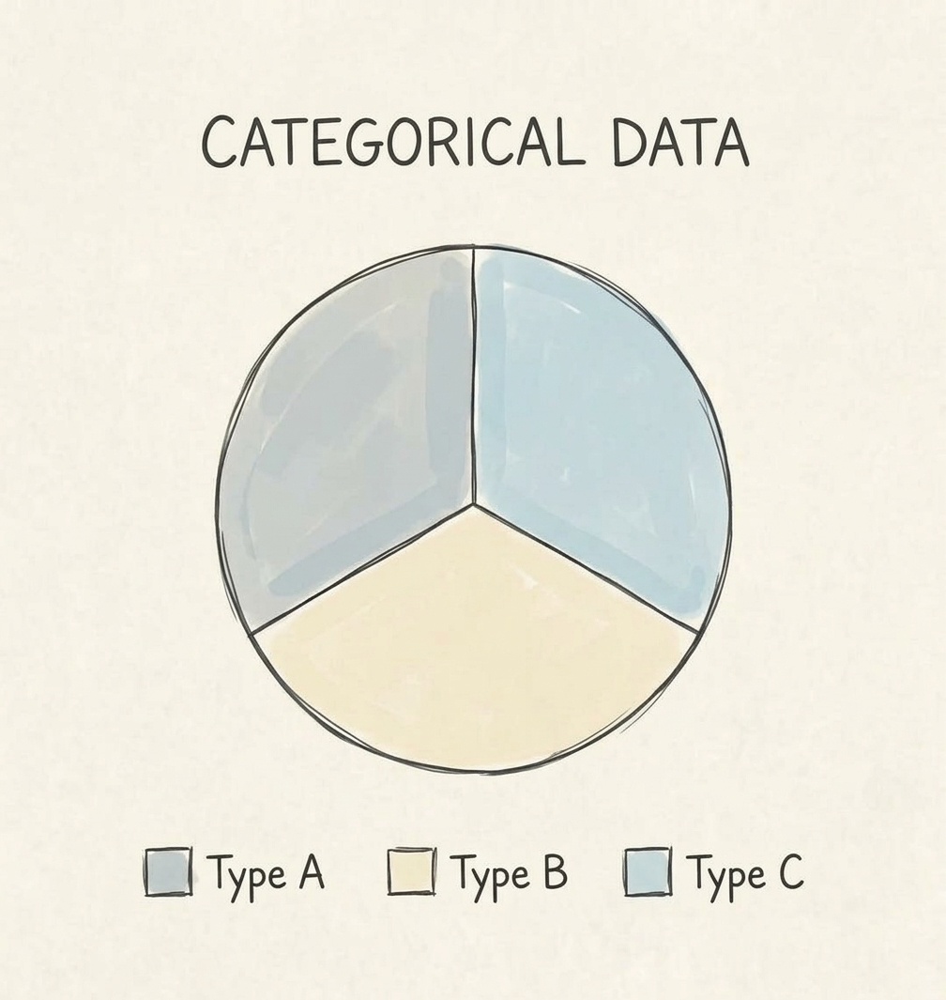

Continuous

means, differences, variances

$\bar x,\;s^2$
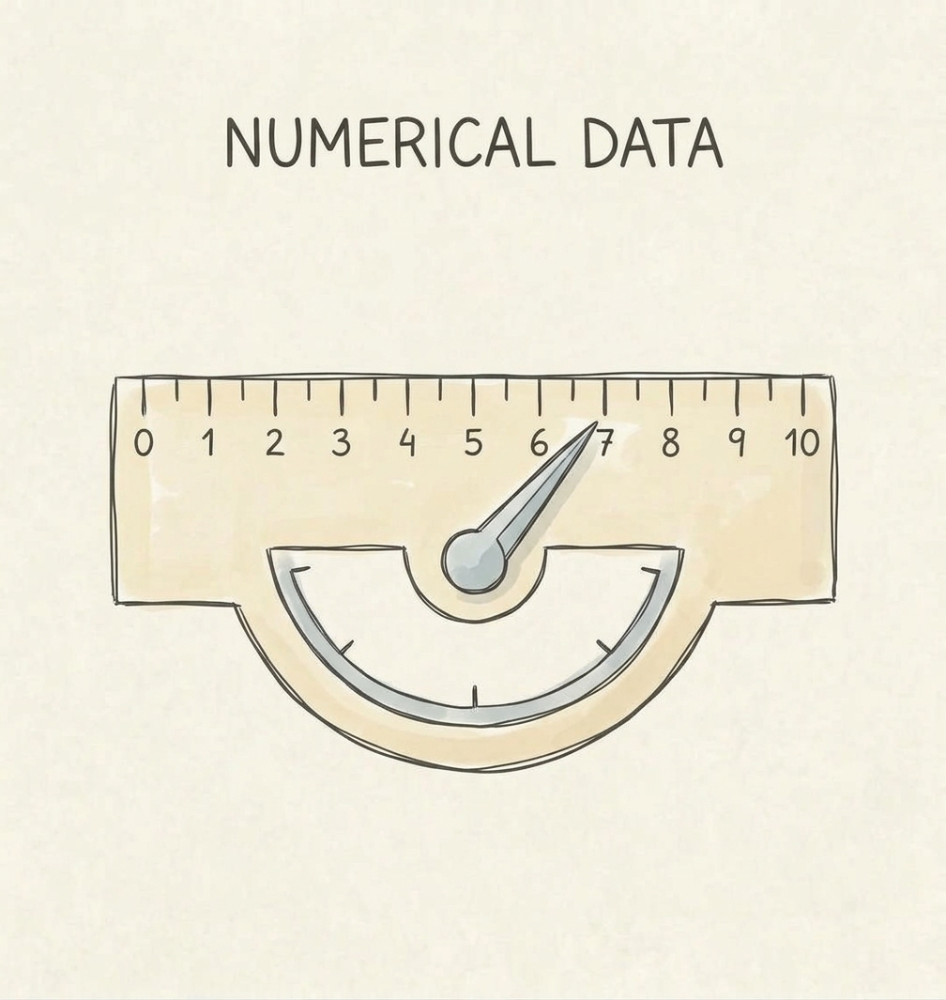

## Second branch: what comparison? {.concept-slide}

Reference vs another group

One sample

compare with a reference value or distribution
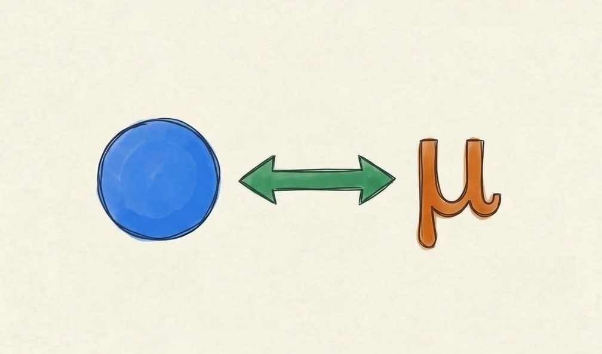

Two samples

compare two populations
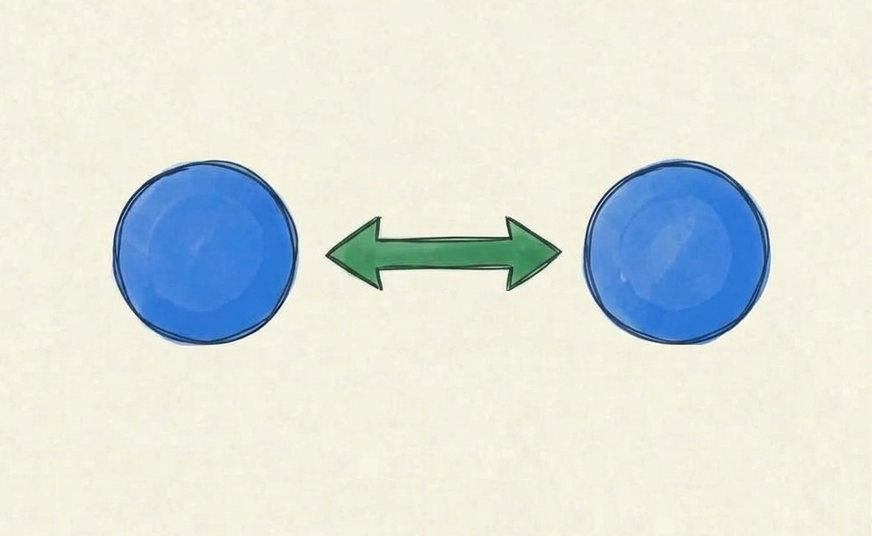

Three or more

compare several means jointly
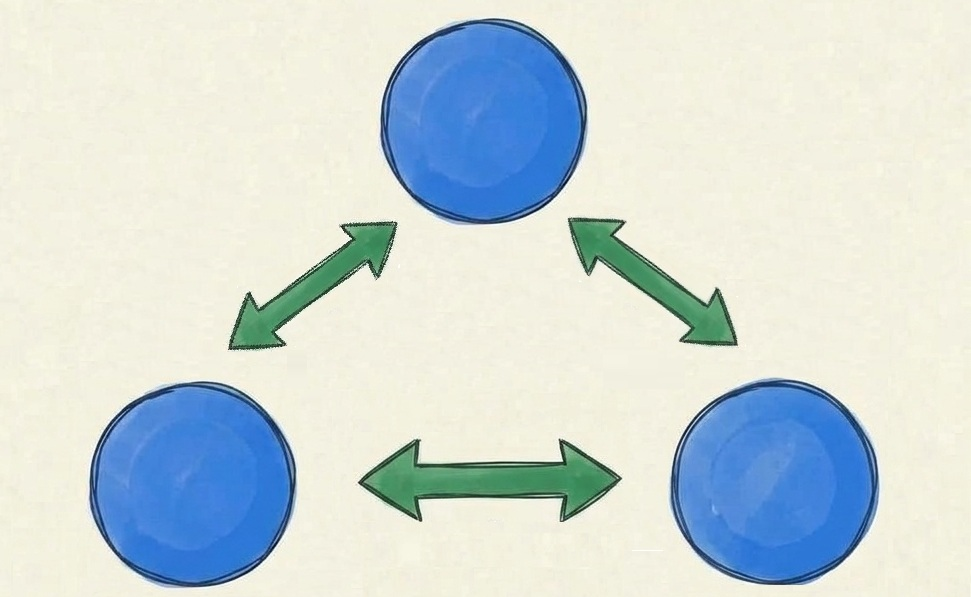

## Third branch: independent or paired? {.concept-slide}

What is the observational unit?

Independent

healthy patients and sick patients are different people
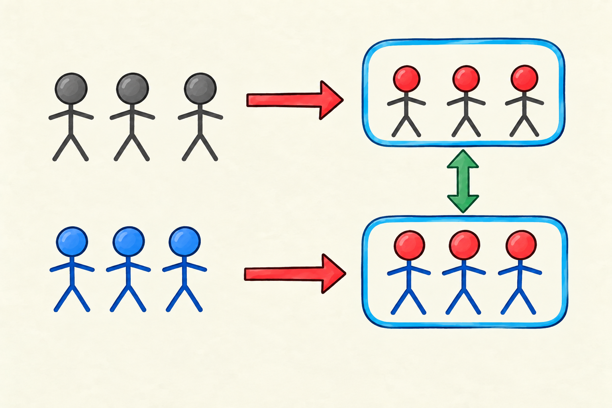

Paired

the same patients measured before and after treatment $\text{T}$
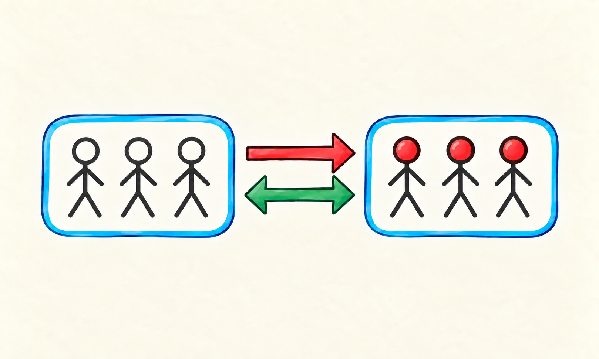

::: {.fragment .fade-up}

A paired analysis works on the <strong>within-subject differences</strong>.

:::

## Fourth branch: location or spread? {.concept-slide}

Different parameters answer different questions

Location

$\mu,\;p$

where is the population centered?

Spread

$\sigma^2$

how variable is the population?

## A compact map for today {.concept-slide}

Not a memorization table

data / design

one group

two independent groups

paired

binary / categorical

binomial / goodness-of-fit

Fisher / $\chi^2$

McNemar

continuous mean

one-sample Student $t$

Welch $t$

paired Student $t$

continuous variance

$\chi^2$ variance test

$F$ variance-ratio test

Pitman–Morgan

::: {.fragment .fade-up}

The point is to reconstruct the choice, not memorize every cell.

:::

  

  
  
William S. Gosset

  

  

  
  
Quinn McNemar

  

  

  
  
Bernard L. Welch

  

  

  
  
Edwin J.G. Pitman

  

## Our Week 7 dataset {.section-slide}

Synthetic clinical study of disease $D$

disease

0 healthy · 1 sick

haemophilia

0 asymptomatic · 1 symptomatic

age group

young · middle · old

hemoglobin

continuous · g/L

id

disease

haemophilia

age group

hemoglobin

001

0

0

young

146

002

1

0

old

121

003

1

1

middle

114

004

0

0

middle

139

005

1

0

old

126

006

0

1

young

134

## A paired mini-study inside the dataset {.concept-slide}

Treatment $T$ in old subjects

<strong>Old patients</strong>same people

→

<strong>Treatment</strong>follow-up period

→

<strong>Post-treatment</strong>compare with their own baseline

## Categorical outcomes {.section-break}

Part II

Counts and proportions

The sampling object is a count, proportion, or contingency table.

## One binary proportion vs a reference {.concept-slide}

Exact binomial test

Observed

$X$ haemophilic among $n$ sick patients

Reference world

$X\sim\mathrm{Binomial}(n,p_0)$

::: {.fragment .fade-up}

Question: is the haemophilia proportion in sick patients different from $p_0=0.50$?

:::

## Example: exact binomial test {.concept-slide}

Exact binomial test

Is $p_{\text{haemophilia}}$ among sick patients different from $0.50$?

Report: observed proportion + CI + exact p-value

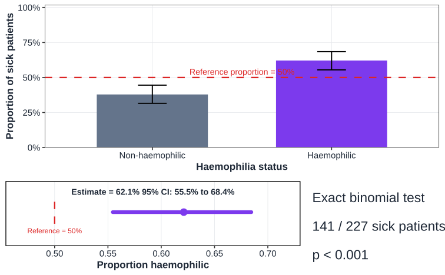

## One categorical distribution vs a reference {.concept-slide}

Chi-squared goodness-of-fit

Observed counts

$O_j$

Expected counts

$E_j=n p_{0j}$

Discrepancy

$\sum (O_j-E_j)^2/E_j$

::: {.fragment .fade-up}

Example: are young / middle / old sick patients distributed as $\frac{1}{3}$, $\frac{1}{3}$, $\frac{1}{3}$?

:::

## Example: goodness-of-fit {.concept-slide}

$\chi^2$ goodness-of-fit

Does the observed age-group distribution match the reference distribution?

Report observed vs expected proportions + $\chi^2$ + df + p

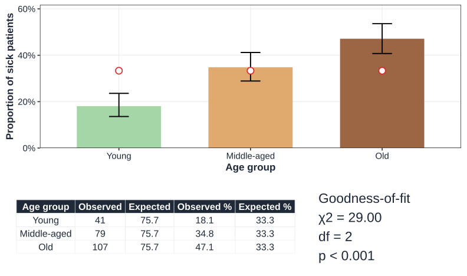

## Two groups and a categorical outcome {.concept-slide}

Homogeneity

Fisher exact

especially useful for small 2×2 tables

Pearson $\chi^2$

compares observed and expected cell counts from marginals

## Example: healthy vs sick {.concept-slide}

Fisher / Pearson $\chi^2$

Is haemophilia proportion different in healthy and sick groups?

Report contingency table + risk/proportion difference CI + p-value

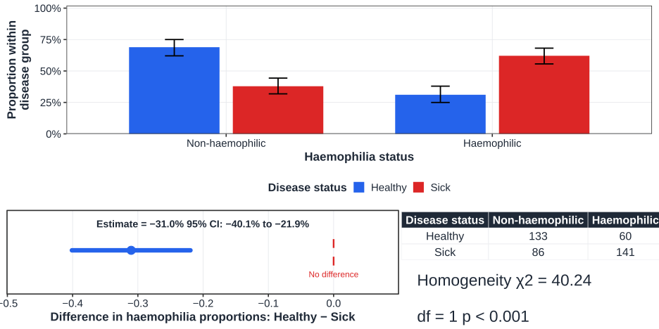

## Paired binary outcome {.concept-slide}

McNemar's test

Before

haemophilia classification at baseline

After

same subjects after treatment

::: {.fragment .fade-up}

Only the <strong>discordant pairs</strong> carry information about directional change.

:::

## Example: paired categorical change {.concept-slide}

McNemar

Did the binary classification change after treatment in the same subjects?

Report discordant transitions + paired proportion difference + p

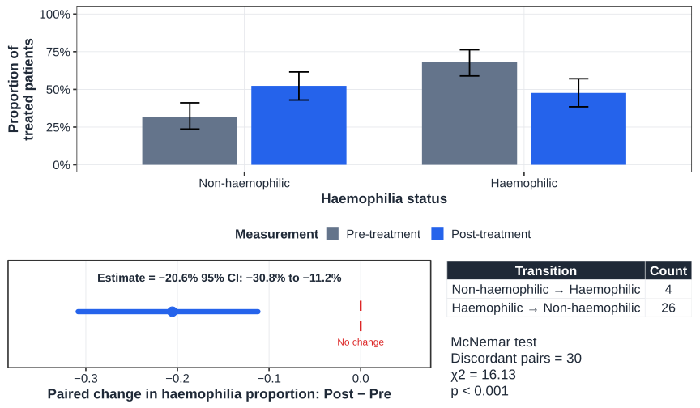

## Categorical synthesis {.concept-slide}

Reconstruct the choice

question

design

statistic

test

binary $p$ vs $p_0$

one sample

count $X$

exact binomial

distribution vs reference

one sample

$\sum(O-E)^2/E$

$\chi^2$ GOF

proportions across groups

independent

contingency table

Fisher / Pearson $\chi^2$

binary change

paired

discordant pairs

McNemar

## Continuous outcomes {.section-break}

Part III

Means and variances

Now the parameters are population location and spread.

## One mean vs a reference {.concept-slide}

One-sample Student's $t$

One-sample Student $t$

Is mean hemoglobin in sick patients different from $130$ g/L?

$t=(\bar x-130)/(s/\sqrt n)$

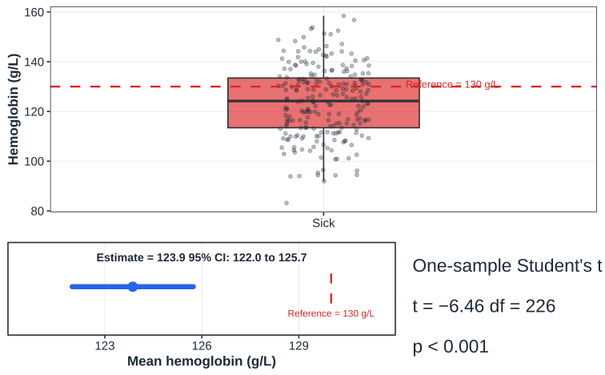

## One variance vs a reference {.concept-slide}

Chi-squared test for one variance

One-variance $\chi^2$

Is population SD different from $10$ g/L?

$(n-1)s^2/\sigma_0^2\sim\chi^2_{n-1}$ under Normality

This test is especially sensitive to non-Normal data.

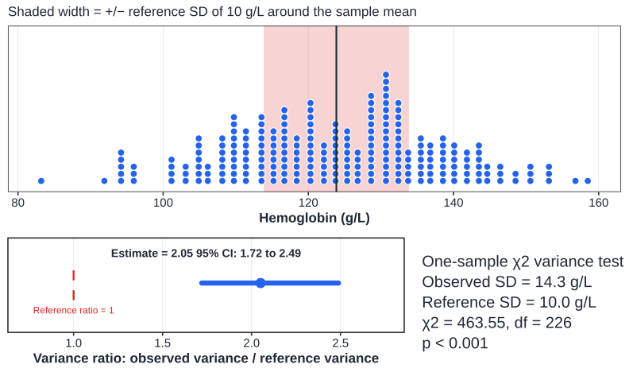

## Two independent means {.concept-slide}

Welch's two-sample $t$ test

Welch $t$

Is mean hemoglobin different in healthy and sick populations?

difference in means + SE using both group variances

Welch is the default here: it does not require equal population variances.

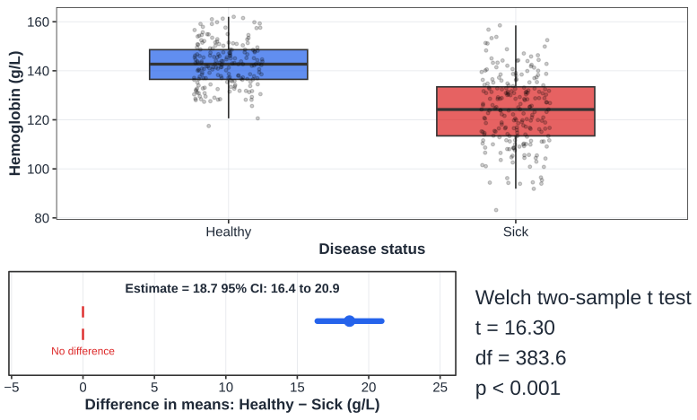

## Two independent variances {.concept-slide}

Classical $F$ variance-ratio test

Variance ratio

Is hemoglobin variability different in healthy and sick populations?

$F=s_1^2/s_2^2$ · infer a <strong>ratio</strong> of variances

The classical $F$ test is strongly sensitive to non-Normality.

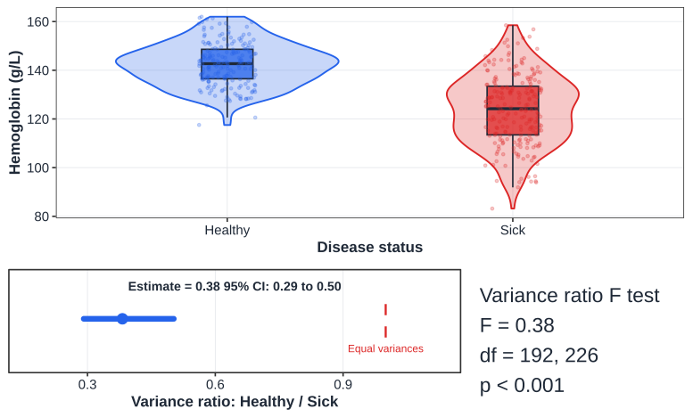

## Paired continuous means {.concept-slide}

Paired $t$ = one-sample $t$ on differences

Paired Student $t$

Did mean hemoglobin change after treatment in the same old subjects?

define $D_i=post_i-pre_i$, then test $E(D)=0$

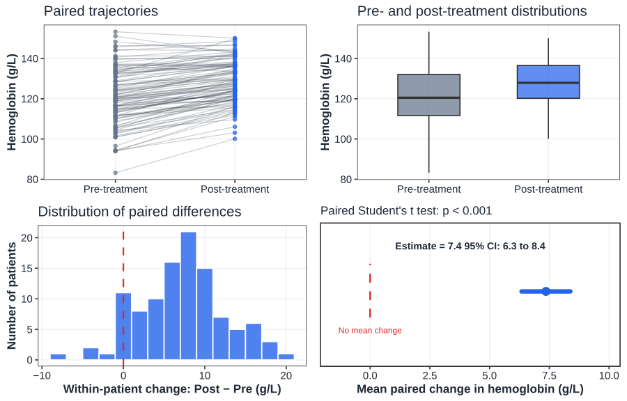

## Paired continuous variances {.concept-slide}

Pitman–Morgan test

Pitman–Morgan

Did population variability change between paired pre/post measurements?

tests equality of two variances when measurements are paired

This is a specialized Normal-theory method; use only when the variance question is scientifically meaningful.

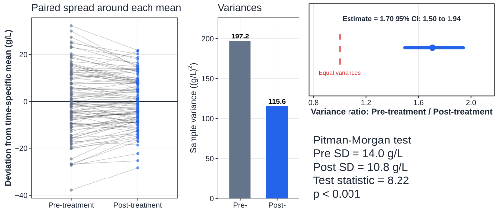

## Parametric tests come with a model {.concept-slide}

Assumptions are part of the inferential claim

<strong>Independence / sampling design</strong>usually more fundamental than the exact shape of the histogram

<strong>Distributional shape</strong>for small samples, strong skew and outliers can matter; paired tests concern the distribution of differences

<strong>Variance structure</strong>Welch relaxes equal-variance assumptions for the two-sample mean problem

<strong>Model adequacy</strong>inspect the data and residual structure rather than using a separate normality test as a mechanical gatekeeper

## Normality is not a yes/no property of a sample {.concept-slide}

Inspect shape, tails, and outliers

Histogram

global shape

QQ plot

quantiles and tail departures

Context

sample size, outliers, balance, scientific plausibility

::: {.fragment .fade-up}

Moderate or large samples often make mean-based methods robust to mild non-Normality.

:::

## How a QQ plot works {.concept-slide}

Quantile against quantile

Theoretical quantile

where a Normal observation should fall

Sample quantile

where the ordered observation actually falls

Near a line

approximately compatible with Normal location-scale shape

## Try it: QQ diagnostics {.exercise-slide}

Interactive distribution diagnostics

<label class="w7-control">
source distribution
<select id="qqDist" style="font-size: 110%">
<option value="normal">normal</option>
<option value="right">right-skewed</option>
<option value="left">left-skewed</option>
<option value="bimodal">bimodal</option>
</select>
</label>
<label class="w7-control">
sample size $n$ = <strong id="qqNValue">80</strong>
<input id="qqN" type="range" min="20" max="300" value="80" step="10">
</label>
<button id="qqRedraw" class="w7-button" type="button">
Draw new sample
</button>

<svg
id="qqSvg"
class="w7-lab-svg qq-svg"
viewBox="0 0 900 500"
preserveAspectRatio="xMidYMid meet"
aria-label="QQ plot with marginal sample and Normal distributions">
</svg>

quantile
<strong id="qqProbOut">move cursor</strong>

theoretical
<strong id="qqTheoOut">—</strong>

sample
<strong id="qqSampleOut">—</strong>

::: {.fragment .fade-up}

Move across the QQ panel: the highlighted point links one theoretical Normal quantile to the corresponding sample quantile.

:::

## Specific tests, worked visually {.section-break}

Part IV

From formula to reference distribution

Two worked tests make the general Week 6 machinery concrete.

## Welch's $t$: standardize a difference in means {.concept-slide}

Two independent continuous groups

Difference

$\bar x_A-\bar x_B$

Standard error

$\sqrt{s_A^2/n_A+s_B^2/n_B}$

Welch statistic

$t=\frac{\bar x_A-\bar x_B}{SE}$

::: {.fragment .fade-up}

The degrees of freedom are adjusted because the two variances are estimated separately.

:::

## Try it: Welch's $t$ test {.exercise-slide}

Enter summary statistics

<!-- Group A (Column 1) -->

Group A

<label class="w7-control">
mean
<input id="welchM1" type="number" value="138" step="1">
</label>
<label class="w7-control">
SD
<input id="welchS1" type="number" value="14" min="0.1" step="1">
</label>
<label class="w7-control">
$n$
<input id="welchN1" type="number" value="60" min="2" step="1">
</label>

<!-- Group B (Column 2) -->

Group B

<label class="w7-control">
mean
<input id="welchM2" type="number" value="132" step="1">
</label>
<label class="w7-control">
SD
<input id="welchS2" type="number" value="18" min="0.1" step="1">
</label>
<label class="w7-control">
$n$
<input id="welchN2" type="number" value="55" min="2" step="1">
</label>

difference<strong id="welchDiffOut">—</strong>

SE<strong id="welchSeOut">—</strong>

t value<strong id="welchTOut">—</strong>

df<strong id="welchDfOut">—</strong>

two-sided p value<strong id="welchPOut">—</strong>

95% CI<strong id="welchCiOut">—</strong>

<svg id="welchSvg" class="w7-lab-svg welch-svg" viewBox="0 0 900 470" aria-label="Welch t distribution and confidence interval"></svg>

## What Welch's test is saying {.concept-slide}

Keep three outputs together

Estimate

how large is the mean difference?

Interval

which population differences are compatible?

p-value

how extreme is the standardized difference under $H_0$?

::: {.fragment .fade-up}

The test does not replace effect size or scientific interpretation.

:::

## Chi-squared contingency tests: compare observed with expected {.concept-slide}

The null model builds the expected table

Observed

$O_{ij}$

Expected under independence

$E_{ij}=\frac{R_iC_j}{N}$

Sum discrepancies

$X^2=\sum\frac{(O-E)^2}{E}$

## Try it: a contingency table {.exercise-slide}

Pearson chi-squared test

  

  

  <label class="w7-control">
  table size
  <select id="chiLayout" style="font-size: 110%">
  <option value="2x2" style="font-size: 80%">2 × 2</option>
  <option value="2x3" style="font-size: 80%">2 × 3</option>
  </select>
  </label>
  <label class="w7-control">
  $\alpha$
  <select id="chiAlpha" style="font-size: 110%">
  <option value="0.10" style="font-size: 80%">0.10</option>
  <option value="0.05"  style="font-size: 80%" selected>0.05</option>
  <option value="0.01" style="font-size: 80%">0.01</option>
  </select>
  </label>
  

  

  

  

  
Group A

  
Group B

  

  

  
Cat 1

  <input id="chiA1" type="number" value="24" min="0">
  <input id="chiB1" type="number" value="40" min="0">
  

  

  
Cat 2

  <input id="chiA2" type="number" value="36" min="0">
  <input id="chiB2" type="number" value="20" min="0">
  

  

  
Cat 3

  <input id="chiA3" type="number" value="20" min="0">
  <input id="chiB3" type="number" value="20" min="0">
  

  

  

  
Expected Frequencies ($E$)

  

  

  

  
χ2<strong id="chiStatOut">—</strong>

  
df<strong id="chiDfOut">—</strong>

  
p<strong id="chiPOut">—</strong>

  

  

  <svg id="chiTableSvg" class="w7-lab-svg chi-svg" viewBox="0 0 900 430" aria-label="Chi-squared reference distribution"></svg>

## Expected counts are part of the approximation {.concept-slide}

Small tables need care

Reasonable expected counts

the chi-squared approximation can work well

Sparse cells

exact methods or alternative models may be preferable

::: {.fragment .fade-up}

This is why Fisher's exact test remains useful for small 2×2 tables.

:::

## ANOVA {.section-break}

Part V

More than two means

Why an analysis of variance answers a question about means.

## Why “analysis of variance” for a mean question? {.concept-slide}

The core logic

<strong>Within groups</strong>natural patient-to-patient variability

vs

<strong>Between groups</strong>dose groups have different centers

→

<strong class="inline-label"><strong style="font-size: 170%">$F$</strong>ratio</strong>signal relative to noise

::: {.fragment .fade-up}

If group means are truly equal, between-group variability should not dwarf within-group variability.

:::

## ANOVA decomposes total variability {.concept-slide}

One-way ANOVA

Total Sum-of-Squares

$SS_T$

all deviations from grand mean

Between Sum-of-Squares

$SS_B$

group means vs grand mean

Within Sum-of-Squares

$SS_W$

individuals vs their group mean

::: {.fragment .fade-up}

$SS_T=SS_B+SS_W$ and $F=MS_B/MS_W$.

:::

## Try it: one-way ANOVA {.exercise-slide}

Three dose groups

<label class="w7-control">low mean<input id="anovaM1" type="number" value="72" step="1"></label>
<label class="w7-control">medium mean<input id="anovaM2" type="number" value="69" step="1"></label>
<label class="w7-control">high mean<input id="anovaM3" type="number" value="64" step="1"></label>
<label class="w7-control">common SD<input id="anovaSd" type="number" value="8" min="0.1" step="1"></label>
<label class="w7-control">$n$ / group<input id="anovaN" type="number" value="30" min="2" step="1"></label>

$SS_B$<strong id="anovaSsbOut">—</strong>

$SS_W$<strong id="anovaSswOut">—</strong>

$MS_B$<strong id="anovaMsbOut">—</strong>

$F$<strong id="anovaFOut">—</strong>

$p$<strong id="anovaPOut">—</strong>

<svg id="anovaSvg" class="w7-lab-svg anova-svg" viewBox="0 0 900 500" aria-label="One-way ANOVA visualization"> </svg>

## A significant ANOVA is an omnibus statement {.concept-slide}

At least one mean differs

ANOVA

tests the global null that all means are equal

Tukey

all pairwise comparisons

Dunnett

each treatment against a chosen reference

::: {.fragment .fade-up}

Post-hoc comparisons answer “which groups?” while controlling multiplicity.

:::

  

  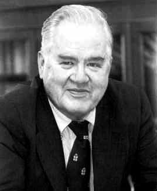
  
John Tukey

  

  

  
  
Charles W. Dunnett

  

## Two factors: dose and smoking {.concept-slide}

Factorial ANOVA

Dose main effect

averaged across smoking status

Smoking main effect

averaged across doses

Interaction

does the dose effect depend on smoking?

## Interaction means “the effect of A depends on B” {.concept-slide}

Parallel vs non-parallel patterns

<strong>No / little interaction</strong>dose-response lines are approximately parallel

<strong>Interaction</strong>dose-response differs across smoking status

## Try it: factorial effects {.exercise-slide}

Manipulate main effects and interaction

  

  <label class="w7-control">baseline mean = <strong id="facBaseValue">72</strong><input id="facBase" type="range" min="55" max="85" value="72" step="1"></label>
  <label class="w7-control">medium-dose effect = <strong id="facMedValue">-2</strong><input id="facMed" type="range" min="-10" max="10" value="-2" step="1"></label>
  <label class="w7-control">high-dose effect = <strong id="facHighValue">-6</strong><input id="facHigh" type="range" min="-15" max="15" value="-6" step="1"></label>
  <label class="w7-control">smoking shift at low dose = <strong id="facSmokeValue">3</strong><input id="facSmoke" type="range" min="-10" max="10" value="3" step="1"></label>
  

  
Interaction · departure from additivity

  <label class="w7-control factorial-interaction-control">smoker × medium dose = <strong id="facIntMedValue">0</strong><input id="facIntMed" type="range" min="-12" max="12" value="0" step="1"></label>
  <label class="w7-control factorial-interaction-control">smoker × high dose = <strong id="facIntHighValue">5</strong><input id="facIntHigh" type="range" min="-12" max="12" value="5" step="1"></label>
  

  <label class="w7-control">common SD = <strong id="facSdValue">6</strong><input id="facSd" type="range" min="2" max="12" value="6" step="1"></label>
  <label class="w7-control">$n$ / cell = <strong id="facNValue">30</strong><input id="facN" type="range" min="10" max="100" value="30" step="5"></label>
  

  

  <svg id="factorialSvg" class="w7-lab-svg factorial-svg" viewBox="0 0 900 470" aria-label="Factorial interaction plot"></svg>
  

  
interaction$F$<strong id="facFOut">—</strong>

  
interaction$p$<strong id="facPOut">—</strong>

  

  

## Factorial models are not six separate t tests {.concept-slide}

The model asks structured questions

Main effect

a systematic average shift

Interaction

departure from additivity

Do not over-slice

many unplanned pairwise tests recreate multiplicity problems

## Agreement and equivalence {.section-break}

Part VI

When “no important difference” is the goal

Association, agreement, equivalence, and interchangeability are different claims.

## Association is not agreement {.concept-slide}

A hierarchy of questions

<strong>Association</strong>do the variables contain information about each other?

→

<strong>Agreement</strong>do measurements / ratings coincide?

→

<strong>Interchangeability</strong>are differences small enough for practical replacement?

::: {.fragment .fade-up}

A high correlation can coexist with poor agreement.

:::

## Categorical agreement: Cohen's kappa {.concept-slide}

Two diagnosticians, same patients

Observed agreement

$P_o$

Chance agreement

$P_e$

Excess agreement

$\kappa=\frac{P_o-P_e}{1-P_e}$

  

  
  
Jacob Cohen

  

  

  
  
Klaus Krippendorff

  

## Try it: Cohen's kappa {.exercise-slide}

Edit the 2×2 rating table

  

Doctor 2 +

Doctor 2 −

  
Doctor 1 +
<input id="kapA" type="number" value="42" min="0"><input id="kapB" type="number" value="8" min="0">
  
Doctor 1 −
<input id="kapC" type="number" value="6" min="0"><input id="kapD" type="number" value="44" min="0">
  

observed$P_o$<strong id="kapPoOut">—</strong>

chance$P_e$<strong id="kapPeOut">—</strong>

$\kappa$<strong id="kapOut">—</strong>

−101

Kappa adjusts raw agreement for agreement expected from the marginal prevalences.

## Equivalence reverses the usual null logic {.concept-slide}

Generic vs originator

<strong class="inline-label" style="font-size: 110%"><strong>Choose</strong><strong style="font-size: 110%">$\Delta$</strong><strong>first</strong></strong>largest scientifically acceptable difference

→

<strong>Test both boundaries</strong>difference must be above$-\Delta$and below$+\Delta$

→

<strong>Conclude equivalence</strong>only if both one-sided tests reject

::: {.fragment .fade-up}

Not “prove the difference is zero”

Exact equality is not the target. Equivalence means the population difference is sufficiently small relative to a pre-specified scientific margin.

:::

## Four confidence-interval situations {.concept-slide}

Equivalence margin $[-\Delta,+\Delta]$

<strong>Equivalent and includes 0</strong>

<small>entire 90% CI lies inside the equivalence margin</small>

<strong>Equivalent but different from 0</strong>

<small>statistical difference can coexist with practical equivalence</small>

<strong>Not equivalent, includes 0</strong>

<small>too imprecise to establish equivalence</small>

<strong>Neither equivalent nor close to 0</strong>

<small>difference extends beyond the acceptable margin</small>

## Try it: equivalence of two means {.exercise-slide}

TOST shown through the equivalent 90% CI

<label class="w7-control">originator mean<input id="eqM1" type="number" value="100" step="0.5"></label>
<label class="w7-control">generic mean<input id="eqM2" type="number" value="101" step="0.5"></label>
<label class="w7-control">common SD<input id="eqSd" type="number" value="8" min="0.1" step="0.5"></label>
<label class="w7-control">$n$ / group<input id="eqN" type="number" value="60" min="2" step="1"></label>
<label class="w7-control">equivalence margin $\Delta$<input id="eqDelta" type="number" value="3" min="0.1" step="0.5"></label>

<svg
id="equivSvg"
class="w7-lab-svg equiv-svg"
viewBox="0 0 900 430"
aria-label="Equivalence confidence interval">
</svg>

difference<strong id="eqDiffOut">—</strong>

90% CI<strong id="eqCiOut">—</strong>

margin<strong id="eqMarginOut">—</strong>

decision<strong id="eqDecisionOut">—</strong>

## Interchangeability asks more than mean equivalence {.concept-slide}

Bland–Altman logic

For each subject

$d_i=A_i-B_i$

Bias

$\bar d$

Limits of agreement

$\bar d\pm1.96s_d$

  

  
  
Martin Bland

  

  

  
  
Douglas G. Altman

  

::: {.fragment .fade-up}

The question is whether <strong>individual differences</strong>, not just the mean difference, are acceptably small.

:::

## Bland–Altman patterns {.concept-slide}

Four qualitatively different situations

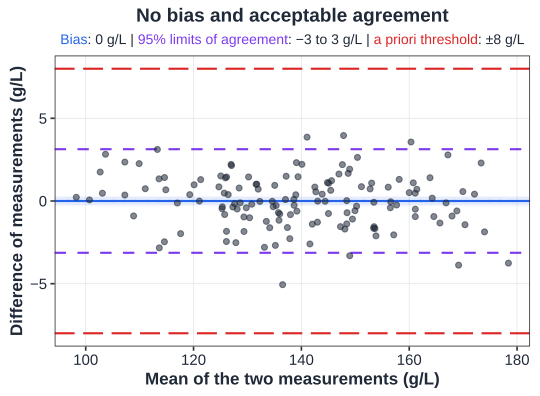

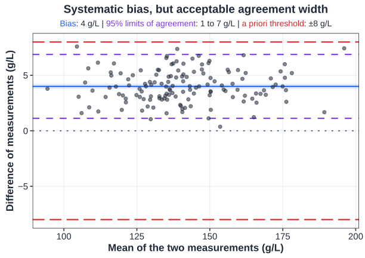

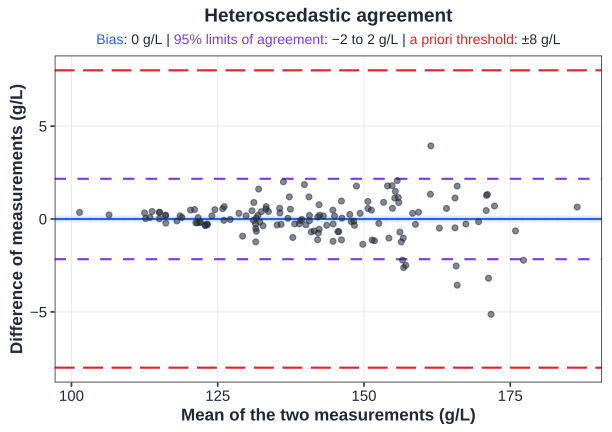

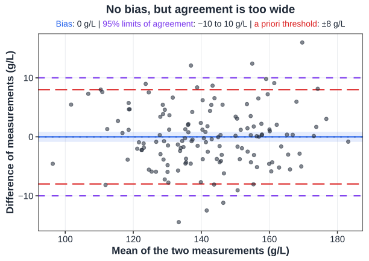

## Correlation would miss the point {.concept-slide}

Agreement is a difference question

High correlation

measurements can move together while one is systematically 10 units higher

Good agreement

individual differences are centered and clinically acceptably narrow

## Choose the test {.exercise-slide}

Prediction exercise

A single group of $80$ patients has a binary adverse-event outcome. You want to know whether the population event proportion differs from the historical value $0.10$.

Which inferential structure fits?

Welch $t$

exact binomial

McNemar

ANOVA

::: {.fragment .fade-up}

<strong>Exact binomial:</strong> one binary proportion compared with a reference probability.

:::

## Choose the test: paired data {.exercise-slide}

Prediction exercise

The same $45$ patients have hemoglobin measured immediately before and after treatment. The question is whether the mean within-patient change is zero.

What statistic should you build first?

two independent means

within-patient differences

variance ratio

contingency table

::: {.fragment .fade-up}

Compute $D_i=post_i-pre_i$, then perform a one-sample $t$ analysis on the differences.

:::

## Read the output, not just the p-value {.exercise-slide}

Interpretation exercise

Difference in means = $-1.8$ g/L, 95% CI $[-5.5,1.9]$, p = $0.34$.

Which statement is defensible?

the means are proven equal

there is no clinically meaningful effect

the data are compatible with a range of negative and positive effects

$H_0$ has probability $0.34$

::: {.fragment .fade-up}

The interval is the key: the study is compatible with several population effects. “Not significant” is not proof of equality.

:::

## Week 7 synthesis {.concept-slide}

Do not memorize an encyclopedia

<strong>1 · Identify data</strong>categorical vs continuous

<strong>2 · Identify design</strong>one / two / many; paired vs independent

<strong>3 · Identify parameter</strong>proportion, mean, variance, agreement

<strong>4 · Choose machinery</strong>statistic + reference distribution + CI

::: {.fragment .fade-up}

Then explain the effect estimate, uncertainty, assumptions, and scientific meaning.

:::

## Next week {.section-slide}

Week 8 · Association and regression

from comparing groups → modelling relationships

::: {.fragment .fade-up}

Correlation, linear regression, and the first generalized linear model ideas.

:::

