## Relationships and regression {.title-slide}

Week 8

How are variables related — and can one help explain another?

::: {.notes}
We finished comparing groups. This week we move from group labels to quantitative predictors and modeling, using analytical chemistry as our narrative spine.
:::

## From group differences to relationships {.motivation-slide}

A missing piece from Week 7

Compare groups

$\bar x_A-\bar x_B$

Does treatment A differ from B?

Relate measurements

$y=f(x)+\varepsilon$

How does response vary with dose?

Predict a response

$\hat y=f(x)$

What do we expect at a new concentration?

::: {.fragment .fade-up}

In chemistry, calibration is already a form of statistical modeling.

:::

## Our motivating question: tablet API assay {.concept-slide}

What the detector measures is not what we want

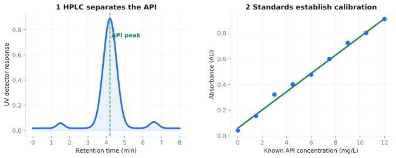

Synthetic demonstration: chromatographic separation identifies the API signal; standards connect detector absorbance to known concentration.

## How do we know concentration? {.concept-slide}

Build a reference relationship

<strong>Known standards</strong>prepare API solutions with chosen concentrations$x$

→

<strong>Measured signal</strong>record UV absorbance$y$after HPLC separation

→

<strong>Calibration model</strong>estimate$y=\beta_0+\beta_1x+\varepsilon$

Two jobs, two questions

<strong>Association</strong> describes co-variation; <strong>regression</strong> specifies a model for a response given predictors.

## Association {.section-break}

Part I

How do two variables change together?

Direction, strength, shape — but not yet a causal explanation.

## Look at cell cultures {.concept-slide}

Cell diameter and growth rate

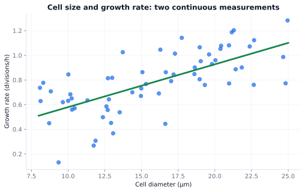

A scatterplot is the first diagnostic for two numerical variables.

## Pearson's correlation $r$ {.concept-slide}

How closely do points follow a straight line?

$r\approx +1$

strong positive <em>linear</em> co-movement

$r\approx 0$

little linear co-movement; a curve may remain

$r\approx -1$

strong negative <em>linear</em> co-movement

::: {.fragment .fade-up}

$$r=\frac{\sum_i(x_i-\bar x)(y_i-\bar y)}{\sqrt{\sum_i(x_i-\bar x)^2\sum_i(y_i-\bar y)^2}}$$

:::

  <strong>Covariance $\text{Cov}(x,y) = \frac{1}{n-1}\sum_i(x_i-\bar x)(y_i-\bar y)$:</strong> Measures joint variation. Its units are <em>$(\text{unit}_x \cdot \text{unit}_y)$</em>, making it scale-dependent.

  <strong>Correlation $r$:</strong> Standardizes covariance by dividing out standard deviations. Unitless; unchanged by positive linear transformations. Undefined if either variable is constant.

## A small worked example {.concept-slide}

Pearson correlation from five measurements

  <!-- Left Column: Overlay Grid Container -->
  

    
  <!-- Base Table -->
  

  
Cell size

Growth

  
10

2

  
12

3

  
14

3

  
16

5

  
18

6

  

  <!-- SVG Fragment Overlay (Covers the table on fade-up) -->
  

  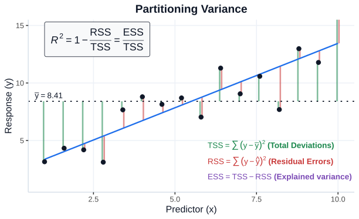
  

  $R^2$ has an intuitive meaning of ratio of explained variance by the model
  

  

  

  <!-- Right Column: Step-by-step calculation -->
  

  
Step-by-step calculation

  

1: Means

$\bar x = 14,\quad \bar y = 3.8$

  

2: Sum of products (Numerator)

$\sum(x_i-\bar x)(y_i-\bar y) = (-4)(-1.8) + (-2)(-0.8) + 0 + (2)(1.2) + (4)(2.2) = \mathbf{20}$

  

3: Sums of squares (Denominator)

$SS_x = \sum(x_i-\bar x)^2 = 16 + 4 + 0 + 4 + 16 = \mathbf{40}$

$SS_y = \sum(y_i-\bar y)^2 = 3.24 + 0.64 + 0.64 + 1.44 + 4.84 = \mathbf{10.8}$

  

4: Pearson $r$

$r = \dfrac{20}{\sqrt{40 \cdot 10.8}} = \dfrac{20}{\sqrt{432}} \approx \mathbf{0.962}$

  
Positive, strong linear association in this sample.

  

## Nine very different patterns {.concept-slide}

Correlation is not a slope detector

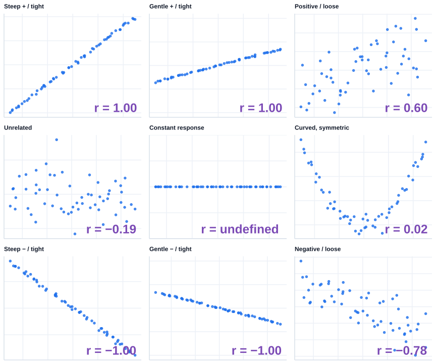

Same $|r|$ can occur with steep or gentle slopes; a strong nonlinear relationship can have $r\approx0$. A perfectly constant response has undefined $r$.

## What if only the ordering matters? {.concept-slide}

Spearman's rank correlation

Pearson

$r(x,y)$

Strength of <strong>linear</strong> association in original values

Spearman

$\rho(\operatorname{rank}x,\operatorname{rank}y)$

Strength of <strong>monotonic</strong> association; resistant to changes of scale

A logarithmic curve can be monotonic even when it is not straight.

  

  
  
Francis Galton

  

  

  
  
Karl Pearson

  

  

  
  
Charles Spearman

  

## Rank the observations first {.concept-slide}

Worked rank transformation (ties get average ranks)

Subject

Size

Size rank

Growth

Growth rank

A

10

1

2

1

B

12

2

3

2.5

C

14

3

3

2.5

D

16

4

5

4

E

18

5

6

5

::: {.fragment .fade-up}

Now apply Pearson's formula to the two <strong>rank columns</strong>.

:::

## What if both variables are categorical? {.concept-slide}

Small / medium / large × slow / medium / fast

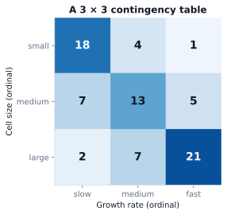
Cramér's $V = \mathbf{0.530}$

Cramér's $V$

$V=\sqrt{\dfrac{\chi^2}{n\min(r-1,c-1)}}$

$0$ to $1$: strength of contingency-table association, without direction or ordering.

For ordered categories, rank-based measures may retain more information.

  

  
  
Harald Cramér

  

  

  
  
C.R. Rao

  

## Association is not agreement or causation {.concept-slide}

Association

Do measurements co-vary?

Agreement

Are two methods close enough to exchange?

Causation

Would intervening on $x$ change $y$?

Remember Weeks 3 and 7

A high $r$ cannot establish that changing cell size causes growth to accelerate; shared causes, selection, or reverse direction remain possible.

## Regression {.section-break}

Part II

Fit a response model

Return to the calibration standards.

## A line can translate detector signal {.concept-slide}

Simple linear regression

$$Y_i=\beta_0+\beta_1x_i+\varepsilon_i \qquad\Longrightarrow \qquad \hat y_i=\hat\beta_0+\hat\beta_1x_i$$

$\beta_0$

intercept; expected absorbance when concentration is zero

$\beta_1$

slope; absorbance increase per mg/L

$\varepsilon$

unmodeled measurement variation around the line

## Try to fit the calibration line {.exercise-slide}

Adjust the slope and intercept to minimize vertical errors

<label class="w8-control">intercept = <strong id="olsInterceptValue">0.22</strong><input id="olsIntercept" type="range" min="-0.15" max="0.35" step="0.01" value="0.22"></label>
<label class="w8-control">slope = <strong id="olsSlopeValue">0.040</strong><input id="olsSlope" type="range" min="0.01" max="0.12" step="0.002" value="0.04"></label>
<button id="olsFit" class="w8-button" type="button">Show least-squares fit</button>

sum of squared errors (SSE)<strong id="olsSseOut">—</strong>

Blue points = standards; faint red segments = vertical residuals.

<svg id="olsSvg" class="w8-svg w8-svg-large" viewBox="0 0 900 490" aria-label="Manual OLS line fitting to absorbance standards"></svg>

## Why square the residuals? {.concept-slide}

Ordinary least squares

$$\underbrace{SSE}_{\text{residual sum of squares}}=\sum_{i=1}^{n}\left[y_i-(\beta_0+\beta_1x_i)\right]^2$$

Observe

$e_i=y_i-\hat y_i$

vertical residual for each standard

Square

$e_i^2\ge 0$

positive and negative residuals cannot cancel

Minimize

$\arg\min_{b_0,b_1}SSE$

best line for this loss criterion

## A fitted line also has uncertainty {.concept-slide}

Results from the same calibration

Parameter estimates

$\hat\beta_0\pm\mathrm{SE}_{\hat\beta_0},\hat\beta_1\pm\mathrm{SE}_{\hat\beta_1}$

Each gets a standard error and confidence interval.

Fit summaries

$R^2,\;p$

$R^2$: fraction of sample variation explained. Slope $p$: evidence against $H_0:\beta_1=0$.

::: {.fragment .fade-up}

In <strong>simple OLS with an intercept</strong>, $R^2=r^2$; this identity does not automatically hold for other models.

:::

## Three different uncertainty questions {.concept-slide}

The center line is not enough

Confidence band

Where might the unknown <strong>mean response</strong> line be?

$E(y\mid x)$

Prediction band

Where might a <strong>single new measurement</strong> fall?

$y_{\mathrm{new}}\mid x$

Tolerance band

Which range contains a specified <strong>fraction of the population</strong> with stated confidence?

$95\%/95\%$

## Explore confidence, prediction, and tolerance {.exercise-slide}

Repeated calibrations from the same generating model

<label class="w8-control">uncertainty displayed<select id="bandType"><option value="all">all three bands</option><option value="mean">mean confidence (95%, pointwise)</option><option value="prediction">prediction (95%, pointwise)</option><option value="tolerance">tolerance (95% content / 95% confidence, approximate)</option></select></label>
<label class="w8-control">measurement SD = <strong id="bandSdValue">0.060</strong><input id="bandSd" type="range" min="0.02" max="0.15" value="0.06" step="0.01"></label>
<button id="bandNew" class="w8-button" type="button">Draw new data</button>
<button id="bandAdd" class="w8-button" type="button">Add one measurement</button>

sample size<strong id="bandNOut">—</strong>

$R^2$<strong id="bandR2Out">—</strong>

$p$<strong id="bandPOut">—</strong>

<svg id="bandSvg" class="w8-svg w8-svg-large" viewBox="0 0 900 500" aria-label="OLS fit with confidence prediction and approximate tolerance bands"></svg>

Tolerance limits are conservative pointwise normal-theory approximations, not a simultaneous calibration band. Observations are simulated; exact inference requires a validated assay model.

## Use the calibration curve inversely {.concept-slide}

Unknown tablet concentration from UV absorbance

  <!-- Point Estimate Card -->
  

  
1: Point Prediction

    
  

  $$\hat y = 0.050 + 0.075x, \quad A_{\mathrm{obs}} = 0.650$$
  

  

  $$\hat x = \frac{0.650 - 0.050}{0.075} = \mathbf{8.0\text{ mg/L}}$$
  

  

  <strong>Assigned Uncertainties:</strong> • Measurement error (known from measuring triplicate): $\mathrm{SE}_{Abs} = 0.003$ • Intercept error (known from calibration): $\mathrm{SE}_{\beta_0} = 0.040$ • Slope error (known from calibration): $\mathrm{SE}_{\beta_1} = 0.002$

  

  <!-- Delta Method Card -->
  

  
2: Delta Method (Propagation of Uncertainty)

  

  $$\mathrm{SE}(\hat x) \approx \sqrt{ \left(\tfrac{\partial \hat x}{\partial Abs}\right)^2\!\mathrm{SE}_{Abs}^2 + \left(\tfrac{\partial \hat x}{\partial \beta_0}\right)^2\!\mathrm{SE}_{\beta_0}^2 + \left(\tfrac{\partial \hat x}{\partial \beta_1}\right)^2\!\mathrm{SE}_{\beta_1}^2 }$$
  

  <!-- Partial derivative terms breakdown -->
  

  
• <strong>Assay ($Abs$):</strong> $\left(\frac{1}{0.075} \cdot 0.003\right)^2 = 0.040^2 = \mathbf{0.0016}$

  
• <strong>Intercept ($\beta_0$):</strong> $\left(-\frac{1}{0.075} \cdot 0.040\right)^2 = (-0.533)^2 = \mathbf{0.2844}$

  
• <strong>Slope ($\beta_1$):</strong> $\left(-\frac{8.0}{0.075} \cdot 0.002\right)^2 = (-0.213)^2 = \mathbf{0.0455}$

  

  

  $$\mathrm{SE}(\hat x) = \sqrt{0.0016 + 0.2844 + 0.0455} \approx \mathbf{0.576\text{ mg/L}}$$
  

  

  Approx. 95% CI: $8.0 \pm 1.15\text{ mg/L}$ ($6.85 \text{ to } 9.15\text{ mg/L}$)
  

  

  <strong>Key Takeaway:</strong> The calibration parameters ($\beta_0, \beta_1$) account for over $99.5\%$ of total variance ($0.3299\text{ (mg/L)}^2$), while the single-measurement assay noise ($Abs$) contributes less than $0.5\%$ ($0.0016\text{ (mg/L)}^2$).

  In this calculation covariance between parameters was ignored.

## Assumptions are about errors {.concept-slide}

Classical simple OLS model

<strong>Conditional mean</strong>Correct functional shape: the relationship is really linear

<strong>Independence</strong>Measurement errors do not systematically depend on one another

<strong>Common variance</strong>Variance is near-constant across calibration levels

<strong>Normal errors (for small-sample inference)</strong>The error term is approximately normal (with zero mean), individual observed values need not be normal

## Inspect the diagnostics {.exercise-slide}

Six simulated cases · fitted curve and diagnostic plots

<label class="w8-control">choose the generating case<select id="diagChoice"><option value="good_tight">good fit · tight positive relation</option><option value="good_loose">good fit · loose negative relation</option><option value="nonnormal">non-normal errors</option><option value="curvature">missed nonlinear trend</option><option value="outliers">outliers / influential observations</option><option value="hetero">heteroscedasticity</option></select></label>
Check residual patterns, not just $R^2$.

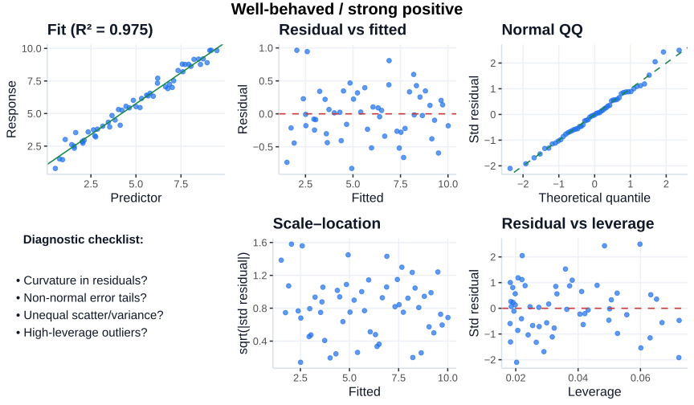

## Learn to recognize the warning signs {.concept-slide}

Residual vs fitted

Should show no systematic curvature and roughly comparable spread.

Normal QQ

Pronounced departures suggest skew/heavy tails or unusual observations.

Residual vs leverage

Large residuals at high-leverage $x$ values merit influence assessment (e.g., Cook's distance).

An excellent $R^2$ can hide a misspecified model

Residual checks examine the assumptions that a good-looking fitted line alone cannot certify.

## When does the intercept mean something? {.concept-slide}

Absorbance at zero API

Blank-corrected response should often be near zero; a nonzero intercept can suggest background or bias. Do not force zero without validation.

Blood pressure at zero height

Outside the meaningful physiological domain; the fitted intercept is a mathematical reference, not a real patient.

Interpret a coefficient only where its reference condition makes scientific sense.

## Interpolation vs extrapolation {.concept-slide}

  <!-- Interpolation Card -->
  

  
Interpolation

  
$x\in[x_{\min},x_{\max}]$

    
  

  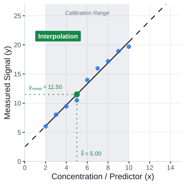
  

    
  
Inside the validated concentration range: still check precision, curvature, matrix effects.

  

  <!-- Extrapolation Card -->
  

  
Extrapolation

  
$x\notin[x_{\min},x_{\max}]$

    
  

  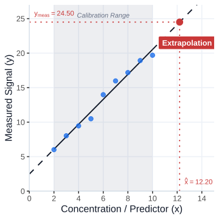
  

    
  
Outside observed calibration levels: model form and analytical response may change.

  

Do not use a calibration line indefinitely

Dilute/reprepare an unknown to bring it into the validated calibration range when appropriate.

## Transforming relationships {.section-break}

Part III

Not every useful relationship is straight

Sometimes a theory-motivated transformation makes fitting simpler.

## A curved relationship may become linear {.exercise-slide}

The transformation must match the physical model

<label class="w8-control">relationship<select id="transformChoice"><option value="exponential">exponential · initial bacterial growth</option><option value="power">power · allometry</option><option value="hyperbolic">hyperbolic · enzyme kinetics</option><option value="logarithmic">logarithmic · membrane potential</option></select></label>
$y=a e^{bx}\quad\Longrightarrow\quad\log y=\log a+bx$

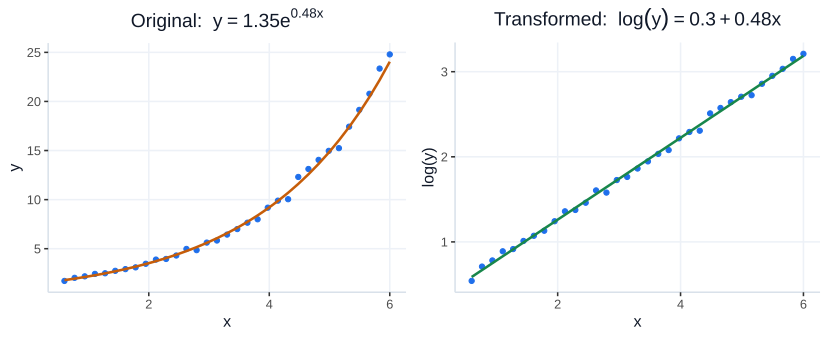

## Transformation is not a free fix {.concept-slide}

<strong>Exponential</strong>$y=a\,e^{b\,x}$ transforms to $\log y=\log a+b\,x$ for $y>0$, but error remains multiplicative on original scale.

<strong>Power / allometry</strong>$y=a\,x^b$ transforms to $\log y=\log a+b\,\log x$ for $x,y>0$, but error remains multiplicative on original scale.

<strong>Inverse / hyperbolic</strong>$y=\frac{a\,x}{b+x}$ transforms to $\frac{1}{y}=\frac{1}{a}+\frac{b}{a}\,\frac{1}{x}$ but reciprocal transformation amplifies noise at low $x$.

<strong>Logarithmic</strong>$y=a+b\,\log x$ would transform to $e^y=e^a\,x^b$, but we can just fit $y$ versus $\log x$ for $x>0$.

Changing the scale changes the error model and what squared deviations mean. Direct nonlinear fitting is often preferable to transforming noisy response data.

Further generalizing the above relationships renders linear transformation impossible altogether. For example $y=a\,e^{b\,(x-c)}+d$, where $d$ represents a constant shift in the response and $c$ a time lag in the measurement.

## Least squares under the hood {.section-break}

Part IV

What is the computer minimizing?

Two points solve a line; more points demand a compromise.

## Two points vs many points {.concept-slide}

The overdetermined system

Exactly two distinct $x$ values

$\begin{aligned}y_1&=\beta_0+\beta_1x_1\\ y_2&=\beta_0+\beta_1x_2\end{aligned}$

A unique line passes through both observations.

Many noisy standards

$\begin{aligned}y_1=&\beta_0+\beta_1x_1\\ y_2=&\beta_0+\beta_1x_2\\ y_3=&\beta_0+\beta_1x_3\\ &...\\ \mathbf y&\approx X\boldsymbol\beta\end{aligned}$

Usually no single line fits all points exactly.

Least squares chooses the best compromise <em>for vertical squared residuals</em>.

## The linear algebra shortcut {.concept-slide}

$$
\underbrace{\begin{bmatrix}y_1\\y_2\\\vdots\\y_n\end{bmatrix}}_{\mathbf y}
\approx
\underbrace{\begin{bmatrix}1&x_1\\1&x_2\\\vdots&\vdots\\1&x_n\end{bmatrix}}_X
\underbrace{\begin{bmatrix}\beta_0\\\beta_1\end{bmatrix}}_{\boldsymbol\beta}
$$

::: {.fragment .fade-up}
$$
\hat{\boldsymbol\beta}=(X^\mathsf TX)^{-1}X^\mathsf T\mathbf y
$$
:::

Displayed for full-column-rank $X$; practical software uses numerically stable QR/SVD methods rather than explicitly computing the inverse.

## Vertical or horizontal residuals? {.concept-slide}

Different errors-in-variables assumptions → different answers

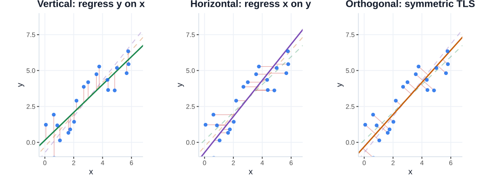

Ordinary $Y$-on-$X$ OLS minimizes vertical deviations, conditional on recorded $x$. Horizontal regression and orthogonal/TLS target different losses; none by itself proves causal direction.

## Nonlinear regression {.section-break}

Part V

When theory specifies a curved response

Potentiometric titration: iterative fitting instead of a closed-form line.

## A titration sigmoid {.concept-slide}

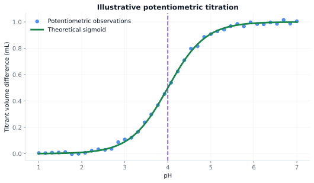

$$
\Delta V(\mathrm{pH}) = a_0 + \frac{D}{1 + 10^{\mathrm{p}K_a - \mathrm{pH}}}
$$

An illustrative sigmoid approximation to one transition, not a universal electrochemical titration equation. Here $\Delta V$ is the volume difference obtained from difference titration, $a_0$ is base of titration curve (should be at $0$), and $D > 0$ controls titration step size.

## Try iterative nonlinear fitting {.exercise-slide}

Change initial guesses; watch damped Gauss–Newton steps

<label class="w8-control">initial $\mathrm{p}K_a$ = <strong id="nlKValue">2.0</strong><input id="nlV" type="range" min="1" max="7" step="0.2" value="2"></label>
<label class="w8-control">initial step size $D$ = <strong id="nlDValue">0.8</strong><input id="nlK" type="range" min="0.3" max="1.5" step="0.1" value="0.8"></label>
<label class="w8-control">iteration steps = <strong id="nlStepsValue">12</strong><input id="nlSteps" type="range" min="1" max="25" step="1" value="12"></label>
<button id="nlRun" class="w8-button" type="button">Start iterations</button>

fitted $\mathrm{p}K_a$<strong id="nlVOut">—</strong>

fitted $D$<strong id="nlKOut">—</strong>

SE of $\mathrm{p}K_a$<strong id="nlSeVOut">—</strong>

SE of $D$<strong id="nlSeKOut">—</strong>

descriptive $R^2$<strong id="nlR2Out">—</strong>

step · SSE<strong id="nlStepOut">—</strong>

<svg id="nlSvg" class="w8-svg w8-svg-large" viewBox="0 0 900 490" aria-label="Iterative nonlinear sigmoid fit"></svg>

For clarity the lower asymptote is held at $0$ mL. The widget estimates $\mathrm{p}K_a$ and step size; displayed parameter SEs are local linear approximations.

## What nonlinear fitting changes {.concept-slide}

Specify the curve

Chemistry or physiology motivates the equation, not just convenient flexibility.

Find starting values

Iterative algorithms may converge slowly, fail, or reach a local solution.

Assess uncertainty

Inspect residuals, parameter SE/CI, identifiability; descriptive $R^2$ is not enough.

Nonlinear regression can still minimize an SSE; what becomes nonlinear is the dependence of predictions on unknown parameters.

  <strong>How do iterations move from starting values?</strong> Unlike linear regression—where linear algebra takes us straight to the exact global solution in one step (or via Dantzig's simplex algorithm in linear programming)—nonlinear models require iterative optimization algorithms.

  <strong>Gradient-guided vs. derivative-free search:</strong> Algorithms like the <em>Damped Gauss-Newton</em> (seen in our widget) or <em>Levenberg-Marquardt</em> use local gradient and curvature directions as a guide to nudge parameters toward lower SSE. When gradients cannot be calculated, derivative-free algorithms (e.g., Nelder-Mead, grid/random search, or evolutionary algorithms) explore the parameter space instead—an entire optimization discipline beyond our scope.

## Multiple linear regression {.section-break}

Part VI

More than one explanatory variable

Condition on the other variables when interpreting a coefficient.

## Weight, height, and systolic BP {.concept-slide}

A plane rather than a line

$$
\widehat{SBP}=\hat\beta_0+\hat\beta_1\,\mathrm{weight}+\hat\beta_2\,\mathrm{height}
$$

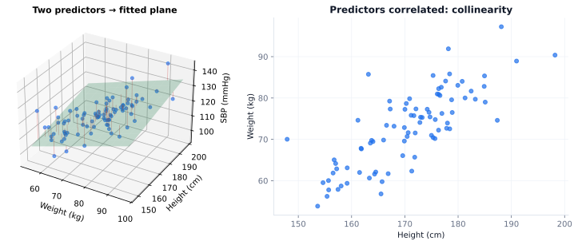

## Read coefficients conditionally {.concept-slide}

Term

Interpretation

When valid?

$\beta_0$

Predicted SBP at weight 0 and height 0

not physiologically meaningful

$\beta_1$

Expected SBP change for +1 kg <strong>holding height constant</strong>

within supported range

$\beta_2$

Expected SBP change for +1 cm <strong>holding weight constant</strong>

within supported range

“Adjusted for” is not the same as “caused by.”

## Multicollinearity hides unique effects {.concept-slide}

Height and weight may carry overlapping information

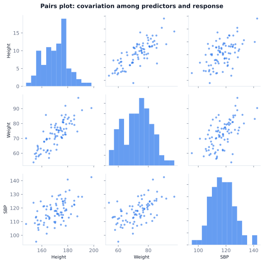

The issue

High predictor correlation can enlarge individual coefficient SEs, destabilize estimates, and complicate interpretation.

It does <strong>not</strong> inherently invalidate every prediction; evaluate design, range, variable importance, and the scientific estimand.

## General linear models {.section-break}

Part VII

Numeric predictors + categorical factors

Same additive linear-model machinery as ANOVA.

## Absorbance depends on more than concentration {.concept-slide}

Solvent + wavelength as explanatory factors

$$
\mathrm{Abs}=\beta_0+\beta_1c+\beta_2I_{\mathrm{water}}+\beta_3I_{280}+\beta_4I_{320}+\varepsilon
$$

Predictor

Type

Reference / contrast

concentration

numeric

1 mg/L increase

solvent

categorical

MeOH reference; water vs MeOH

wavelength

categorical

250 nm reference; 280 or 320 vs 250

In this equation $I$ is called dummy/indicator variable, but the interpretation of its $\beta$ is important, which we will see next.

## Without interactions: parallel lines {.concept-slide}

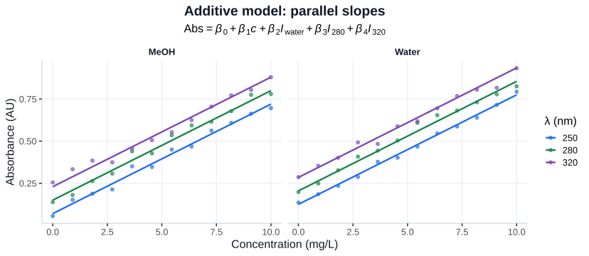

Categorical main effects shift intercepts; every group shares the same concentration slope.

  <!-- Left Side: Coefficient Table -->
  

  

  
Term

Interpretation

  
$\beta_0$

Absorbance at $c=0$ mg/L, in MeOH at $250$ nm

  
$\beta_1$

Extinction coefficient (times cuvette length), shared in all conditions

  

  

  <!-- Right Side: Coefficient Table -->
  

  

  
Term

Interpretation

  
$\beta_2$

Absorbance change when switching from MeOH to water

  
$\beta_3$

Absorbance change when switching from $250$ to $280$ nm

  
$\beta_4$

Absorbance change when switching from $250$ to $320$ nm

  

  

## Concentration × wavelength interaction {.concept-slide}

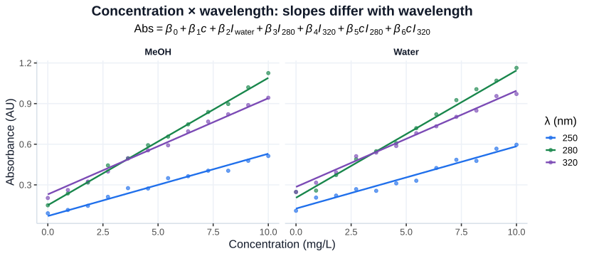

An interaction allows a different concentration slope at $250$, $280$, and $320$ nm; solvent shifts the intercept only in this model.

  <!-- Left Side: Coefficient Table -->
  

  

  
Term

Interpretation

  
$\beta_0$

Absorbance at $c=0$ mg/L, in MeOH at $250$ nm

  
$\beta_1$

Extinction coefficient, at $250$ nm

  
$\beta_2$

Absorbance change when switching from MeOH to water

  

  

  <!-- Right Side: Coefficient Table -->
  

  

  
Term

Interpretation

  
$\beta_3$

Absorbance shift at $c=0$ mg/L when switching from $250$ to $280$ nm

  
$\beta_4$

Absorbance shift at $c=0$ mg/L when switching from $250$ to $320$ nm

  
$\beta_5$

Extinction coefficient change when switching from $250$ to $280$ nm

  
$\beta_6$

Extinction coefficient change when switching from $250$ to $320$ nm

  

  

## What if even the spectral shape changes? {.concept-slide}

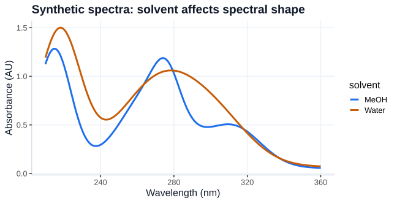

Solvent-dependent wavelength effect

A full $c\times\mathrm{wavelength}\times\mathrm{solvent}$ interaction allows concentration slopes to vary with wavelength <em>and</em> solvent.

Plausible physical model; more parameters require enough calibration observations.

## Full interactions: different line families {.concept-slide}

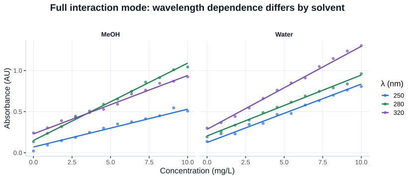

Every solvent–wavelength combination may have its own intercept and slope. More flexible ≠ automatically more reliable or more interpretable.

## A cubic relationship can still be a linear model {.concept-slide}

Cell size, growth, and a hormone factor

$$
\mathrm{growth}=\beta_0+\beta_1x+\beta_2x^2+\beta_3x^3+\beta_4I_{\mathrm{hormone}}+\varepsilon
$$

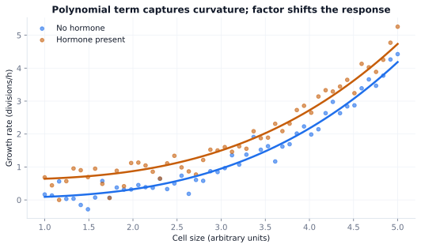

Linear <strong>in coefficients</strong>, even if nonlinear <strong>in the predictor</strong>. Polynomial regression is a general linear model, not nonlinear parameter fitting.

## Can more flexible models always win? {.exercise-slide}

Fit polynomials to the same sample

<label class="w8-control">polynomial degree = <strong id="polyDegreeValue">3</strong><input id="polyDegree" type="range" min="1" max="15" value="3" step="1"></label>
<button id="polyNew" class="w8-button" type="button">Draw new sample</button>

$R^2$<strong id="polyR2Out">—</strong>

AIC*<strong id="polyAicOut">—</strong>

best AIC degree<strong id="polyBestOut">—</strong>

*Within-sample Gaussian AIC with a common additive constant omitted; lower is preferred among these fits.

<svg id="polySvg" class="w8-svg w8-svg-large" viewBox="0 0 900 500" aria-label="Polynomial fitted models and AIC by degree"></svg>

## Good fit is not the whole goal {.concept-slide}

Training $R^2$

Never decreases when polynomial terms are added using the same observations.

Akaike Information Criterion

$n\log(SSE/n)+2k$

Rewards fit, penalizes parameters; choose the <strong>lowest</strong> score.

Scientific adequacy

Mechanism, residual diagnostics, parameter stability, and external validation still matter.

AIC scores have meaning only <em>relative to comparable models fitted to the same observations and response scale</em>. The formula shown omits a common Gaussian constant.

  

  
  
Hirotugu Akaike

  

## Choose a modeling approach {.exercise-slide}

Predict the best starting point

You measure absorbance at 8 known API concentrations, all using one solvent and one wavelength. Which starting model?

<button class="w8-choice" data-q="model" data-a="A">A · Paired $t$ test</button><button class="w8-choice" data-q="model" data-a="B">B · Simple linear regression</button><button class="w8-choice" data-q="model" data-a="C">C · Cohen's kappa</button>

Choose an answer.

## Interpret the model correctly {.exercise-slide}

In $SBP\sim\mathrm{weight}+\mathrm{height}$, what does the weight coefficient represent?

<button class="w8-choice" data-q="coef" data-a="A">A · The causal effect of gaining 1 kg</button><button class="w8-choice" data-q="coef" data-a="B">B · The expected SBP difference per kg, at fixed height</button><button class="w8-choice" data-q="coef" data-a="C">C · The correlation of height and weight</button>

Choose an answer.

## Read the diagnostic evidence {.exercise-slide}

A line has $R^2=0.95$, but residuals trace a pronounced U-shape. Best next step?

<button class="w8-choice" data-q="diag" data-a="A">A · Trust the line because $R^2$ is high</button><button class="w8-choice" data-q="diag" data-a="B">B · Investigate nonlinear form and model adequacy</button><button class="w8-choice" data-q="diag" data-a="C">C · Delete all residuals</button>

Choose an answer.

## Interpolation or extrapolation? {.exercise-slide}

Standards span 1–12 mg/L. An unknown gives a response corresponding to 21 mg/L. What is defensible?

<button class="w8-choice" data-q="extra" data-a="A">A · Report 21 mg/L directly because the line exists</button><button class="w8-choice" data-q="extra" data-a="B">B · Dilute/reprepare and repeat within the validated range</button><button class="w8-choice" data-q="extra" data-a="C">C · Use the correlation coefficient as the concentration</button>

Choose an answer.

## Week 8 synthesis {.concept-slide}

<strong>Association</strong>Scatterplots first; Pearson for linear and Spearman for monotonic patterns.

<strong>Model</strong>Specify conditional mean, estimate coefficients, examine uncertainty.

<strong>Check</strong>Residuals, domain, design, collinearity, influential cases, scientific plausibility.

<strong>Choose</strong>Complexity earns its place through explanatory value and reliable prediction.

## Next week {.section-slide}

From responses to probabilities

When the outcome is <strong>yes / no</strong>, a straight-line mean model no longer makes sense.

Continuous response

$E(y\mid x)$

Binary outcome

$\mathbb{P}(y=1\mid x)$

Week 9

logit + GLMs

<!-- Week 08 uses one isolated JS block and one initialization point. -->

