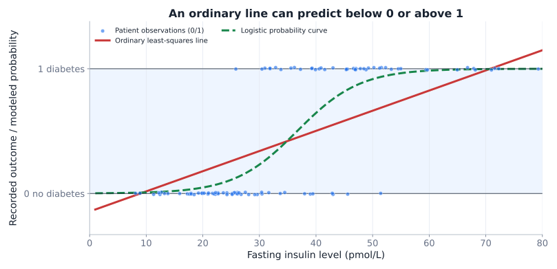
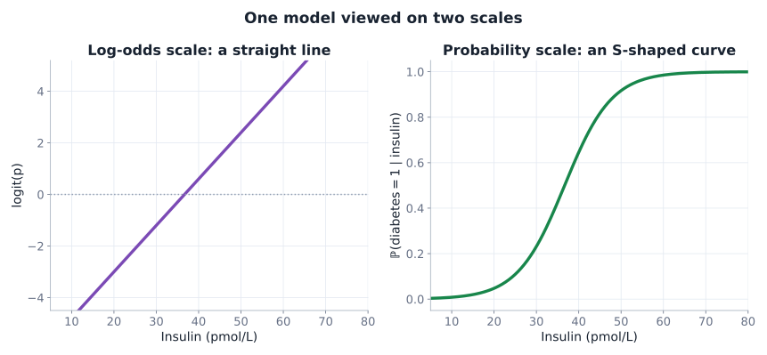
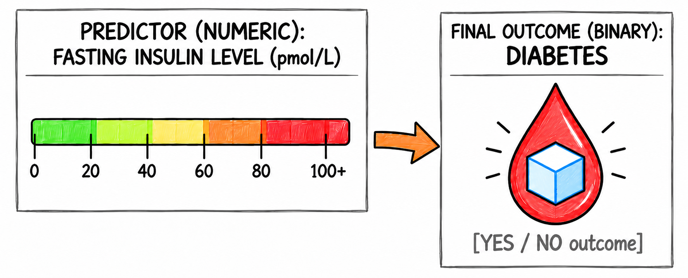
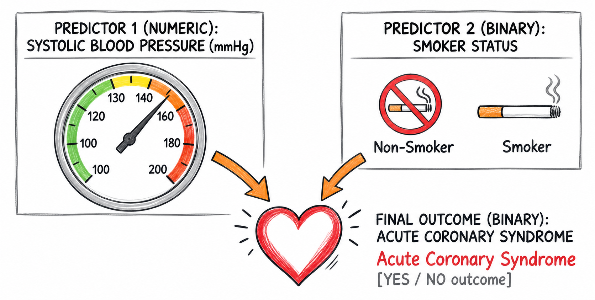
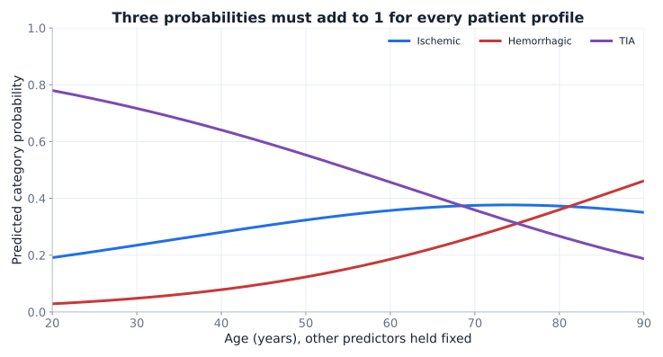
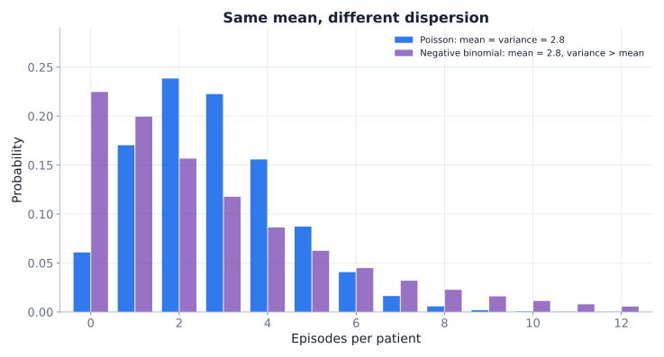
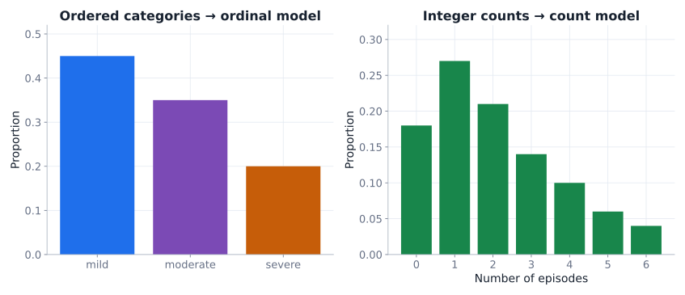
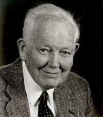

## Beyond classical linear methods {.title-slide}

Week 9 · Midterm week

What if the outcome is <strong>not continuous and Normally distributed</strong>?

::: {.notes}
Shorter teaching week owing to midterm. Main learning goal: choose an appropriate family for the outcome, not memorize a test catalog.
:::

## The last missing square {.concept-slide}

What kind of outcome are we explaining?

Outcome ↓ · Predictor →

Categorical

Numerical

Categorical

<strong>χ2 / Fisher</strong>Group label ↔ disease status

<strong>Logistic regression</strong>Disease status ~ biomarker level

Numerical

<strong>t test / ANOVA</strong>Blood pressure ~ treatment group

<strong>Linear regression</strong>Absorbance ~ concentration

The model family is driven primarily by the <strong>outcome</strong> and its data-generating process.

## Clinical hook: fasting insulin levels and diabetes {.motivation-slide}

PREDICTOR $x$

Insulin

$10$, $20$, $50$ … pmol/L

A continuous laboratory measurement

OUTCOME $y$

Diabetes present?

$y\in\{0,1\}$

Reference clinical classification for a synthetic study

Research question

How does <strong>the probability of diabetes</strong> change with fasting insulin level? A classification threshold is a different decision problem — next week.

Clinical note: Fasting insulin is not an established diabetes diagnostic criterion, as standard diagnosis relies on evaluating blood glucose or HbA1c levels; fasting insulin testing helps evaluate pancreatic hormone production and identify insulin resistance but does not independently identify diabetes type. <a href="https://www.niddk.nih.gov/health-information/diabetes/overview/tests-diagnosis">NIDDK</a>

## A binary outcome does not behave like absorbance {.concept-slide}

Jitter only makes the binary points visible. Linear regression can produce predicted values outside $[0,1]$ and uses the wrong error/variance structure.

## Explore probability → odds → logit {.exercise-slide}

Move one probability; watch two transformations

<label class="w9-control">event probability $p$ = <strong id="oddsPVal">0.50</strong><input id="oddsP" type="range" min="0" max="100" step="1" value="50"></label>

probability$p$<strong id="oddsProbOut">0.50</strong>

odds$p/(1-p)$<strong id="oddsOddsOut">1.00</strong>

logit$\log[p/(1-p)]$<strong id="oddsLogitOut">0.00</strong>

For $p=0.20$, $\mathrm{odds}=0.20/0.80=0.25$.
Endpoints:

at $p=0$ $\mathrm{odds}=0$ and logit tends to $-\infty$;
at $p=1$ odds and logit tend to $+\infty$.

<svg id="oddsSvg" class="w9-svg w9-svg-large" viewBox="0 0 900 500" aria-label="Odds and logit as functions of event probability"></svg>

## The logit opens the door to a straight line {.concept-slide}

We model the <strong>log-odds</strong>, not the raw 0/1 observation.

## Logistic regression: the recipe {.concept-slide}

1 · Linear predictor<strong style="font-size: 120%">$\eta=\beta_0+\beta_1x$</strong>

2 · Log-odds link<strong style="font-size: 120%">$\log\dfrac{p}{1-p}=\eta$</strong>

3 · Back to probability<strong style="font-size: 120%">$p=\dfrac{1}{1+e^{-\eta}}$</strong>

The coefficients are estimated from Bernoulli outcomes using likelihood, <strong>not by taking the logit of each observed 0/1</strong>.

## What do $\beta_0$ and $\beta_1$ mean? {.concept-slide}

INTERCEPT $\beta_0$

$e^{\beta_0}$

Baseline odds at $x=0$; may be meaningless if zero is outside the observed domain

SLOPE $\beta_1$

$e^{\beta_1}$

Multiplicative change in event odds for +1 unit of $x$

Odds ratio (OR)

$OR=e^{\beta_1}$:

above $1$ → higher odds;

below $1$ → lower odds;

exactly $1$ → no odds change per modeled unit.

## A worked biomarker coefficient {.concept-slide}

Illustrative fitted association · not a diagnostic rule

$\operatorname{logit}(\mathbb{P}(\mathrm{diabetes}))=-1.20+0.80\,\frac{\mathrm{insulin}-30}{10}$

At insulin = $30$ pmol/L

$e^{-1.20}=0.30$

Baseline odds; $p\approx0.23$

For $+10$ pmol/L

$e^{0.80}=2.23$

Odds are multiplied by $2.23$

At insulin = $40$ pmol/L

$p\approx0.40$

Probability computed by inverse logit

Centering at $30$ and dividing by $10$ makes the intercept interpretable. The fitted coefficients are invented for teaching.

## Multiplying odds is not adding risk {.concept-slide}

Baseline risk 10%

$\mathrm{odds}=0.10/0.90$

Double odds → probability <strong>18.2%</strong>, not 20%

Baseline risk 50%

$\mathrm{odds}=0.50/0.50$

Double odds → probability <strong>66.7%</strong>, not 100%

Watch the language

An odds ratio of 2 is <strong>not necessarily a doubled probability or risk</strong>. Its effect on absolute risk depends on baseline risk.

## The GLM family {.concept-slide}

Same idea, different outcome distributions and links

<strong>Continuous</strong>Gaussian modelidentity$E(Y\mid x)=\eta$

<strong>Binary</strong>Bernoulli modellogit$\operatorname{logit}(p)=\eta$

<strong>Count</strong>Poisson modellog$\log(\mu)=\eta$

$\eta$ is the <strong>linear predictor</strong>; the link function connects it to the outcome's conditional mean.

## Extending the model: ACS, SBP, smoking {.section-break}

Part II

The predictors can be both numeric and categorical

And an interaction asks whether one predictor modifies another's association.

## Add an interaction to the model {.concept-slide}

Now we model the probability of <strong>acute coronary syndrome (ACS)</strong> with predictor independent variables: systolic blood pressure (SBP) and smoking status.

$\operatorname{logit}(\mathbb{P}(\mathrm{ACS}))=\beta_0+\beta_1\frac{\mathrm{SBP}-120}{10}+\beta_2I_{\mathrm{smoker}}+\beta_3\frac{\mathrm{SBP}-120}{10}I_{\mathrm{smoker}}$

## Explore baseline, slopes, and interaction {.exercise-slide}

<label class="w9-control">baseline log-odds $\beta_0$ = <strong id="logB0Value">−2.30</strong><input id="logB0" type="range" min="-4" max="0" step="0.1" value="-2.3"></label>
<label class="w9-control">SBP slope $\beta_1$ / 10 mmHg = <strong id="logB1Value">0.34</strong><input id="logB1" type="range" min="-0.6" max="1.2" step="0.02" value="0.34"></label>
<label class="w9-control">smoking shift $\beta_2$ = <strong id="logB2Value">0.68</strong><input id="logB2" type="range" min="-2" max="2" step="0.1" value="0.68"></label>

Interaction · slope modification

<label class="w9-control">SBP × smoking $\beta_3$ = <strong id="logB3Value">0.26</strong><input id="logB3" type="range" min="-0.8" max="0.8" step="0.02" value="0.26"></label>

$x=(SBP-120)/10$; two probabilities come from one logistic model.

<svg id="logisticSvg" class="w9-svg w9-svg-large" viewBox="0 0 900 500" aria-label="Interactive smoker and non-smoker logistic probability curves"></svg>

OR per +10 mmHg · non-smoker<strong id="logOrNon">1.40</strong>

OR per +10 mmHg · smoker<strong id="logOrSm">1.82</strong>

ratio of SBP ORs<strong id="logRatio">1.30</strong>

## The reference-group (effects) view {.concept-slide}
  

$e^{\beta_0}$Baseline odds at SBP 120 mmHg for non-smokers

$e^{\beta_1}$SBP odds ratio for +10 mmHg <em>within non-smokers</em>

$e^{\beta_2}$Smoker vs non-smoker odds ratio <em>at SBP 120 mmHg</em>

$e^{\beta_3}$Ratio of SBP odds ratios (smoker / non-smoker)

## The group-specific (strata) view {.concept-slide}

Non-smoker

$\operatorname{logit}(p)=\beta_0+\beta_1\frac{\mathrm{SBP}-120}{10}$

Reference odds: $e^{\beta_0}$

SBP OR / +10 mmHg: $e^{\beta_1}$

Smoker

$\operatorname{logit}(p)=(\beta_0+\beta_2)+(\beta_1+\beta_3)\frac{\mathrm{SBP}-120}{10}$

Reference odds: $e^{\beta_0+\beta_2}$

SBP OR / +10 mmHg: $e^{\beta_1+\beta_3}$

$e^{\beta_0}$Baseline odds at SBP 120 mmHg for non-smokers

$e^{\beta_1}$SBP odds ratio for +10 mmHg <em>within non-smokers</em>

$e^{\beta_0+\beta_2}$Baseline odds at SBP 120 mmHg for smokers

$e^{\beta_1+\beta_3}$SBP odds ratio for +10 mmHg <em>within smokers</em>

One model; two equally valid ways to read its coefficients.

## Two views, different communication goals {.concept-slide}

Question

Effects / reference-group view

Group-specific / strata view

Emphasis

How does the smoking indicator <em>modify</em> the SBP association?

What is the SBP association <em>within each</em> smoking stratum?

Useful for

Testing and reporting interaction

Communicating subgroup profiles and conditional predictions

Caution

Reference levels and units matter

Subgroup ORs are not absolute patient risks

## Interpretation is not diagnosis {.concept-slide}

Fit

Model $\mathbb{P}(Y=1\mid X)$

Conditional probabilities and uncertainty

Evaluate

Calibration + discrimination

Do estimates agree with reality? Can cases be ranked?

Decide

Choose a threshold

False positives, false negatives, clinical consequences

Regression assumptions and model checking still matter; no single ordinary $R^2$ replaces them. Detailed classification and diagnostics follow in Week 10.

## More than two outcome categories {.section-break}

Part III

One binary logit is not always enough

Multinomial outcomes and event counts call for other models.

## Multinomial logistic regression {.concept-slide}

Stroke-presentation categories: ischemic (reference), hemorrhagic, TIA

Hemorrhagic vs ischemic<strong style="font-size: 120%">$\log\dfrac{\mathbb{P}(\mathrm{H})}{\mathbb{P}(\mathrm{I})}=\eta_{\mathrm{H}}(X)$</strong>

TIA vs ischemic<strong style="font-size: 120%">$\log\dfrac{\mathbb{P}(\mathrm{T})}{\mathbb{P}(\mathrm{I})}=\eta_{\mathrm{T}}(X)$</strong>

Probability normalization<strong style="font-size: 120%">$\mathbb{P}(\mathrm{I})=\dfrac{1}{1+e^{\eta_{\mathrm{H}}}+e^{\eta_{\mathrm{T}}}}$</strong>

Each nonreference category has its own log-odds equation. Exponentiated intercepts are baseline odds <em>relative to ischemic</em>, not probabilities; slopes yield relative-category odds ratios.

## How do three probabilities move together? {.concept-slide}

Illustrative synthetic probability profiles while changing age; other predictors are fixed. Each vertical stack adds to 100%.

## Reading a multinomial output {.concept-slide}

Invented coefficients · outcome reference = ischemic stroke

Comparison

Predictor

$\beta$

$e^\beta$

Hemorrhagic / ischemic

Anticoagulant (yes vs no)

0.80

2.23

Hemorrhagic / ischemic

SBP (+10 mmHg)

0.18

1.20

TIA / ischemic

Time since onset (+1 h)

−0.20

0.82

TIA / ischemic

Age (+10 y)

−0.15

0.86

$e^{0.80}=2.23$: modeled hemorrhagic-versus-ischemic odds are multiplied by 2.23 for anticoagulant use, with other predictors fixed.

Coefficients are purely illustrative; none assert a clinical relationship, significance, or recommended triage action.

## Poisson and negative binomial {.concept-slide}

Poisson

$E(Y)=\mathrm{Var}(Y)=\mu$

Negative binomial

Allows $\mathrm{Var}(Y)>E(Y)$ (overdispersion)

## Two pharmaceutical count examples {.concept-slide}

Sterile filling line

Bacteria / 10,000 vials

Count events per comparable batch; a Poisson starting point may be useful.

Phase III oncology study

Severe nausea episodes

Counts per patient during follow-up; between-patient heterogeneity may cause overdispersion.

$\log E(Y_i)=\beta_0+\beta_1x_i+\log(t_i)$

If observation times $t_i$ differ, an <strong>offset</strong> accounts for exposure. $e^{\beta_1}$ then represents a multiplicative change in the <strong>event rate</strong>.

Interpretation of units:

In the Poisson example the equation can rewritten as: $\frac{E(Y_i)}{t_i}=e^{\beta_0+\beta_1x_i}$

$E(Y_i)$ is number of bacteria in sample $i$, $t_i$ is number of vials in sample $i$

$x$ is a predictor of our choice, e.g. incubation temperature $\text{°C}$, then $\beta_1$ is $\log{\text{(bacteria/vial)}}/\text{°C}$, and $\beta_0$ is $\log{\text{(bacteria/vial)}}$

## Ordinal categories have a model too {.concept-slide}

Nominal 3+ levels

Multinomial logit

No built-in order among categories

Ordered levels

Ordinal logit

Uses ordering, e.g. mild → moderate → severe

Nonnegative counts

Poisson / Negative Binomial

Number of events, possibly accounting for exposure

All are discrete, but they do <strong>not</strong> describe the same type of outcome.

## If Normality is implausible {.section-break}

Part IV

Other inferential tools exist

Know the rationale, not every test's formula.

## Rank-based alternatives {.concept-slide}

Familiar method

Common rank-based alternative

What to remember

One-sample or paired $t$

<strong>Wilcoxon signed-rank</strong>

Signed ranks of differences; symmetry matters for location interpretation

Independent two-sample $t$ / Welch

<strong>Mann–Whitney / Wilcoxon rank-sum</strong>

Ranks across groups; tests relative distributional tendency, not automatically means

One-way ANOVA

<strong>Kruskal–Wallis</strong>

Rank-based test of distributional differences across groups

These are <em>alternatives</em>, not perfect drop-in equivalents with identical null hypotheses.

  

  
  
Frank Wilcoxon

  

  

  
  
Henry Mann

  

  

  
  
D. Ransom Whitney

  

  

  
  
William Kruskal

  

  

  
  
W. Allen Wallis

  

## Rank methods are not assumption-free {.concept-slide}

Outliers / skew

Ranks can reduce sensitivity to extreme magnitudes

Dependence

Study design and pairing still matter

Different shapes

A rank test is not automatically a test of median differences

Better decision rule

Start with the <strong>estimand, design, and data-generating process</strong>. Inspect distributions. Then choose a method whose assumptions and interpretation fit the question.

## Beyond this course {.concept-slide}

Repeated / clustered observations

Mixed-effects models

Patient, clinic or batch-specific variation; possible correlation and variance structures

Population-average association

GEE

Generalized estimating equations for correlated responses

These address <strong>dependence and heterogeneity</strong>. They are not automatically fixes for any poor model.

  

  
  
John Nelder

  

  

  
  
Robert Wedderburn

  

## Check your intuition: which outcome family? {.exercise-slide}

You record the number of adverse-event episodes per patient during 6 months. Which is the most natural starting model?

<button class="w9-choice" data-q="family" data-a="A">A · Simple linear regression</button><button class="w9-choice" data-q="family" data-a="B">B · Poisson / negative binomial count regression</button><button class="w9-choice" data-q="family" data-a="C">C · Multinomial logistic regression</button>

Choose one.

## Interpret an odds ratio {.exercise-slide}

A logistic model reports $OR=1.50$ for a +10 mmHg SBP change. What does that mean?

<button class="w9-choice" data-q="odds" data-a="A">A · Probability increases by 50 percentage points</button><button class="w9-choice" data-q="odds" data-a="B">B · Odds are multiplied by 1.5, conditional on the other modeled predictors</button><button class="w9-choice" data-q="odds" data-a="C">C · Every patient's outcome changes from 0 to 1</button>

Choose one.

## Understand the interaction {.exercise-slide}

In $\operatorname{logit}(p)=\beta_0+\beta_1x+\beta_2s+\beta_3xs$, which coefficient tells us whether the SBP log-odds slope differs by smoking status?

<button class="w9-choice" data-q="interaction" data-a="A">A · $\beta_0$</button><button class="w9-choice" data-q="interaction" data-a="B">B · $\beta_2$</button><button class="w9-choice" data-q="interaction" data-a="C">C · $\beta_3$</button>

Choose one.

## Final check: where can interpretation fail? {.exercise-slide}

Two groups have strongly skewed data and unequal distribution shapes. A Mann–Whitney test is significant. What is safely concluded?

<button class="w9-choice" data-q="ranks" data-a="A">A · Their population means are necessarily different</button><button class="w9-choice" data-q="ranks" data-a="B">B · There is evidence against equal distributions, not automatically evidence of a median difference</button><button class="w9-choice" data-q="ranks" data-a="C">C · All modeling assumptions have been removed</button>

Choose one.

## Week 9 synthesis {.concept-slide}

<strong>Binary event</strong>Model probability through a logit; interpret coefficients on the odds-ratio scale.

<strong>Several categories</strong>Model relative-category odds and normalize to probabilities summing to one.

<strong>Episode counts</strong>Use event-count models and investigate overdispersion and exposure time.

<strong>Nonstandard data</strong>Rank methods and more advanced dependence models exist; match method to estimand and design.

## Next: specialized pharmaceutical applications {.section-slide}

Week 10

A fitted probability is not yet a clinical decision. We will examine <strong>diagnostic thresholds, sensitivity, specificity, trials, and evidence synthesis</strong>.

Measure

Observed patient outcome

Estimate

Predicted event probability

Decide

Evidence + consequences

<!-- Exactly one Week 09 JS block. Do not add a second copy via a separate script tag. -->

