## Pharmaceutical and clinical statistics {.title-slide}

Week 10

How does statistics enter actual pharmaceutical evidence?

## Today: one evidence chain {.concept-slide}

Not another catalog of tests

Populationsepidemiology
<b>→</b>
Patientsdiagnostics
<b>→</b>
Interventionsclinical trials
<b>→</b>
Exposuretoxicology
<b>→</b>
Knowledgemeta-analysis

The question and study design determine the interpretation; statistical machinery quantifies <strong>effects and uncertainty</strong>.

## First: can we intervene? {.concept-slide}

Return to Week 03 · study design

Observe

Exposure is not allocated

Cohort / case–control / cross-sectional studies

Randomize

Exposure is allocated

Controlled trial with prespecified endpoints

Both designs have sampling variability. Random allocation helps break systematic links between measured <em>and unmeasured</em> baseline confounders on average.

## Prevalence: how many are affected now? {.concept-slide}

Disease burden · stock of existing cases

$\mathrm{Prevalence}=\dfrac{\text{existing cases}}{\text{population at time / period}}$

Illustrative population

1,000 people

Observed at the start of the year

Already affected

50 people

Point prevalence = 50 / 1,000 = 5%

Prevalence describes population burden. It reflects both arrival of new cases and how long people remain cases.

## Incidence: how many become affected? {.concept-slide}

New events among people initially at risk

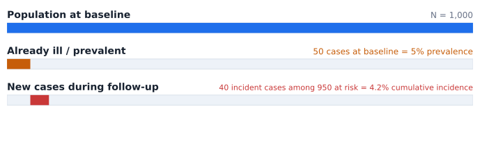

$\text{Cumulative incidence}=40/950\approx4.2\%$ during 1 year

Cumulative incidence is a risk over a specified time horizon, assuming appropriate follow-up and accounting for censoring when needed.

## Incidence rate uses person-time {.concept-slide}

A different denominator and unit

$\text{Incidence rate}=\dfrac{\text{new cases}}{\sum\text{person-time at risk}}$

Example

40 new cases

Among a dynamic followed population

Observed time

900 person-years

Different people contribute different durations

Incidence rate

4.44 / 100 person-years

An event rate, not a 4.44% probability

Rate and probability become close only under additional conditions, including relatively low risk over the time horizon.

## Revisit the invisible third variable {.concept-slide}

Synthetic association · sugary drinks → school performance

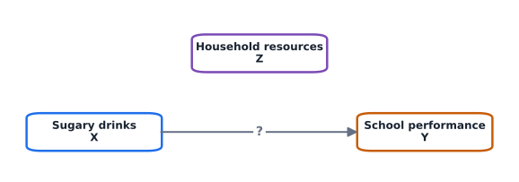

Household resources $Z$ can be a <strong>confounder</strong> if it is a common cause of $X$ and $Y$; a mediator or collider would have a different causal role.

## An association that appears when pooled {.concept-slide}

Compare within the low- and high-rent strata

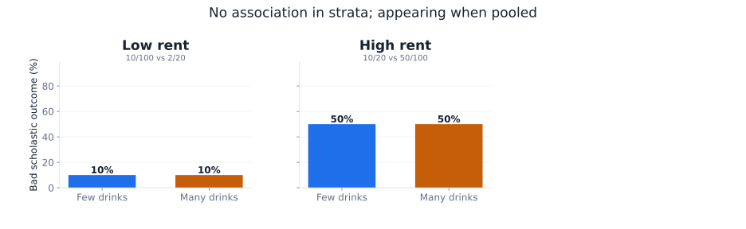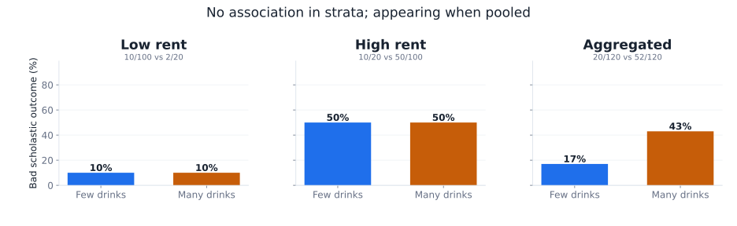

Low rent: 10/100 versus 2/20 · high rent: 10/20 versus 50/100 · pooled: 20/120 versus 52/120. All counts synthetic.

## Directed acyclic graph {.concept-slide}

Causal interpretation · Stratification blocks the backdoor path

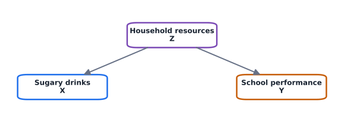

When the association vanishes within strata, it suggests $Z$ confounds both variables rather than $X$ directly causing $Y$—provided no unmeasured confounders remain.

## Confounder or effect modifier? {.concept-slide}

Two different scientific questions

Concept

What happens?

What should we do?

Confounding

An overall estimate is distorted by differing group compositions

Adjustment aims at an association net of the confounding pathway

Effect modification

Exposure–outcome associations genuinely differ between strata

Report the strata; an overall effect can conceal clinically useful differences

Our synthetic drink example illustrates both:

$RR$ within low rent $= 2.0$;

$RR$ within high rent $= 1.33$;

pooled $RR = 1.0$.

## The hospital paradox, once again {.concept-slide}

Drug response across three hospitals

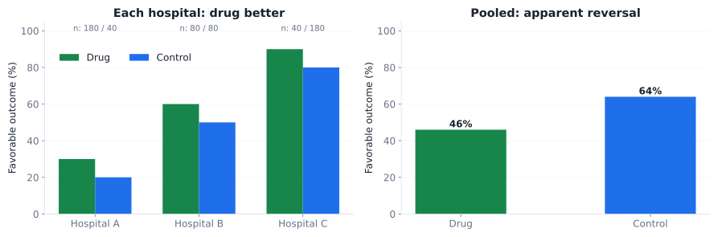

Drug: 30%, 60%, 90% success in hospitals A/B/C; control: 20%, 50%, 80%. Different arm allocations create the pooled reversal.

## When the confounder is measured {.concept-slide}

Design and analysis options

01<strong>Before data collection</strong>Restriction or matching can improve comparability; randomization addresses baseline confounding by design.

02<strong>During analysis</strong>Stratify, standardize or adjust using regression; always inspect effect modification.

03<strong>If effects are broadly common</strong>Mantel–Haenszel estimates an adjusted association across strata (with a clear target estimand).

A common pooled effect is not appropriate when stratum-specific treatment effects differ substantially.

## What if confounding is unobserved? {.concept-slide}

A fundamental limit of observational evidence

Propensity methods

Measured covariates

Matching / weighting / adjustment can balance observed confounders

Sensitivity analysis

Unmeasured covariates

Ask how strong hidden confounding must be to reverse a result

Triangulate

Different designs

Compare evidence across designs with different weaknesses

These approaches do <strong>not</strong> automatically solve unmeasured confounding; more sophisticated methods are outside this course.

## Epidemiology: which effect measure? {.concept-slide}

Use incidence for risk; distinguish risk from odds

Measure

Formula

Interpretation

Risk ($p$)

Events / people at risk

Probability over a specified period

Odds

$p/(1-p)$

Event relative to non-event probability

Relative risk ($RR$)

$p_\mathrm{T}/p_\mathrm{C}$

Relative event risk: multiplicative

Odds ratio ($OR$)

$[p_\mathrm{T}/(1-p_\mathrm{T})]/[p_\mathrm{C}/(1-p_\mathrm{C})]$

Multiplicative odds, not risk

Risk difference ($RD$)

$p_\mathrm{T}-p_\mathrm{C}$

Absolute percentage-point difference

$\mathrm{T}$ = exposed / treated; $\mathrm{C}$ = comparator. Choose a time horizon and clear event definition.

  

  
  
John Graunt

  

  

  
  
William Farr

  

  

  
  
John Snow

  

  

  
  
Florence Nightingale

  

## Same RR, very different absolute impact {.concept-slide}

Why baseline risk matters

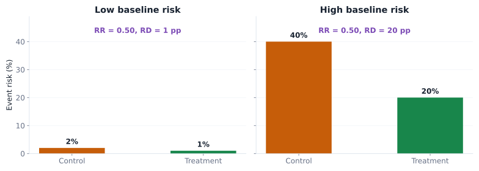

A $50\%$ relative reduction can mean <strong>1</strong> or <strong>20</strong> events prevented per 100 patients, depending on baseline risk.

## Worked example: risk and risk difference {.concept-slide}

Synthetic one-year prevention trial

Comparator risk

20%

20 events per 100 patients

Treatment risk

10%

10 events per 100 patients

RR

0.50

Half the event risk under treatment

Absolute RD

10 percentage points

0.10 − 0.20 = −0.10

Absolute and relative summaries describe the <strong>same contrast</strong>, on different scales.

## NNT and NNH: put consequences on the same page {.concept-slide}

Number needed to treat / harm

Benefit

NNT = 10

ARR = 0.10 → one additional prevented event per 10 treated, on average

Harm

NNH = 25

Absolute harm increase 0.04 → one additional adverse event per 25 treated, on average

Specify comparator, population, endpoint and time horizon. NNT does not identify which patient benefits, and comparing NNT/NNH needs clinical weighting of outcomes.

## Attributable fractions: causal language needs care {.concept-slide}

Illustrative association · exposure raises risk from 10% to 20%

<strong>Among exposed</strong>$AF_E=(RR-1)/RR=50\%$<small>Fraction of exposed cases attributed to exposure, if association is causal</small>

<strong>In population</strong>$PAF=(R_{pop}-R_0)/R_{pop}\approx23\%$<small>With 30% exposed: population risk = 13%, baseline risk = 10%</small>

Attributable fractions are <strong>not</strong> causal without assumptions about confounding, timing and intervention effects.

## Diagnostic tests {.section-break}

Part II

Diagnostic tests can fall for misclassification

We now see what to be aware of when diagnosing patients to estimate prevalence.

## Diagnostic tests: from association to classification {.concept-slide}

Return to Bayes · Week 01

Test accuracy

Sensitivity / specificity

How often the test correctly classifies reference-standard outcomes

Population context

Prevalence

How common the target condition is in the tested population

Patient interpretation

PPV / NPV

How likely a result is to indicate disease / health

Accuracy statistics alone do not tell us how much to trust a <strong>positive</strong> test.

## Start from four patients categories {.concept-slide}

Positive / negative test × present / absent condition

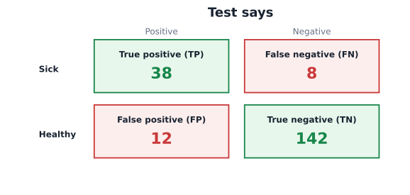

$\mathrm{Sensitivity}=TP/(TP+FN)$ &nbsp;&nbsp; $\mathrm{Specificity}=TN/(TN+FP)$

## Interactive lab · thirty diagnostic metrics {.exercise-slide}

Numbers change together · meaning depends on the denominator

Edit the patient counts

<label class="w10-control">TP · sick & positive<input id="cmTP" type="number" min="0" step="1" value="38"></label>

<label class="w10-control">FN · sick & negative<input id="cmFN" type="number" min="0" step="1" value="8"></label>

<label class="w10-control">FP · healthy & positive<input id="cmFP" type="number" min="0" step="1" value="12"></label>

<label class="w10-control">TN · healthy & negative<input id="cmTN" type="number" min="0" step="1" value="142"></label>

Sensitivity<strong id="cmSensBig">—</strong>

Specificity<strong id="cmSpecBig">—</strong>

PPV<strong id="cmPpvBig">—</strong>

NPV<strong id="cmNpvBig">—</strong>

Undefined denominators display “—”. Counts must be nonnegative whole numbers.

Explore the full diagnostic vocabulary · 5 columns × 6 metrics

::: {.notes}
Focus on sensitivity, specificity, PPV, NPV; the more advanced metrics are for recognition, not memorization.
:::

## A metric is a question with a denominator {.concept-slide}

Read the conditioning, not just the abbreviation

Metric

Clinical interpretation

Definition

Sensitivity / recall

Of those truly sick, what fraction tests positive?

$TP/(TP+FN)$

Specificity

Of those truly healthy, what fraction tests negative?

$TN/(TN+FP)$

PPV

Of those testing positive, what fraction is sick?

$TP/(TP+FP)$

NPV

Of those testing negative, what fraction is healthy?

$TN/(TN+FN)$

Sensitivity and specificity condition on <em>reference disease status</em>; predictive values condition on the <em>observed test result</em>.

## A diagnostic marker needs a decision threshold {.concept-slide}

Last week: a probability model · today: an action

01<strong>Measure</strong>A continuous biomarker varies across sick and healthy people.

02<strong>Classify</strong>Choose a cutoff: trade missed cases against false alarms.

03<strong>Validate</strong>Estimate sensitivity, specificity and calibration in a new relevant population.

A model threshold that maximizes an in-sample statistic may be too optimistic in new patients.

## Interactive lab · threshold and ROC {.exercise-slide}

Synthetic iron-deficiency status · disease reference label known

<label class="w10-control">Biomarker (synthetic study)<select id="rocMarker"><option value="ferritin">Ferritin · strong separation</option><option value="folate">Folate · weak separation</option></select></label>
<label class="w10-control">Positive if marker ≤ <strong id="rocCutVal">30</strong><input id="rocCut" type="range" min="0" max="110" value="30" step="1"></label>

Drag the red threshold line on the left plot; the current operating point moves on the ROC.

Sensitivity<strong id="rocSen">—</strong>

Specificity<strong id="rocSpe">—</strong>

AUC · fixed per marker<strong id="rocAuc">—</strong>

Youden cutoff (sample)<strong id="rocBest">—</strong>

<svg id="rocSvg" class="w10-svg" style="height:14em" viewBox="0 0 900 475" aria-label="Synthetic biomarker dot plot with draggable threshold and corresponding ROC curve"></svg>

::: {.notes}
Strong/weak marker distributions are explicitly synthetic and not clinical performance claims. Ferritin values decrease in this simulated iron-deficiency dataset; folate is deliberately weak.
:::

## What the ROC curve is showing {.concept-slide}

Each cutoff gives ONE point; all cutoffs give ONE curve

Element

Definition

Interpretation

Horizontal axis

$1-Sp$

False-positive rate

Vertical axis

$Se$

True-positive rate

AUC

Area under the entire ROC

Discrimination across all cutoffs; does not change when slider moves

Upper-left corner

High&nbsp;$Se$, low&nbsp;$FPR$

Ideal only if clinical costs and prevalence allow

Maximum <em>Youden index</em> and shortest distance to the corner are possible cutoff criteria — neither is a universal clinical optimum.

## Which error is more costly? {.concept-slide}

Clinical thresholds encode clinical decisions

High sensitivity

Avoid missed disease

Often acceptable to trigger a confirmatory test

High specificity

Avoid false positives

Important if unnecessary treatment would be risky

AUC

Overall ranking performance

AUC alone does not choose a patient-facing threshold

Select cutoffs with anticipated costs, prevalence, clinical pathway and independent validation in mind.

## Bayes comes back: PPV changes with prevalence {.concept-slide}

Illustrative test: sensitivity 90%, specificity 90%

Prevalence 1%

PPV = 8.3%

Most positives are false positives at very low prevalence

Prevalence 20%

PPV = 69.2%

Positive result becomes substantially more credible

$PPV=\dfrac{Se\times Prev}{Se\times Prev+(1-Sp)(1-Prev)}$

## Diagnostic uncertainty does not stop at the cutoff {.concept-slide}

A test-accuracy estimate comes from a finite study

01<strong>Report intervals</strong>Sensitivity and specificity have sampling uncertainty; so does AUC.

02<strong>Specify reference standard</strong>Errors in the disease reference label can bias measured diagnostic accuracy.

03<strong>Verify transportability</strong>Prevalence, disease spectrum, laboratories and settings may differ.

If thresholds are chosen on the same data used for evaluation, apparent accuracy may be optimistic.

## Pooling samples: when fewer tests can suffice {.concept-slide}

Group testing · only when assay dilution is acceptable

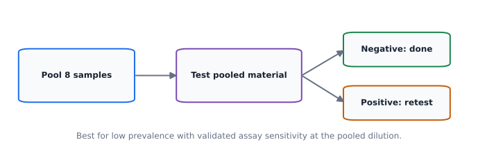

Expected tests per person (idealized) $\approx 1/k + 1-(1-p)^k$

Valid only under an appropriate pooling protocol and assumptions; lower assay sensitivity after dilution, dependence and prevalence can change whether pooling helps.

## Clinical trials {.section-break}

Part III

For causal inference use clinical study

We now see all the care we have to give for correct planning and execution.

## Clinical trials: what randomization buys us {.concept-slide}

Treatment allocation as a planned intervention

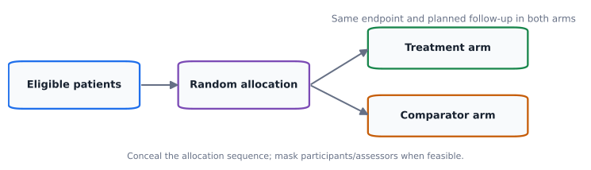

The target is a <strong>causal contrast</strong> under a clearly specified intervention, endpoint, population and follow-up.

## Write the question before running the test {.concept-slide}

Superiority, noninferiority, equivalence

Objective

Clinical question

Statistical logic

Superiority

Is&nbsp;$T$&nbsp;better than&nbsp;$C$?

Evidence that the effect exceeds a reference such as zero

Noninferiority

Is&nbsp;$T$&nbsp;not unacceptably worse?

One-sided prespecified margin and appropriate CI

Equivalence

Are effects close enough in both directions?

Two-sided margin; TOST / corresponding 90% CI

The same observed treatment difference can support different conclusions depending on the <strong>prespecified question</strong>.

## Every trial needs a defensible comparator {.concept-slide}

Ethics and interpretability

Placebo

When appropriate

Can separate treatment effect from expectations, but ethical constraints apply

Active comparator

Standard of care

Tests relative benefit or acceptable loss against existing treatment

No intervention

Sometimes relevant

Not interchangeable with placebo when expectations/attention matter

Comparator choice is part of the scientific and ethical question, not an afterthought.

## Endpoints: one convincing outcome beats many weak ones {.concept-slide}

Efficacy, safety and multiplicity

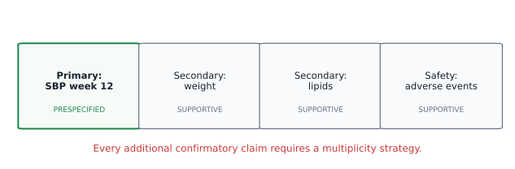

Define what is measured, when, how and by whom. Multiple confirmatory claims require an error-control strategy.

## Baseline, covariates and missing follow-up {.concept-slide}

Prevent avoidable ambiguity

01<strong>Before dosing</strong>Record baseline endpoint and prognostic factors; plan any covariate adjustment.

02<strong>During follow-up</strong>Apply identical outcome ascertainment and monitoring principles across arms.

03<strong>At analysis</strong>Define the population to analyze and the assumptions for missing values before seeing outcomes.

Baseline differences can occur by chance despite proper randomization. Do not use significance testing as a gatekeeper for adjustment.

## Masking and allocation concealment {.concept-slide}

These prevent different problems

Concealment

Before assignment

Prevents knowledge of the upcoming allocation from influencing enrolment

Masking

After assignment

Can reduce performance and outcome-assessment biases

Transparent reporting

Throughout

Specify exactly who was masked and how

Labels like “double blind” are less informative than naming <strong>participants, clinicians, assessors and analysts</strong>.

## Interactive lab · randomize one patient at a time {.exercise-slide}

Watch adaptation to arm imbalance

<label class="w10-control">Allocation mechanism<select id="ranMode"><option value="simple">Simple randomization: p = 0.50</option><option value="biased">Biased coin: p = 0.75 toward underrepresented arm</option></select></label>

<button id="ranOne" class="w10-button" type="button">Allocate 1</button><button id="ranTen" class="w10-button" type="button">Allocate 10</button><button id="ranReset" class="w10-button secondary" type="button">Reset</button>

Treatment / control<strong id="ranCounts">0 / 0</strong>

Next p(treatment)<strong id="ranProbability">0.50</strong>

Allocated<strong id="ranTotal">0</strong>

Absolute imbalance<strong id="ranGap">0</strong>

Balanced-biased-coin allocation is <strong>not</strong> an outcome-adaptive design; it uses prior arm counts only.

<svg id="randomSvg" class="w10-svg" style="height: 14em" viewBox="0 0 900 475" aria-label="Sequential trial assignment and arm balance"></svg>

## Randomization: not all methods are interchangeable {.concept-slide}

Use transparent, prespecified rules

Design

What it changes

What to remember

Simple random

Each assignment independent

Some imbalance is natural, especially in small studies

Blocked / stratified

Restrictions preserve balance

Specify blocks, factors and concealment protocol

Biased coin

Preferentially corrects imbalance

Assignment probability changes using current counts

Proper randomization does not guarantee equal arm sizes or eliminate chance variation in prognostic factors.

## Interactive lab · plan the sample size {.exercise-slide}

A two-arm continuous-endpoint superiority study

<label class="w10-control">Anticipated absolute effect $\Delta$<input id="powEffect" type="number" min="0.1" max="100" step="0.5" value="5"></label>
<label class="w10-control">Common planning SD $\sigma$<input id="powSd" type="number" min="0.1" max="100" step="0.5" value="12"></label>
<label class="w10-control">Two-sided $\alpha$<select id="powAlpha"><option value="0.10">0.10</option><option value="0.05" selected>0.05</option><option value="0.01">0.01</option></select></label>
<label class="w10-control">Target power<select id="powTarget"><option value="0.8" selected>80%</option><option value="0.9">90%</option><option value="0.95">95%</option></select></label>

Required / arm<strong id="powN">—</strong>

Total planned<strong id="powTotal">—</strong>

Standardized effect<strong id="powD">—</strong>

Attained approx. power<strong id="powAttained">—</strong>

Two independent groups, equal allocation; finite-df t-critical, normal approximation to t-test power.

<svg id="powerSvg" class="w10-svg" style="height: 16em" viewBox="0 0 900 475" aria-label="Power versus sample size for a two-sample treatment comparison"></svg>

## What goes into sample-size planning? {.concept-slide}

You cannot compute $n$ without assumptions

01<strong>Clinically important difference</strong>Choose $\Delta$ on the original outcome scale, not merely an attainable statistical signal.

02<strong>Within-arm SD and α</strong>Higher variability or more stringent α generally needs more patients.

03<strong>Target power and operations</strong>Higher power needs more patients; add credible allowance for attrition and operational limitations.

The widget gives an illustrative approximation for two independent groups, not a regulatory trial-planning calculation.

## Read a trial result as an effect and its interval {.concept-slide}

An example reporting sentence

“The treatment reduced systolic blood pressure by an estimated <strong>5 mmHg</strong> relative to control (95% CI <strong>2 to 8 mmHg</strong> reduction), at 12 weeks.”

Magnitude

5 mmHg

Is it clinically important?

Uncertainty

95% CI

What range of effects remains compatible with data?

Context

12 weeks

Who, when, comparator, adverse effects?

Statistical significance is not a complete benefit–risk assessment.

  

  
  
James Lind

  

  

  
  
Sir Austin Bradford Hill

  

## Toxicology {.section-break}

Part IV

It is actually important to prove safety first

We now see the basic idea of assessing drug toxicity.

## Toxicology: dose, effect and harm {.concept-slide}

Repeated exposures and nonlinear biological responses

Pharmacology

EC50 / IC50

Dose or concentration at a defined half-maximal response

Toxicology

TC50 / LC50

Half-maximal toxic response / 50% lethality in a stated assay

Experiment

Doses and times

Exposure schedule and concentration range matter

A dose–response model describes a particular endpoint under a particular exposure protocol.

## Sigmoids are useful, not universal {.concept-slide}

Potency, slope, saturation

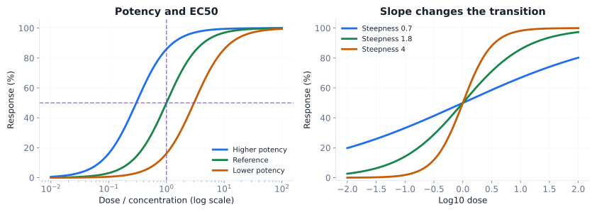

The extended logit curve from last week links log-dose with response shape; model choice requires mechanistic and empirical justification.

## From Mass Action to the Boltzmann Sigmoid {.concept-slide}

First-principles derivation · Binding kinetics &amp; cooperativity

  <!-- Card 1: Mass Action -->
  

  
1: Equilibrium Mass Action

  

  Receptor $\text{R}$ binds ligand $\text{L}$:
  $$\text{L} + \text{R} \underset{k_{\mathrm{off}}}{\overset{k_{\mathrm{on}}}{\rightleftharpoons}} \text{RL}, \quad K_{\mathrm{d}} = \frac{[\text{L}][\text{R}]}{[\text{RL}]}$$
  

  

  $$\theta = \frac{[\text{RL}]}{[\text{R}]_{\mathrm{tot}}} = \frac{[\text{L}]}{[\text{L}] + K_{\mathrm{d}}}$$
  

  

  Hyperbolic response curve on a linear concentration scale ($[\text{L}]$).
  

  

  <!-- Card 2: Log-Dose / Boltzmann Sigmoid -->
  

  
2: Log-Dose reparameterization

  

  Define log-concentration $x = \log[\text{L}]$ and log-dissociation $x_{50} = \log K_{\mathrm{d}}$:
  

  

  $$\theta = \frac{e^x}{e^x + e^{x_{50}}} = \frac{1}{1 + e^{-(x - x_{50})}}$$
  

  

  This is <strong>exactly</strong> the standard logistic (Boltzmann) sigmoid on the log-dose axis.
  

  

  <!-- Card 3: Hill Cooperativity -->
  

  
3: Hill Cooperativity ($n_{\mathrm{H}}$)

  

  Multi-site binding ($n_{\mathrm{H}}$ molecules bind cooperatively):
  

  

  $$\theta = \frac{[\text{L}]^{n_{\mathrm{H}}}}{[\text{L}]^{n_{\mathrm{H}}} + K_{\mathrm{d}}^{n_{\mathrm{H}}}} = \frac{1}{1 + e^{-n_{\mathrm{H}}(x - x_{50})}}$$
  

  

  The Hill coefficient $n_{\mathrm{H}}$ directly scales the <strong>slope factor</strong> (steepness) of the sigmoid.
  

  

<strong>Mechanistic insight:</strong> The logistic curve is not just an empirical smoothing function—it arises naturally when ligand-receptor equilibrium is plotted against log-concentration. $n_{\mathrm{H}} > 1$ indicates positive cooperativity, while $n_{\mathrm{H}} < 1$ reflects negative cooperativity or multiple receptor subtypes.

## Dose planning determines what can be estimated {.concept-slide}

Avoid fitting a curve to the wrong region

01<strong>Include a meaningful control</strong>Establish baseline or background toxicity.

02<strong>Bracket the transition</strong>Sample both lower and higher response regions, where feasible; do not require a universal 30–70% range.

03<strong>Replicate and account for exposure</strong>Dose spacing, sample size, time and measurement error affect certainty.

An apparent EC50 can be extrapolation if the measured doses never bracket half-response.

## NOAEL / LOAEL versus modeled BMD {.concept-slide}

One comes from dose groups; one from a curve

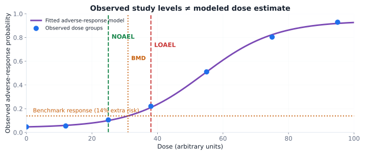

NOAEL/LOAEL are study-dependent observed dose levels. BMD (benchmark dose) is fitted at a specified benchmark response; BMDL is a lower confidence bound for that modeled dose.

## Exposure duration changes the interpretation {.concept-slide}

One dose, more than one answer

Acute

Single/short exposure

Different endpoints than prolonged dosing

Repeated-dose

Weeks/months

Accumulation and adaptation may alter response

Clinical translation

Species and protocols

Do not equate experimental safety thresholds directly with a safe patient dose

A toxicity statement is incomplete without dose, route, exposure duration, species/population and endpoint.

## Meta-analysis {.section-break}

Part V

Human knowledge accumulated

Why consensus provides a stronger evidence.

## From individual studies to cumulative evidence {.concept-slide}

Systematic review → quantitative synthesis

01<strong>Define a systematic question</strong>Population, intervention/exposure, comparator, outcome and study design.

02<strong>Search and appraise</strong>Include eligible studies transparently; assess bias and publication/selective reporting.

03<strong>Synthesize</strong>Combine comparable estimates and examine between-study differences.

A meta-analysis is a calculation <em>inside</em> a systematic review, not a substitute for one.

  

  
  
Archie Cochrane

  

  

  
  
Gene V. Glass

  

## How to read a forest plot {.concept-slide}

Each line = one study, diamond = pooled estimate

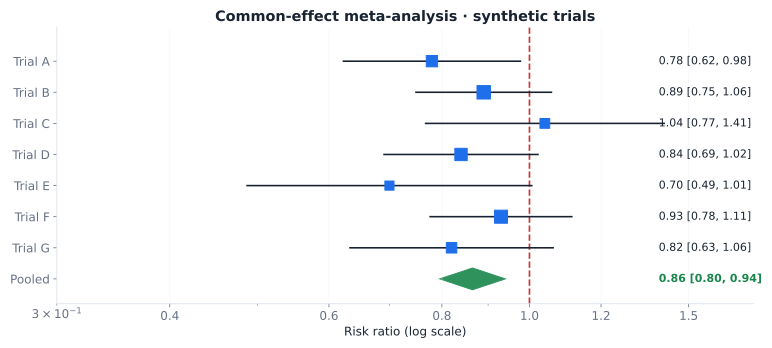

Squares represent study estimates; square area reflects precision weight. Horizontal lines are 95% CIs. The dashed line at RR=1 is the no-effect reference.

## Why more precise studies get more weight {.concept-slide}

Common-effect model, under its assumptions

$w_i=1/SE_i^2,\qquad \hat\theta_{pool}=\dfrac{\sum_i w_i\hat\theta_i}{\sum_i w_i}$

High precision

Small SE

Larger inverse-variance weight

Low precision

Large SE

Smaller weight

For ratio measures, average <strong>log risk ratios / log odds ratios</strong>, then exponentiate. Pool only effects on a comparable estimand and scale.

## What if studies truly differ? {.concept-slide}

Between-study heterogeneity

Approach

Concept

Caution

Common-effect

One underlying effect in the included studies

Variation attributed to sampling uncertainty

Random-effects

A distribution of underlying study effects

Accounts for between-study heterogeneity; requires more assumptions

Subgroups / sensitivity

Explore prespecified differences

Avoid assuming any pooled mean applies to all patients

A narrower pooled CI is not evidence that all populations benefit equally.

## Funnel plots: a clue, not a verdict {.concept-slide}

Small studies, precision and selective publication

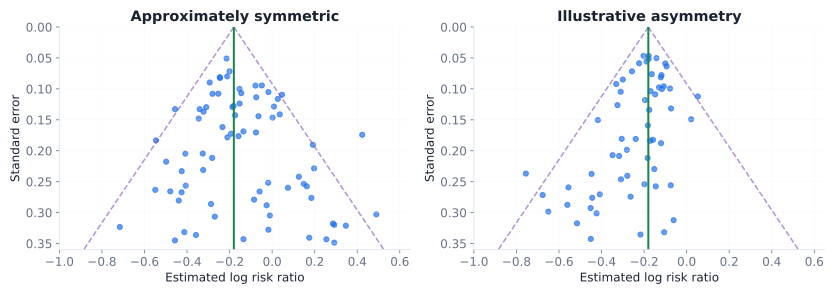

Asymmetry may result from publication bias, heterogeneity, methodological differences or chance; assess alongside study design and reporting.

## Check your intuition · Which denominator? {.exercise-slide}

Interpret, do not memorize

A negative diagnostic test is obtained. What is the probability the person is actually healthy?

<button type="button" class="w10-choice" data-choice="A">A · Sensitivity</button><button type="button" class="w10-choice" data-choice="B">B · Specificity</button><button type="button" class="w10-choice" data-choice="C">C · Negative predictive value</button>

## Check your intuition · Best threshold? {.exercise-slide}

Interpret, do not memorize

A threshold is moved along a fixed biomarker ROC curve. What might change?

<button type="button" class="w10-choice" data-choice="A">A · AUC</button><button type="button" class="w10-choice" data-choice="B">B · Sensitivity and specificity</button><button type="button" class="w10-choice" data-choice="C">C · Disease prevalence</button>

## Check your intuition · Randomization? {.exercise-slide}

Interpret, do not memorize

Which statement about randomized allocation is correct?

<button type="button" class="w10-choice" data-choice="A">A · Eliminates sampling variation</button><button type="button" class="w10-choice" data-choice="B">B · Guarantees equal covariates</button><button type="button" class="w10-choice" data-choice="C">C · Reduces systematic baseline confounding on average</button>

## Check your intuition · Meta-analysis? {.exercise-slide}

Interpret, do not memorize

Several precise studies estimate different population effects. What is most important to inspect?

<button type="button" class="w10-choice" data-choice="A">A · Heterogeneity and applicability</button><button type="button" class="w10-choice" data-choice="B">B · Only the pooled p-value</button><button type="button" class="w10-choice" data-choice="C">C · Whether all effect estimates are identical</button>

## One map: where statistics enters evidence {.concept-slide}

From research question to decision

<strong>Who?</strong>Population, prevalence, selection

<strong>What?</strong>Diagnosis and misclassification

<strong>Why?</strong>Trial causal effect and benefit–harm

<strong>How much?</strong>Dose–response and uncertainty

<strong>How sure?</strong>Systematic review and meta-analysis

A sound interpretation requires <strong>design + estimand + measurement + uncertainty + applicability</strong>.

## Next: the data do not always come one patient at a time {.section-slide}

Week 11 · time, signals, survival and prediction

Outcomes may arrive as <strong>trajectories</strong>, <strong>repeated measurements</strong> and <strong>time until an event</strong>.

Time series

Signal trajectories

Serial dependence matters

Survival

Time-to-event

Follow-up and censoring matter

Prediction

Generalization

Validation matters

<!-- One JS block. Do not load week10.js separately. -->

