## Time, survival, smoothing {.title-slide}

Week 11

What changes when observations have <strong>temporal structure?</strong>

## The unifying change {.concept-slide}

From exchangeable observations to a path through time

<strong>Trajectory</strong>What happened?

<strong>Dependence</strong>How is today related to yesterday?

<strong>Events</strong>How long until something occurs?

<strong>Prediction</strong>What happens next, with uncertainty?

The order of measurements can contain information. Ignoring it may yield overly confident or misleading answers.

## Why is time not just another $x$-variable? {.concept-slide}

Two scatter plots may look equally convincing

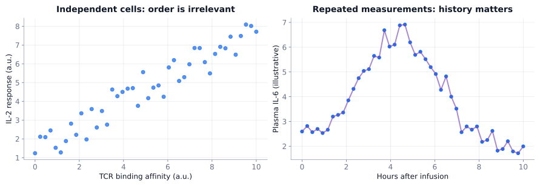

For independent cells, the order is arbitrary; for successive IL-6 measurements from a patient, order is part of the experiment.

## Longitudinal versus time-series data {.concept-slide}

<strong>Longitudinal</strong>Many subjects; each may be measured repeatedly at several visits.

<strong>Time series</strong>One process observed in order; adjacent observations can be dependent.

<strong>Both</strong>Temporal dependence, irregular sampling and missing visits need attention.

Repeated measurements do not logically imply autocorrelation, but they often do in biomedical settings.

Longitudinal data can be handled with repeated-measured ANOVA, but modern applications use mixed-effects regression modeling.

  

  
  
Nan Laird

  

  

  
  
James Ware

  

## Three common response shapes {.concept-slide}

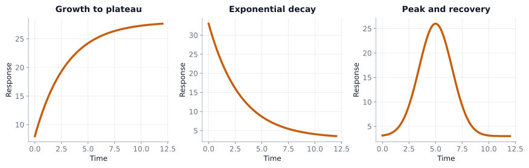

Growth toward a plateau · elimination/decay · peak and recovery. Each requires different summary questions.

## Plot individual trajectories first {.concept-slide}

Drug A versus Drug B · n = 10 per arm

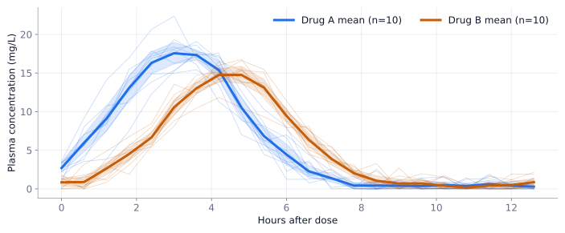

Faint curves are patients; bold curves are sample means; shaded bands illustrate 95% pointwise mean CIs.

## Why not six separate $t$ tests? {.concept-slide}

<strong>Repeated measures</strong>Each person contributes a correlated trajectory.

<strong>Multiplicity</strong>Comparing each time point repeatedly creates many opportunities for false alarms.

<strong>Missing pattern</strong>An isolated p-value can conceal timing, amplitude and overall exposure.

A scientifically meaningful <strong>trajectory-level endpoint</strong> can sometimes replace a much more complicated analysis.

## Reduce a whole trajectory to interpretable endpoints {.concept-slide}

Question

Summarize with

Interpretation

Overall exposure

$\mathrm{AUC}$, time average

Depends on observation window and baseline

Peak response

$C_{\max}$ / $C_{\min}$

Response magnitude

When is the peak?

$t_{\max}$

Timing of response

Change / decay rate

Slope or rate constant

Kinetic behavior

How long above target?

Time above threshold

Duration of target attainment

Starting / baseline level

$C_{\text{baseline}}$

Initial/final response / reference status

Prespecify endpoints; changing definitions after seeing data introduces bias.

## Pharmacokinetics: the shape has meaning {.concept-slide}

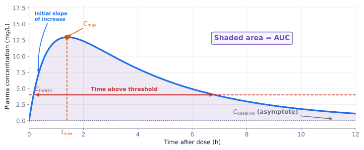

$\mathrm{AUC}$ = area under concentration versus time; $C_{\max}$ = peak concentration; $t_{\max}$ = peak time.

## PK quantities should not be confused {.concept-slide}

<strong>AUC</strong>Total concentration–time exposure, not administered dose.

<strong>Time above threshold</strong>Especially important for time-dependent antimicrobial pharmacodynamics.

<strong>Clearance</strong>Under a simple one-compartment model with first-order elimination, $CL=k V_d$.

The elimination-rate constant $k$ has units of inverse time. Zero-order and first-order elimination follow different kinetic equations.

## An HPLC chromatogram is also time-indexed {.concept-slide}

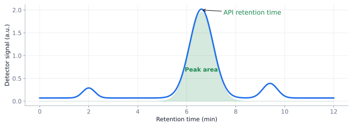

Peak position = retention time; integrated detector response = peak area. Calibration is required to infer analyte amount.

## Can we remove time by design? {.concept-slide}

Repeated blood pressure during one clinic visit

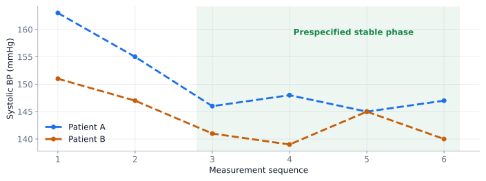

If an acquisition protocol <strong>prespecifies</strong> a stabilization phase, averaging later readings can yield one patient-level endpoint. Do not discard early values <em>post hoc</em> merely because they differ.

## Regression to the mean {.concept-slide}

Selection on extreme measurements

<strong>At screening</strong>A patient is selected partly because of a genuinely high value, partly because of random positive noise.

<strong>At repeat testing</strong>The same person often has a less extreme observed value even without effective treatment.

$Y_{it}=\mu_i+\varepsilon_{it}$

Persistent person-specific level $\mu_i$ + measurement-to-measurement fluctuation $\varepsilon_{it}$.

## Lab: watch regression to the mean {.concept-slide}

<label class="w11-control">Select top <strong id="rtmTopV">10</strong> % of original readings<input id="rtmTop" type="range" min="2" max="30" value="10" step="1"></label>
<button class="w11-btn " id="rtmResample" type="button">Repeat selected</button><button class="w11-btn secondary" id="rtmNew" type="button">New cohort</button><button class="w11-btn secondary" id="rtmReset" type="button">Reset</button>

Same selected people remain highlighted. Only their repeat measurement changes; the cohort is not reselected.

<svg id="rtmSvg" class="w11-svg" style="height:13.6em;" viewBox="0 0 900 460" aria-label="Regression to the mean: screen top measurements and repeat"></svg>

Initial selected mean<strong id="rtmOldMean">—</strong>

Most recent mean<strong id="rtmNewMean">—</strong>

Selection size<strong id="rtmCount">—</strong>

## The placebo-group surprise {.concept-slide}

<strong>Screen</strong>Recruit only people with unusually elevated blood pressure.

<strong>Follow up</strong>Even without an active effect, their average may decrease on repeat measurement.

<strong>Interpret</strong>A control arm helps separate spontaneous variation from a treatment effect.

A reduction after treatment <strong>alone</strong> is not proof that the treatment caused it (SYMPLICITY HTN-3 clinical trial 2011).

## Autocorrelation {.section-break}

Part II

Time-series analysis

We now see how we can analyze trends in time-series data.

## A fitted time curve can still be useful {.concept-slide}

<strong>Regression</strong>Fit a prespecified exponential, logistic or other trajectory.

<strong>Coefficients</strong>Compare rate, peak, delay, plateau, or asymptote.

<strong>Danger</strong>Repeated observations can have correlated residuals.

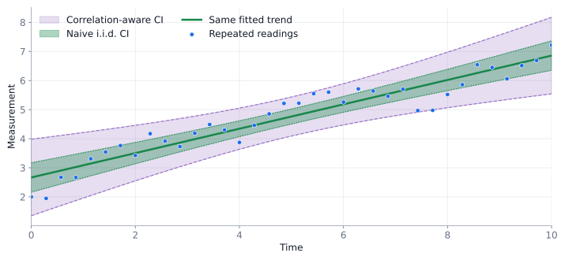

Bands intentionally schematic. The broader band illustrates why independence assumptions can understate uncertainty; actual widths depend on the fitted correlation model.

Correlation changes <strong>uncertainty</strong>: same trend; different standard-error assumptions.

## Autocorrelation means a lag matters {.concept-slide}

$\rho(k)=\operatorname{Corr}(Y_t,Y_{t-k})$

<strong>Lag 1</strong>The similarity of consecutive values.

<strong>Lag 6</strong>The similarity of values separated by six time steps.

<strong>Differencing</strong>$Y_t-Y_{t-1}$ is a separate transformation, not the definition of autocorrelation.

  

  
  
George Udny Yule

  

  

  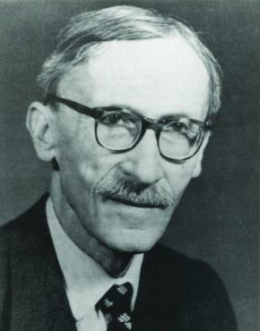
  
Paul Lévy

  

  

  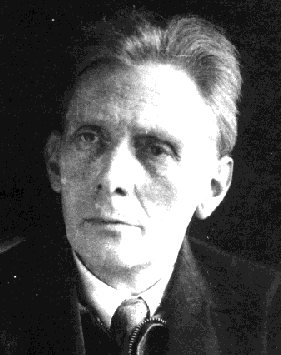
  
Aleksandr Khinchin

  

  

  
  
Norbert Wiener

  

## Three contrasting dependence structures {.concept-slide}

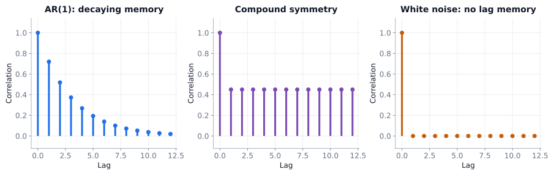

AR(1): correlation decays across lags. Compound symmetry: an illustrative equal within-subject correlation. White noise: no serial correlation.

Examples include
<strong>First-order autoregressive:</strong> lake water temperature, where recent history has greatest impact on present (short memory)

<strong>Compound symmetry / exchangeable:</strong> epidemiological viral endemic (lagging memory)

<strong>Independent / Identity:</strong> White noise (no memory)

## A random walk is not independent observations {.concept-slide}

<strong>Steps</strong>Independent changes: $X_{t+1}-X_t=\epsilon_t$.

<strong>Positions</strong>Accumulated history: $X_t=\sum_{j\le t}\epsilon_j$.

<strong>Consequence</strong>Even independent steps can create strongly dependent position values.

An ideal symmetric lattice walk in 1D or 2D returns with probability 1; in 3D it may return, but the return probability is below 1.

  

  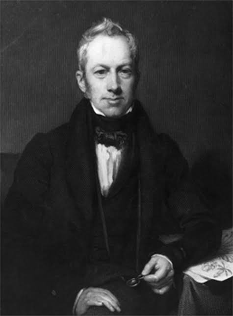
  
Robert Brown

  

  

  
  
Albert Einstein

  

## Random walk: 2D versus 3D {.concept-slide}

An animation of accumulated chance
<video class="w11-video" style="height: 16em" data-autoplay muted loop playsinline><source src="media/random_walk_2d_3d.mp4" type="video/mp4"></video>

## Time-series decomposition {.concept-slide}

Trend + seasonal component + slower cycle + noise

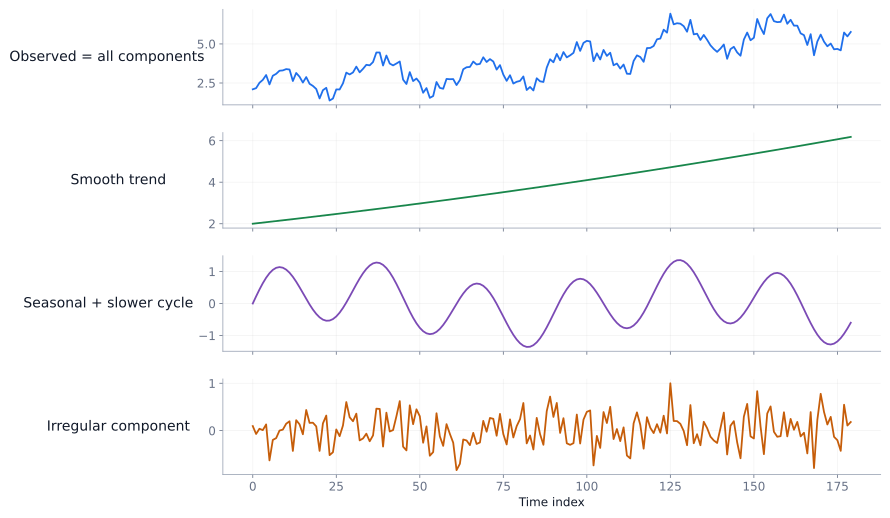

The components are modeling choices, not automatically identifiable features of every signal.

## Signal processing {.section-break}

Part III

Signal processing

We now see how we can smooth, filter, and decompose time-series measurements.

## Smoothing: what should survive? {.concept-slide}

<strong>Signal</strong>Structured variation relevant to the scientific question.

<strong>Noise</strong>Variation we hope to attenuate, which may itself contain meaningful events.

<strong>Trade-off</strong>Aggressive smoothing erases sharp peaks and can bias maxima or event timing.

Choose a smoother with the scientific endpoint in mind, not only how pleasing the final curve looks.

## Moving average {.concept-slide}

  

  
$\widehat y_t=\dfrac{1}{2k+1}\sum_{j=-k}^{k}y_{t+j}$

<strong>Window width</strong>A wider window attenuates short-term fluctuation.

<strong>Cost</strong>Sharp peaks flatten; edge values need special handling.

A simple local average is not a regression model for the underlying mechanism.

  

  

  

  <video data-autoplay muted loop playsinline>
  <source src="media/MovingAverageWindow.mp4" type="video/mp4">
  </video>
  

  

  <!-- Empty intentionally, to preserve alignment -->
  

  

## Savitzky–Golay / LOESS: local polynomial fitting {.concept-slide}

  

  

<strong>Within each window</strong>Fit a low-degree polynomial to nearby observed points.

<strong>At the window center</strong>Use the fitted central value; then slide the window.

<strong>In practice</strong>Retains local peaks and derivatives better than a boxcar average in many settings.

Polynomial degree must be smaller than the odd window length; excessive degree may overfit noise.

  

  

  

  <video data-autoplay muted loop playsinline>
  <source src="media/SavitzkyGolayMovingWindow.mp4" type="video/mp4">
  </video>
  

  

  

  

  
  
Marcel J.E. Golay

  

  

  
  
William S. Cleveland

  

  

  

  

## Smoothing splines: let curvature cost something {.concept-slide}

  

  
$\min_f\;\sum_i (y_i-f(t_i))^2 + \lambda\!\int [f\prime\prime(t)]^2\,dt$

<strong>Small λ</strong>Fit follows data more closely; can appear jagged.

<strong>Large λ</strong>Favors less curvature; approaches a straight line.

<strong>Natural boundaries</strong>The second derivative vanishes at the endpoints; slope need not vanish.

  

  

  

  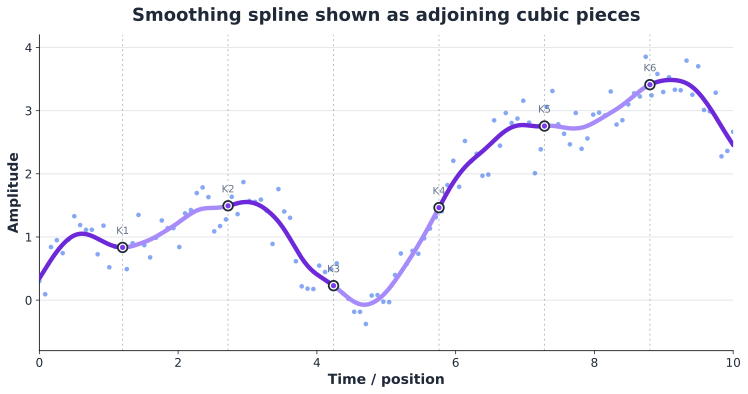
  

  

  

  

  
  
Isaac Jacob Schoenberg

  

  

  
  
Grace Wahba

  

  

  

  

## Lab: compare smoothing methods on the same data {.concept-slide}

<label class="w11-control">Method<select id="smMethod"><option value="mean">Moving average</option><option value="sg">Savitzky–Golay</option><option value="spline">Smoothing spline</option></select></label><label class="w11-control">Odd window size <strong id="smWindowV">7</strong><input id="smWindow" type="range" min="3" max="21" value="7" step="2"></label><label class="w11-control">Polynomial degree <strong id="smDegreeV">3</strong><input id="smDegree" type="range" min="1" max="4" value="3" step="1"></label><label class="w11-control">Curvature penalty (log₁₀ λ) <strong id="smLambdaV">-1</strong><input id="smLambda" type="range" min="-4" max="3" value="-1" step="0.25"></label>
<button class="w11-btn " id="smGcv" type="button">Choose λ by GCV</button><button class="w11-btn secondary" id="smNew" type="button">New data</button>

Spline panel uses a finite-difference curvature penalty, a close discrete analogue; GCV selects its penalty.

<svg id="smoothSvg" class="w11-svg" viewBox="0 0 900 460" style="height:13em" aria-label="Compare moving average, local polynomials and curvature smoothing"></svg>

Method<strong id="smMethodOut">—</strong>

RMSE to truth<strong id="smRmseOut">—</strong>

Selected λ<strong id="smLambdaOut">—</strong>

## Filtering asks a different question {.concept-slide}

<strong>Smoothing</strong>Attenuate fluctuations locally or by roughness penalty.

<strong>Fourier view</strong>Express the signal as a superposition of frequencies.

<strong>Filtering</strong>Keep or attenuate frequency ranges, then reconstruct.

A sudden event spreads energy across frequencies; suppressing high frequencies can blur clinically important spikes.

  

  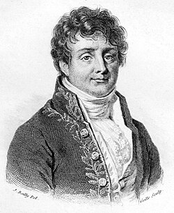
  
Joseph Fourier

  

## A signal can be made from sinusoidal parts {.concept-slide}

$y(t)=\sum_j A_j\sin(2\pi f_jt+\phi_j)$

<strong>Amplitude <em>A</em></strong>Controls how strong a component is.

<strong>Frequency <em>f</em></strong>Controls cycles per unit time.

<strong>Phase <em>ϕ</em></strong>Shifts the component through time; magnitude need not change.

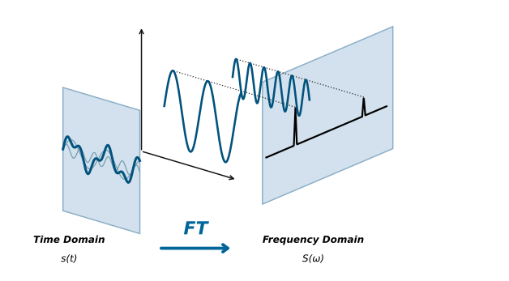

## Lab: a Fourier magnitude spectrum {.concept-slide}

  

  <label class="w11-control">Component 1 amplitude <strong id="ftA1V">2</strong><input id="ftA1" type="range" min="0" max="3" value="2" step="0.1"></label>
  <label class="w11-control">Component 1 frequency <strong id="ftF1V">3</strong><input id="ftF1" type="range" min="1" max="15" value="3" step="1"></label>
  <label class="w11-control">Component 1 phase <strong id="ftP1V">0</strong><input id="ftP1" type="range" min="0" max="6.28" value="0" step="0.2"></label>
  <label class="w11-control">Component 2 amplitude <strong id="ftA2V">1.2</strong><input id="ftA2" type="range" min="0" max="3" value="1.2" step="0.1"></label>
  <label class="w11-control">Component 2 frequency <strong id="ftF2V">8</strong><input id="ftF2" type="range" min="1" max="15" value="8" step="1"></label>
  <label class="w11-control">Component 2 phase <strong id="ftP2V">1.2</strong><input id="ftP2" type="range" min="0" max="6.28" value="1.2" step="0.2"></label>
  

  

  <svg id="fourierSvg" class="w11-svg" viewBox="0 0 900 460" style="height:14em" aria-label="Wave components and discrete Fourier magnitudes"></svg>
  

  
Dominant frequency<strong id="ftDom">—</strong>

  
Peak magnitude<strong id="ftMag">—</strong>

  

  

## Frequency-selective filtering {.concept-slide}

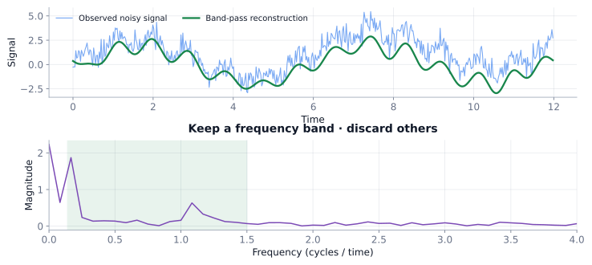

Remove unwanted bands, but beware of losing slow biological trends or fast clinically meaningful transients.

## The measurement system can blur hidden events {.concept-slide}

Convolution: an instrument response shapes what we see

$y(t)=(x*h)(t)+\varepsilon(t)$

<strong>Hidden input <em>x</em></strong>A neural impulse or narrow chromatographic peak.

<strong>Response <em>h</em></strong>A slower hemodynamic or instrument impulse response.

<strong>Observed <em>y</em></strong>Overlapping, blurred responses plus noise.

## Deconvolution: reconstruct, never magically undo {.concept-slide}

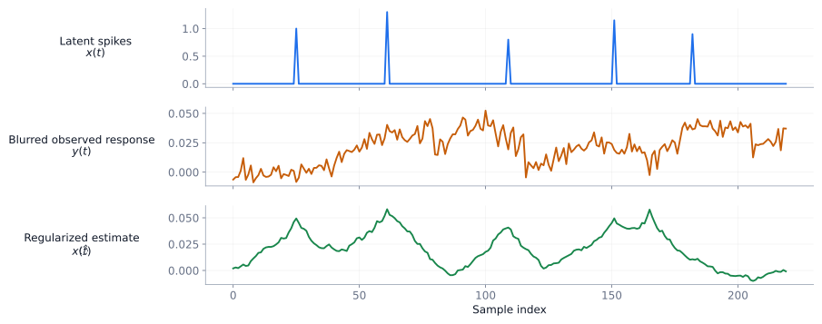

Regularization is required because division by a near-zero Fourier component amplifies noise. Exact millisecond timing cannot generally be recovered from a slow fMRI signal.

## Survival analysis {.section-break}

Part IV

Survival analysis

We now see how lifetime expectancy can be estimated.

## A different time question: time until an event {.concept-slide}

<strong>Event</strong>Death, relapse, adverse effect, or another defined endpoint.

<strong>Start time</strong>Diagnosis, first dose, randomization or enrollment.

<strong>Complication</strong>Some people have not had an event by their last known follow-up.

Survival analysis is about <strong>time to event</strong>, not necessarily death.

## Censoring differs from truncation {.concept-slide}

Mechanism

What is known?

Right censor

Event time exceeds the final observation time. We only know the event time is greater than the last known check.

Left censor

Event happened before the first reliable observation.

Interval censor

Event happened in between two inspection or check-in times, rather than at a precise timestamp.

Left truncation

Observations below a certain threshold are left out of the sample.

Right truncation

Observations above a certain threshold are excluded from the dataset.

Censoring is <em>partial</em> information: the subject is included in the study, but the exact time of the event is unknown; we only know that the event happened within a certain range or relative to a specific point.

With truncation, data points outside a specific range are <em>completely excluded</em> from the dataset; if an observation is truncated, we do not even know it exists.

## What timelines actually look like {.concept-slide}

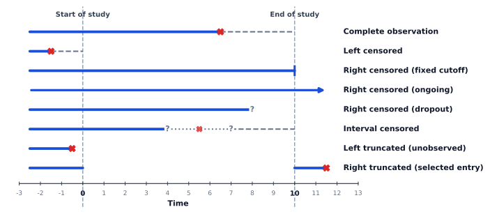

Cross: observed event; tick: right censor; other rows show differing information/selection mechanisms.

## Kaplan–Meier: multiply conditional survival {.concept-slide}

$\widehat S(t)=\prod_{t_i\le t}\left(1-\dfrac{d_i}{r_i}\right)$

<strong style="font-size:120%">$r_i$</strong>Number still at risk immediately before event time $t_i$.

<strong style="font-size:120%">$d_i$</strong>Number with the event at that time.

<strong style="font-size:120%">$1-d_i/r_i$</strong>Probability of surviving this event time, conditional on the risk set.

Right censoring reduces subsequent risk sets but does not itself cause a drop in the KM curve.

  

  
  
Edward L. Kaplan

  

  

  
  
Paul Meier

  

  

  
  
Wayne Nelson

  

  

  
  
Odd Aalen

  

## Work out the first few KM steps {.concept-slide}

Time

At risk&nbsp;$r_i$

Events&nbsp;$d_i$

Censored&nbsp;$c_i$

Conditional factor

Cumulative&nbsp;$\hat S(t)$

Month 1

8

1

0

$7/8$

$7/8 = 0.875$

Month 2

7

2

1 (right censored)

$5/7$

$(7/8)(5/7)=0.625$

Month 3

4

1

0

$3/4$

$0.625(3/4)=0.469$

Illustrative risk sets: one person was censored after month 2 but before month 3. The product gives cumulative survival.

## Compare two Kaplan–Meier curves {.concept-slide}

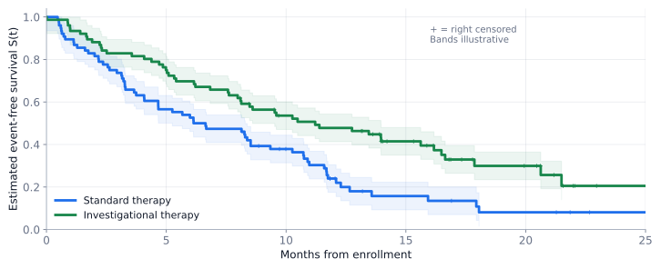

Hypothetical therapies; right-censor marks (+). Confidence bands are schematic, not formal Greenwood bands.

## A survival plot does not by itself prove a difference {.concept-slide}

<strong>Visual evidence</strong>Step heights and separation suggest differences in event timing.

<strong>Inference</strong>A log-rank test or Cox model addresses a defined comparison.

<strong>Limitations</strong>Censoring, competing events and non-proportional hazards matter.

Median survival is the first time at which estimated $S(t)$ reaches or falls below $0.5$; it may be unreached.

## Hazard: the danger conditional on survival {.concept-slide}

$h(t)=\lim_{\Delta t\to0}\dfrac{\mathbb{P}(t\le T<t+\Delta t\mid T\ge t)}{\Delta t}$

<strong>Survival</strong>$S(t)$: Probability event time is later than $t$.

<strong>CDF</strong>$1-S(t)$: Probability the event has occurred by $t$.

<strong>Hazard</strong>$h(t)$: An instantaneous conditional event rate (probability density), not a probability.

Intuition: While the survival function tells us the probability of making it past a certain point, the hazard function tells us how intense the danger is at that moment, given that we have survived up to that moment.

## Hazard can rise, fall, or stay constant {.concept-slide}

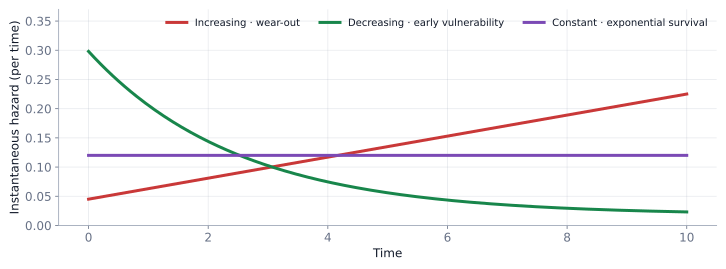

Illustrative mechanisms: wear-out, early vulnerability, and memoryless exponential survival.

## The area under survival measures time {.concept-slide}

$E[T]=\int_0^\infty S(t)\,dt$

Mean or expected survival time is <strong>life expectancy</strong>.

With incomplete follow-up, <strong>restricted mean survival time</strong> (RMST) integrates only to a prespecified horizon $\tau$.

<strong>Survival</strong>How much of the population remains event-free?

<strong>Hazard</strong>How intense is the instantaneous event rate?

## Survival curves can also be modeled parametrically {.concept-slide}

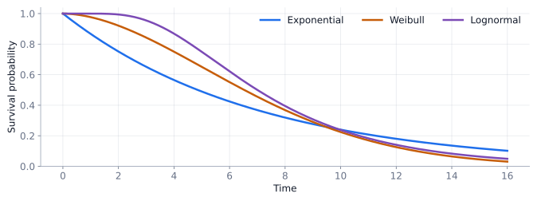

Different distributions imply different time-dependent hazards. Model choice is substantive, not decorative.

## Cox regression keeps baseline hazard flexible {.concept-slide}

$h(t\mid x)=h_0(t)\exp(\beta_1x_1+\cdots+\beta_px_p)$

<strong>Baseline hazard</strong>Time-changing hazard at the reference covariate profile.

<strong>Exponential multiplier</strong>Covariates multiply the instantaneous hazard.

<strong>Primary assumption</strong>Covariate hazard ratios are constant over time in a proportional-hazards model.

  

  
  
David Cox

  

## Same changing baseline; different hazard multipliers {.concept-slide}

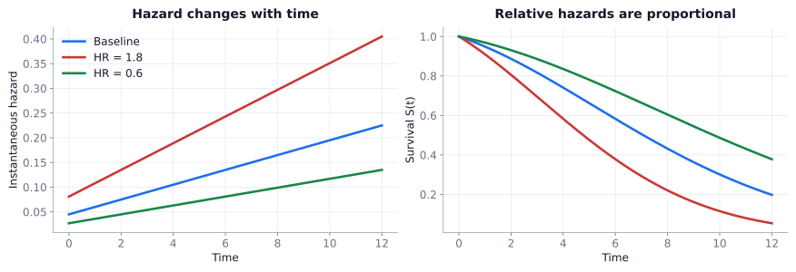

Hazard ratio 1.8 means 80% higher instantaneous hazard (at a given time), not 80% higher probability of an event.

Baseline hazard $h_0(t)$: general instantaneous hazard, applies to reference covariate profile

Hazard ratio $e^{\beta_i}$: $+1$ unit increase in $x_i$ multiplies baseline hazard by this much.

Proportional hazards assumption: if smoking increase instantaneous hazard by 2× at 40 years of age, it must also increase it by 2× at 60 years of age. The absolute amount of danger may change over time if baseline hazard changes, but the relative difference between the groups is locked in parallel.

## What if proportional hazards fails? {.concept-slide}

<strong>Check</strong>Curves and diagnostics may suggest time-varying effects.

<strong>Alternatives</strong>Time-varying coefficients, stratified Cox, or accelerated failure-time models.

<strong>Scope</strong>These are honorable mentions; learn the interpretation of HR and KM first.

## Prediction {.section-break}

Part V

Prediction

We now see how data can enable us to predict missing values.

## Missing values: fit the observed, then predict {.concept-slide}

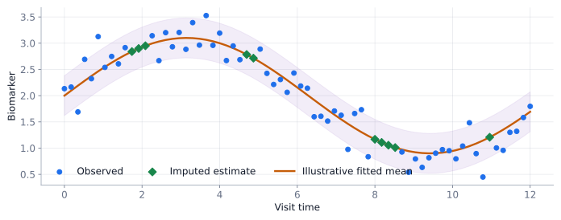

Predictions are estimates, not newly observed patient measurements. Imputation uncertainty must be represented for formal inference.

## No simple formula for the response curve? {.concept-slide}

Gaussian-process regression

  

  

<strong>A function prior</strong>We describe possible response curves with a mean and covariance kernel.

<strong>Nearby experiments</strong>Can be more similar under a smooth kernel; different kernels encode different beliefs on smooth/jagged/periodic functions.

<strong>Posterior</strong>Each new measurement updates both mean prediction and uncertainty.

  

  

  

  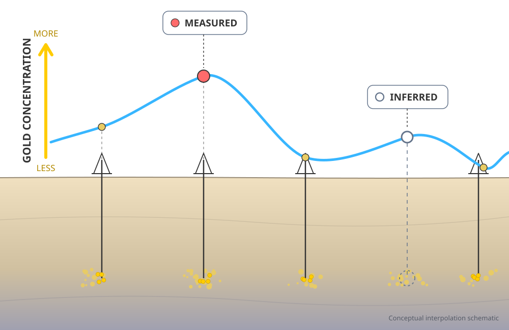
  

  

  

  

  
  
Danie G. Krige

  

  

  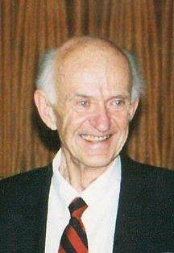
  
Jonas Mockus

  

  

  

  

## Lab: the next experiment reduces uncertainty {.concept-slide}

<label class="w11-control">Kernel length scale <strong id="gpLengthV">1.2</strong><input id="gpLength" type="range" min="0.3" max="3.5" value="1.2" step="0.1"></label><label class="w11-control">Acquisition score<select id="gpAcq"><option value="unc">Maximum uncertainty</option><option value="ucb">Mean + 1.5 × SD</option></select></label>
<button class="w11-btn " id="gpSuggest" type="button">Suggest next x</button><button class="w11-btn secondary" id="gpReset" type="button">Clear samples</button>

Click anywhere within the plot to sample that experimental condition. Synthetic truth is visible faintly as a teaching aid; an experimenter would not know it.

<svg id="gpSvg" class="w11-svg" style="height:15em" viewBox="0 0 900 460" aria-label="Gaussian-process predictive mean and uncertainty on sampled x locations"></svg>

Samples<strong id="gpN">—</strong>

Latest sample<strong id="gpLast">—</strong>

Suggested x<strong id="gpNext">—</strong>

## Prediction can help plan the next experiment {.concept-slide}

<strong>Explore</strong>Sample where uncertainty is largest.

<strong>Exploit</strong>Sample where predicted outcome is promising.

<strong>Balance</strong>An acquisition function scores where the next measurement may be most useful.

This is the intuition behind Bayesian optimization. It is <strong>not</strong> guaranteed to find the optimum from a handful of observations.

## What if the process moves between discrete states? {.concept-slide}

Nosocomial infection example

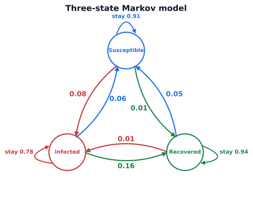

A Markov model represents transition probabilities among susceptible, infected and recovered states. Arrows are illustrative daily probabilities.

## The Markov property {.concept-slide}

$\mathbb{P}(X_{t+1}=j\mid X_t=i,\mathrm{history})=\mathbb{P}(X_{t+1}=j\mid X_t=i)$

<strong>Memoryless</strong>Given today’s state, yesterday adds no predictive information in this model.

<strong>Transition matrix</strong>Each row lists possible next states; row probabilities sum to 1.

<strong>Not universal</strong>Real infection history and immunity may require richer states or models.

## Lab: follow one patient through a Markov chain {.concept-slide}

<button class="w11-btn " id="mkDay" type="button">Tomorrow</button><button class="w11-btn secondary" id="mkTen" type="button">+10 days</button><button class="w11-btn secondary" id="mkReset" type="button">Reset patient</button>

Current patient path is sampled stochastically. The bars display the theoretical population-state distribution after the same number of steps.

<svg id="markovSvg" class="w11-svg" style="height:15em" viewBox="0 0 900 460" aria-label="Markov transition simulation and state probabilities"></svg>

Day<strong id="mkDayOut">—</strong>

Patient state<strong id="mkState">—</strong>

Long-run probability of infection<strong id="mkStable">—</strong>

## Repeated matrix multiplication {.concept-slide}

$\boldsymbol\pi_{t+1}=\boldsymbol\pi_t \mathbb{P}$

<strong>Starting distribution</strong>$\boldsymbol\pi_0=(1,0,0)$: all initially susceptible.

<strong>Next day</strong>$\boldsymbol\pi_1=\boldsymbol\pi_0 \mathbb{P}$.

<strong>Long run</strong>If the chain is irreducible and aperiodic, distributions converge to a stationary vector.

## A tiny Markov model can even generate text {.concept-slide}

<strong>Training</strong>Count which word follows which in a small public-domain-style toy vocabulary.

<strong>Generation</strong>Draw each next token using the transition probabilities of the current token.

<strong>Limit</strong>Local transitions are not genuine understanding or long-context language modeling.

  
Sample Training Verses

  

  the soft night holds the silver stars
  the silent river follows the moon
  the green river hears the distant rain
  the stars rest above the sleeping garden
  a soft wind crosses the open field
  night draws a curtain over the river
  the distant hills remember summer light
  soft shadows follow quiet footsteps
  river water gathers beneath the moon
  the night folds around the quiet stars
  stars in the river move with the tide
  the wind whispers through the silver trees
  soft light returns beyond the hills
  the river carries echoes of the night
  green leaves sway when the wind wakes
  the sleeping garden waits for morning light
  

## Lab: a very small text generator {.concept-slide}

<label class="w11-control">Starting word<select id="wordStart"><option value="the">the</option><option value="night">night</option><option value="soft">soft</option><option value="river">river</option><option value="stars">stars</option></select></label>
<button class="w11-btn " id="wordGenerate" type="button">Generate new verse</button><button class="w11-btn secondary" id="wordReset" type="button">Reset</button>

Offline miniature transition table only; not trained on 1,000 actual poems or on proprietary text.

<svg id="wordSvg" class="w11-svg" viewBox="0 0 900 460" aria-label="Simple next-word Markov text generation"></svg>

Tokens<strong id="wordTokens">—</strong>

Unique words<strong id="wordUnique">—</strong>

Generated Verse

Select a starting word and generate.

## The common framework {.concept-slide}

What is changing?

Method introduced

Crucial caution

Repeated values

Longitudinal summaries / correlation

Do not treat every visit as independent

Signal shape

Smoothers / frequency analysis

Removing noise can also remove signal

Time to event

Kaplan–Meier / Cox

Censoring and hazard ≠ probability

Unknown response function

Gaussian process

Kernel assumptions control prediction

Discrete evolving states

Markov chain

Current-state sufficiency is an assumption

## Exercise 1: the repeated-measures trap {.concept-slide}

Blood pressure is recorded six times per patient. Which analysis is invalid if it ignores within-person dependence?

<button type="button" class="w11-choice" data-choice="A">A. Treat all readings as independent patients</button><button type="button" class="w11-choice" data-choice="B">B. Prespecify and compare one patient-level summary</button><button type="button" class="w11-choice" data-choice="C">C. Fit a model that accounts for patient clustering</button>

Choose one response.

## Exercise 2: a time-to-event misconception {.concept-slide}

At month 6, a subject has not had the event but leaves the study. In a standard KM analysis they are…

<button type="button" class="w11-choice" data-choice="A">A. Counted as an event at month 6</button><button type="button" class="w11-choice" data-choice="B">B. Right censored at month 6</button><button type="button" class="w11-choice" data-choice="C">C. Excluded from every earlier risk set</button>

Choose one response.

## Exercise 3: the wrong interpretation {.concept-slide}

Cox regression reports HR = 1.5. Which statement is best?

<button type="button" class="w11-choice" data-choice="A">A. Instantaneous event hazard is 50% greater, conditional on the model</button><button type="button" class="w11-choice" data-choice="B">B. The 10-year event probability is exactly 50% greater</button><button type="button" class="w11-choice" data-choice="C">C. Average survival time is exactly 50% shorter</button>

Choose one response.

## Exercise 4: what does more data buy? {.concept-slide}

Why can a new Gaussian-process measurement be particularly useful near an unsampled region?

<button type="button" class="w11-choice" data-choice="A">A. It guarantees the global optimum</button><button type="button" class="w11-choice" data-choice="B">B. It can reduce posterior uncertainty nearby, depending on the kernel</button><button type="button" class="w11-choice" data-choice="C">C. It eliminates the need to make any correlation assumptions</button>

Choose one response.

## Week 11 in one sentence {.concept-slide}

Model what time does to <strong>dependence, uncertainty, event occurrence, and prediction</strong>.

<strong>Trajectory</strong>Summarize intelligently

<strong>Dependence</strong>Respect correlation

<strong>Survival</strong>Honor censoring

<strong>Prediction</strong>Show uncertainty

## Next: Week 12 {.concept-slide}

From structured models to learning from many variables

<strong>Multivariate structure</strong>Principal components, factors and clustering.

<strong>Prediction</strong>Generalization, validation and model capacity.

<strong>Machine learning</strong>A wider collection of methods, not a replacement for statistical reasoning.

The last week asks: when patterns are high-dimensional, how can models learn without fooling us?

