## Multivariate statistics &amp; machine learning {.title-slide}

Week 12 · final lecture

How do we reason when <strong>many variables act simultaneously</strong>?

## Imagine 200 patients × 2,500 metabolites {.concept-slide}

LC–MS · hypothetical metabolomics study

<strong>Rows: 200 patients</strong>Mild cognitive impairment at baseline; prospective follow-up.

<strong>Columns: 2,500 metabolites</strong>Mass-spectrometry signals, intensities and derived features.

<strong>Outcome: progression</strong>Could a metabolic fingerprint help predict Alzheimer’s progression over 3 years?

## The dimensionality is in the variables {.concept-slide}

High dimension ≠ extra physical dimensions

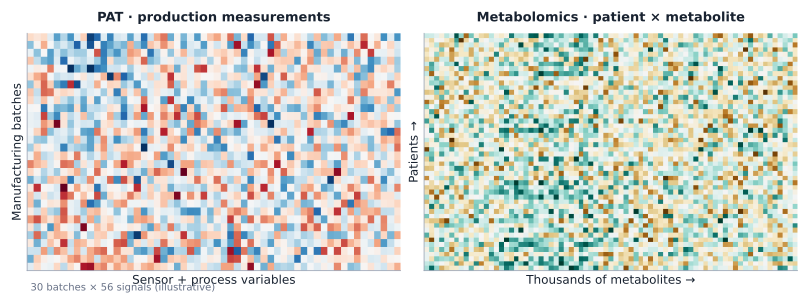

Every column is an distinct measurement type/variable (but might be statistically correlated); every row is a sampled observational unit.

## Process analytical technology: why we care {.concept-slide}

Industrial pharmaceutical applications

<strong>Raw material fingerprints</strong>Composition, supplier and batch variability.

<strong>Process conditions</strong>Temperature, pressure, flow, particle size, spectroscopy.

<strong>Quality prediction</strong>Potentially detect emerging deviations before a batch is lost.

Too many measurements for a single-variable scatter plot.

## Two different statistical paradigms {.concept-slide}

<!-- Top Row: Paradigm Shift (Modeling vs. Prediction) -->

  

  
Until Last Week

  <strong>Statistical Estimation & Modeling</strong>
  <strong style="font-size:120%">Goal:</strong> Explain mechanisms & test hypotheses.
  Inference, parameters, confidence intervals, and interpretability.
  

  

  
This Week

  <strong>Statistical Learning & Prediction</strong>
  <strong style="font-size:120%">Goal:</strong> Predict outcome on unseen data.
  Focuses on generalization and predictive accuracy, often trading off interpretability.
  

<!-- Bottom Section Label -->

  Statistical Learning splits into two primary paradigms:

<!-- Bottom Row: Learning Types (Unsupervised vs. Supervised) -->

  

  
1: Unsupervised Learning

  <strong>Structure Discovery</strong>
  Analyze features ($X$) without target labels ($Y$). How many useful dimensions? Are samples similar? Are there clusters?
  

  PCAUMAPClustering
  

  

  

  
2: Supervised Learning

  <strong>Outcome Prediction</strong>
  Map features to labeled targets ($X \rightarrow Y$). Can measured features predict a future or unknown outcome?
  

  LDA / PLSDecision TreesNeural Networks
  

  

## Multivariate distributions {.section-break}

Part II

Multivariate data

We now see what these high dimensional data look like.

## The challenge of high-dimensional data {.concept-slide}

Many variables · few patients

<strong>n = 200 patients</strong>How much independent information can we learn?

<strong>p = 2,500 variables</strong>Correlations, multiple comparisons and overfitting multiply.

<strong>Need parsimonious structure</strong>Dimension reduction, regularization and honest validation.

## First, what does a distribution look like? {.concept-slide}

Two jointly continuous variables

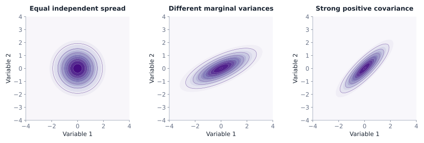

A multivariate Normal distribution has a mean vector and covariance matrix. Covariance controls the orientation of its elliptical contours.

## Lab: rotate a multivariate density {.concept-slide}

Interactive · change spread and correlation

<label class="w12-control">distribution<select id="gaussMode"><option value="normal">one bivariate Normal</option><option value="mixture">two latent groups (mixture)</option></select></label><label class="w12-control">SD of X <strong id="gaussSxVal">1.30</strong><input id="gaussSx" type="range" min="0.5" max="2.0" step="0.05" value="1.30"></label><label class="w12-control">SD of Y <strong id="gaussSyVal">0.90</strong><input id="gaussSy" type="range" min="0.5" max="2.0" step="0.05" value="0.90"></label><label class="w12-control">correlation ρ <strong id="gaussRhoVal">0.45</strong><input id="gaussRho" type="range" min="-0.9" max="0.9" step="0.05" value="0.45"></label>
Drag the SVG to rotate the density surface. The two-group mixture is not a single Gaussian.

<svg class="w12-svg rotate w12-gauss-main" id="gaussSvg" viewBox="0 0 900 490" style="height:10em" aria-label="Interactive rotatable bivariate density surface"></svg>

Top-down view · 200 sampled points and density contours
<svg class="w12-svg w12-gauss-map" id="gaussScatterSvg" style="height:8em" viewBox="0 0 900 290" aria-label="Synchronized top-down scatter plot and density contours"></svg>

## A mixture is not one Gaussian {.concept-slide}

The difference matters for interpretation

<strong>Single multivariate Normal</strong>One mode with covariance-defined elliptical contours.

<strong>Gaussian mixture</strong>Two or more latent subpopulations create a weighted combination of densities.

<strong>Beware hidden groups</strong>A large overall covariance can be produced by mixing dissimilar populations.

## What can pair plots still show? {.concept-slide}

Diagonal = distribution · below = association · above = coefficient

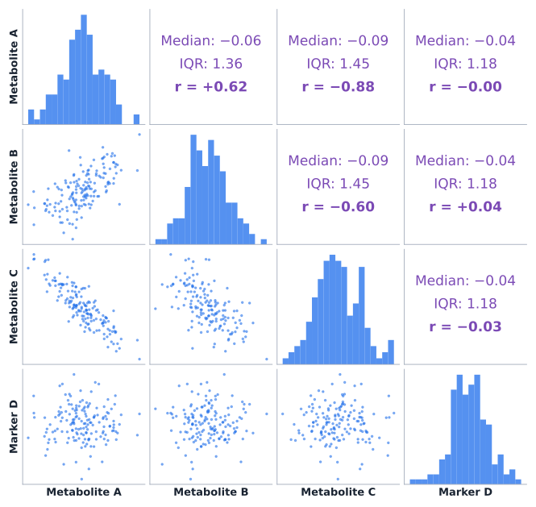

Pairs plots remain useful for a modest number of variables; with 2,500 columns there are over three million distinct variable pairs.

## Curse of dimensionality {.concept-slide}

Distance and density become harder to interpret

<strong>Distances may concentrate</strong>Nearest and farthest points become harder to distinguish in some high-dimensional settings.

<strong>Scaling determines geometry</strong>A variable measured in large numerical units may dominate ordinary Euclidean distance.

<strong>Assumptions still matter</strong>Feature selection, domain knowledge and task-specific metrics remain essential.

## Not every “distance” asks the same question {.concept-slide}

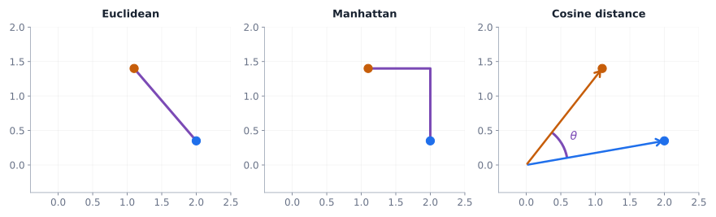

<strong>Euclidean</strong>Straight-line difference between standardized numerical profiles.

<strong>Manhattan</strong>Absolute coordinate differences; emphasizes per-feature offsets.

<strong>Cosine</strong>Difference of directions; useful for spectral profile shapes.

## Fingerprint overlap: Tanimoto similarity {.concept-slide}

Binary chemical fingerprints · bits for structural features

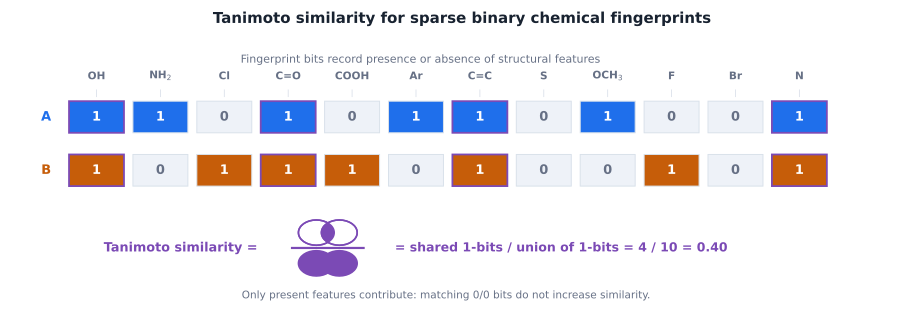

For binary fingerprints, the Tanimoto coefficient equals Jaccard similarity: number of features present in both divided by features present in at least one. Distance is one minus similarity.

## Between groups: what does “close” mean? {.concept-slide}

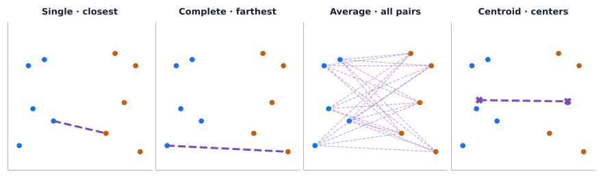

Single, complete, average and centroid linkages answer different questions. They may generate different hierarchical cluster trees.

## A covariance-aware distance {.concept-slide}

Mahalanobis distance

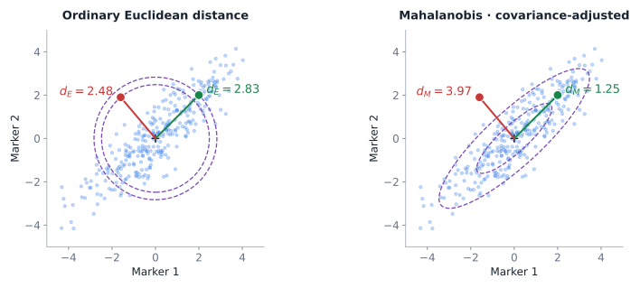

$d_M(x,\mu)=\sqrt{(x-\mu)^T\Sigma^{-1}(x-\mu)}$

Different directions in the cloud are not equally surprising. A 2,500-variable covariance matrix cannot be inverted naively with only 200 patients.

## A pharmaceutical distance problem {.concept-slide}

Identity checks · sample against chemical reference standard

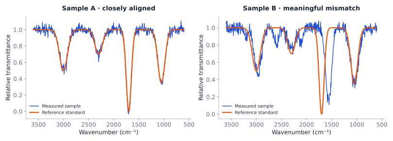

Spectral comparison needs baseline correction, alignment, appropriate scaling, and a similarity criterion. A metric threshold is not automatic proof of identity.

## Multivariate tests exist—briefly {.concept-slide}

<strong>Student t test</strong>Compares one measured outcome.

<strong>Hotelling T²</strong>Tests a multivariate mean difference under stronger covariance assumptions.

<strong>Our focus</strong>Pattern recognition and prediction, not a catalogue of advanced multivariate tests.

With more variables than patients, the usual covariance estimate is singular; regularized approaches are needed.

  

  
  
Harold Hotelling

  

  

  
  
P.C. Mahalanobis

  

## Unsupervised learning {.section-break}

Part III

Unsupervised learning

We now see how we can extract patterns from data.

## Before pattern recognition: numerical scales are not neutral {.concept-slide}

Data preprocessing slide · required for a meaningful multivariate comparison

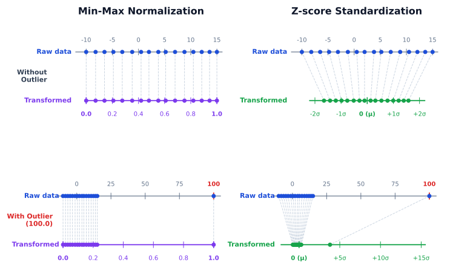

Without scaling, high-variance units often dominate even when they are not scientifically more informative.

## Two common scaling approaches {.concept-slide}

Transformation is not the same as dimension reduction

<strong>Min–max normalization</strong>$x^{*}=(x-\min x)/(\max x-\min x)$ · maps observed data range to 0–1.

<strong>Z-score standardization</strong>$z=(x-\bar x)/s$ · centers at 0 with SD 1.

## PCA: find a new axis system {.concept-slide}

Principal component analysis · unsupervised

<strong>Inputs</strong>A table of standardized metabolite intensities.

<strong>Orthogonal directions</strong>PC1 captures the greatest remaining variance; PC2 is orthogonal and captures the next greatest.

<strong>Outputs</strong>New score coordinates for patients + loadings describing each original variable.

## PCA is blind to disease labels {.concept-slide}

Variance ≠ class separation

<strong>Wrong objective</strong>"Choose the 2D view with the greatest separation between sick and healthy patients" is not PCA’s optimization goal.

<strong>Correct objective</strong>Choose orthogonal directions with maximal retained data variance.

<strong>Possible consequence</strong>Class separation can emerge—but it can also hide in a low-variance direction.

Principal components are linear combinations of original variables and might not be interpretable, e.g. $\mathrm{PC_1} = 0.316 \, \mathrm{weight} + 0.947 \, \mathrm{hemoglobin} - 0.053 \, \mathrm{age}$, and keep in mind the original variables have already been z-score scaled.

## Lab: rotate and find principal directions {.concept-slide}

3D → 2D projection with unknown group labels

Rotate the three-dimensional point cloud. Try to retain maximum spread in your two-dimensional view; then reveal the mathematically optimal PCA plane.

<button class="w12-btn" type="button" id="pcaShow">Show PCA</button><button class="w12-btn secondary" type="button" id="pcaReset">Explore again</button>

Variance retained in current 2D view<strong id="pcaVar">—</strong>

View<strong id="pcaPlane">Custom viewpoint</strong>

Synthetic standardized hemoglobin, age and weight. The labels of underlying clouds are deliberately hidden.

<svg id="pcaSvg" class="w12-svg rotate" style="height: 16em" viewBox="0 0 900 480" aria-label="Rotatable PCA point-cloud projection and variable loading vectors"></svg>

## A metabolomics PCA workflow {.concept-slide}

<strong>Prepare</strong>Quality control; handling below-detection measurements

<strong>Transform</strong>Appropriate intensity transform + training-only scaling

<strong>Project</strong>Compute PC scores and loadings

<strong>Interpret</strong>Check batch effects, biology and external datasets

If PC1 separates instrument batches rather than patients, it may be revealing an unwanted technical artifact.

Explained variance: PCA compresses a dataset by sacrificing some of its variation. The lost variation can still contain clinically relevant information.

## Beyond straight-line projections {.concept-slide}

Neighborhood-based nonlinear dimension reduction

<strong>PCA</strong>Linear projections; emphasizes global variance.

<strong>UMAP / related approaches</strong>Seek neighborhood structure in a lower-dimensional map; adjustable neighborhood and spacing parameters.

<strong>Projection ≠ proof</strong>The exact shape, distances, and apparent clusters depend on method and settings.

  

  
  
Teuvo Kohonen

  

## UMAP Lab: Neighborhoods can reshape a projection {.concept-slide}

Interactive UMAP illustration

<label class="w12-control">n_neighbors
<select id="nonlinK">
<option value="15">15 nearest neighbors</option>
<option value="50" selected>50 nearest neighbors</option>
<option value="200">200 nearest neighbors</option>
</select>
</label>

<strong>min_dist = 0.25</strong> (fixed). Rotate the 3D mammoth on the left; watch how different UMAP neighborhoods change its 2D representation on the right.

The colors identify corresponding observations. The 2D layout and apparent gaps depend on UMAP settings.

Data and visual idea adapted from <a href="https://github.com/PAIR-code/understanding-umap" target="_blank" rel="noopener">PAIR / Understanding UMAP</a> (Apache-2.0). Based on a <a href="https://3d.si.edu/object/3d/mammuthus-primigenius-blumbach:341c96cd-f967-4540-8ed1-d3fc56d31f12" target="_blank" rel="noopener">Smithsonian 3D mammoth scan</a>. Offline, subsampled, independently precomputed embeddings.

<svg id="nonlinearSvg" class="w12-svg rotate" style="height: 16em" viewBox="0 0 900 470" aria-label="Rotatable three-dimensional mammoth at left and real UMAP projections at right"></svg>

## Application to molecular spaces {.concept-slide}

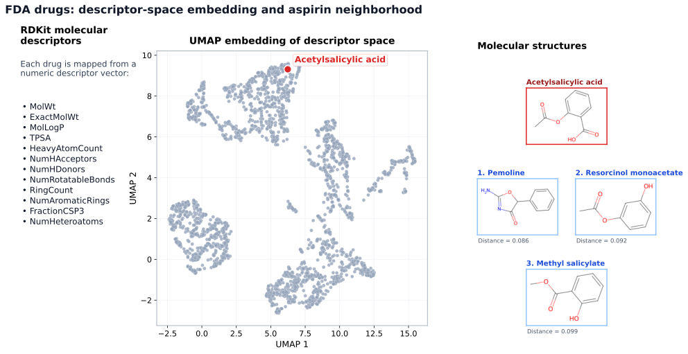

## From compressed data to discovered groups {.concept-slide}

Unsupervised clustering

<strong>Input</strong>Data with no known class labels.

<strong>Algorithm</strong>Defines a notion of same-group membership.

<strong>Output</strong>An assigned partition or cluster probabilities—not verified clinical diagnoses.

Look at 3 algorithms.

<strong>K-means</strong> assumes compact groups: minimizes within-cluster squared Euclidean distances from centroids.

<strong>Gaussian mixture</strong> is a probability model: estimates mean, covariance and mixture weight for each component.

<strong>DBSCAN</strong> looks at nearby density: observations within a chosen neighborhood radius and high density grow into clusters; does not require a predefined number of clusters.

## Lab: three ways to find clusters {.concept-slide}

K-means, Gaussian mixture, and density-based clustering

<label class="w12-control">point-cloud geometry<select id="clusterShape"><option value="moons">interlocking curved moons</option><option value="blobs">roughly Gaussian blobs</option></select></label><label class="w12-control">clustering method<select id="clusterMethod"><option value="kmeans">K-means</option><option value="gmm">Gaussian mixture</option><option value="dbscan">DBSCAN (density-based)</option></select></label><label class="w12-control">clusters k = <strong id="clusterKVal">2</strong><input id="clusterK" type="range" min="2" max="5" value="2" step="1"></label><label class="w12-control">DBSCAN radius<select id="clusterEps"><option value="0.14">0.14</option><option value="0.21" selected>0.21</option><option value="0.29">0.29</option><option value="0.38">0.38</option></select></label>

Clusters found<strong id="clusterNum">—</strong>

Noise points<strong id="clusterNoise">—</strong>

<svg id="clusterSvg" class="w12-svg" style="height: 14em" viewBox="0 0 900 470" aria-label="Different clustering partitions of the same point cloud"></svg>

## Clusters are hypotheses, not diagnoses {.concept-slide}

<strong>Technical artifacts</strong>Batch, instrument or site effects can masquerade as biological subtypes.

<strong>Stability</strong>Repeat on different samples and preprocessing choices.

<strong>External validity</strong>Ask whether patterns replicate and predict clinically meaningful outcomes.

## Supervised learning {.section-break}

Part IV

Supervised learning

We now see how algorithms can learn from data.

## Statistical learning: make a useful function {.concept-slide}

From hand-written rules to fitted models

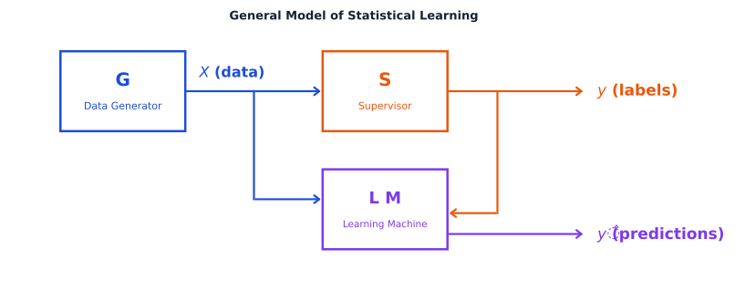

The goal is low expected loss on future observations, not perfect memorization of training measurements.

## Three learning paradigms {.concept-slide}

<strong>Unsupervised</strong>Inputs X without known labels: PCA, clustering, density models.

<strong>Supervised</strong>Labeled pairs (X, Y): classification of disease status or regression of concentration.

<strong>Reinforcement</strong>Sequential actions with feedback and reward; important, but outside this course.

  

  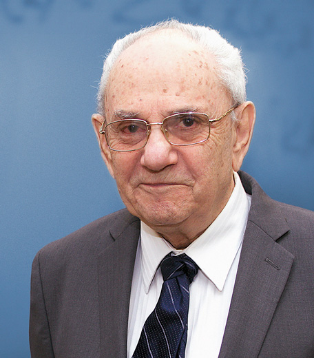
  
Vladimir Vapnik

  

  

  
  
Bradley Efron

  

  

  
  
Robert Tibshirani

  

## What does the model actually learn? {.concept-slide}

$\hat f = \arg\min_{f\in\mathcal F}\left\{\frac{1}{n}\sum_{i=1}^n L(y_i,f(x_i)) + \lambda\,\mathrm{penalty}(f)\right\}$

<strong>Empirical loss</strong>How poorly do predictions agree with labeled training outcomes?

<strong>Model capacity</strong>How flexible is the family of functions?

<strong>Regularization</strong>How strongly should complexity be restrained?

## Keep evaluation honest {.concept-slide}

<strong>Training</strong>Learn fitted parameters

<strong>Validation</strong>Choose settings and features

<strong>Test</strong>One final unbiased check on held-out patients

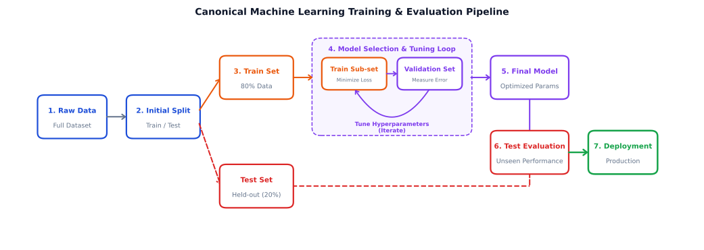

## A common pharmaceutical data leak {.concept-slide}

<strong>Leakage</strong>Scale all 200 patients, use all labels to screen 2,500 metabolites, then split data.

<strong>Correct method</strong>Split first. Fit every learned preprocessing and feature-selection step within training folds.

<strong>Even harder</strong>Related patients, repeated visits and shared batches may require grouped splits.

## Lab: PCA versus LDA — variance is not discrimination {.concept-slide}

Same patients · same three biomarkers · different objective

The three visible clouds are not the groups we want to distinguish. Each cloud contains both <strong>healthy</strong> and <strong>sick</strong> patients. Compare unsupervised PCA against supervised LDA, or drag to explore the 3D data.

<button class="w12-btn" type="button" id="pcaLdaShowPCA">Show PCA</button><button class="w12-btn" type="button" id="pcaLdaShowLDA">Show LDA</button>

Variance in 2D view<strong id="pcaLdaVariance">—</strong>

Visible class separation (Fisher distance)<strong id="pcaLdaSeparation">—</strong>

View: <strong id="pcaLdaView">Custom view</strong>. Classes are <strong>synthetic</strong>, assigned using the low-variance PC3 direction; they are not diagnoses. PCA ignores labels. LDA uses labels to separate classes.

<svg id="pcaLdaSvg" class="w12-svg rotate" style="height: 16em" viewBox="0 0 900 480" aria-label="Rotatable PCA versus LDA projection of the same synthetic cloud with two class labels"></svg>

With two classes, LDA has exactly one discriminant direction (LD1). The vertical <strong>PC1*</strong> direction in the LDA view is only a perpendicular companion axis for visualization, not a second discriminant.

## Decision trees turn thresholds into rules {.concept-slide}

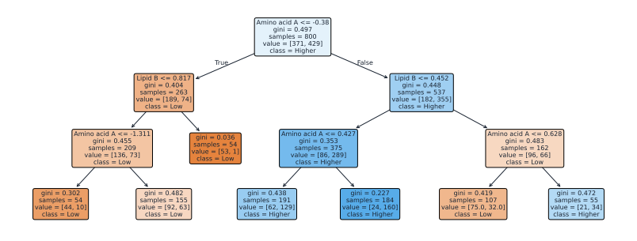

Each internal node chooses a feature and threshold that reduces an impurity criterion, such as Gini impurity or entropy. Terminal nodes predict class proportions.

## Lab: walk down a trained decision tree {.concept-slide}

Synthetic three-biomarker model · changing inputs changes the path

Choose three standardized biomarker values. Press <strong>Predict</strong> to follow the decision rules from the root to one of seven leaves.

<label class="w12-control">Amino acid A = <strong id="treeV0">-0.8</strong><input id="treeF0" type="range" min="-3" max="3" value="-0.8" step="0.1"></label>
<label class="w12-control">Lipid B = <strong id="treeV1">0.3</strong><input id="treeF1" type="range" min="-3" max="3" value="0.3" step="0.1"></label>
<label class="w12-control">Metabolite C = <strong id="treeV2">1.5</strong><input id="treeF2" type="range" min="-3" max="3" value="1.5" step="0.1"></label>

<button id="treePredict" class="w12-btn" type="button">Predict</button>

Predicted class<strong id="treePred">—</strong>

Higher-risk probability<strong id="treeProb">—</strong>

Rules used<strong id="treeDepth">—</strong>

Illustrative classification tree trained on synthetic observations. Leaf percentages are training-set class proportions, not calibrated clinical probabilities.

<svg id="treeSvg" class="w12-svg w12-tree-svg" style="height: 16em" viewBox="0 0 900 515" aria-label="Seven-leaf classification tree, highlighting a patient prediction path step by step" role="img"></svg>

Set values and press Predict.

## A tree can memorize noise {.concept-slide}

The price of highly specific splitting

<strong>Shallow tree</strong>Interpretable, but may miss real patterns.

<strong>Fully grown tree</strong>May fit incidental noise and batch artifacts.

<strong>Pruned tree</strong>Limit depth/leaf size and validate on new observations.

  

  
  
Leo Breiman

  

## Random Forest: agreement across trees {.concept-slide}

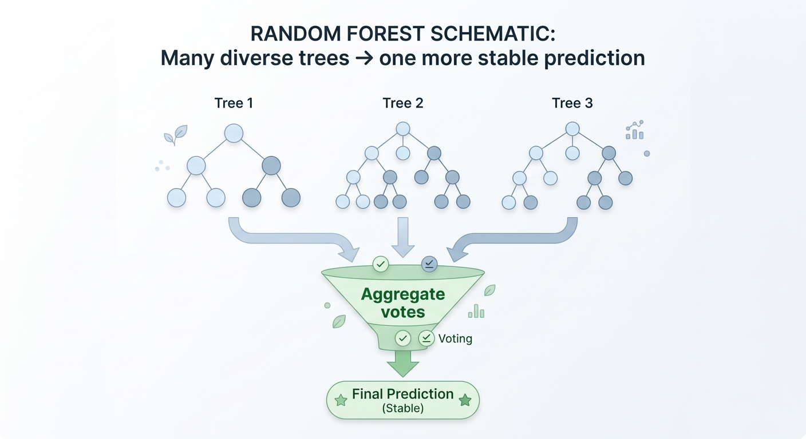

Train many diverse trees on bootstrap samples and subsets of predictors, then aggregate their predictions. A forest often has lower variance than a single unstable tree.

## Memorization versus generalization {.concept-slide}

The central machine-learning problem

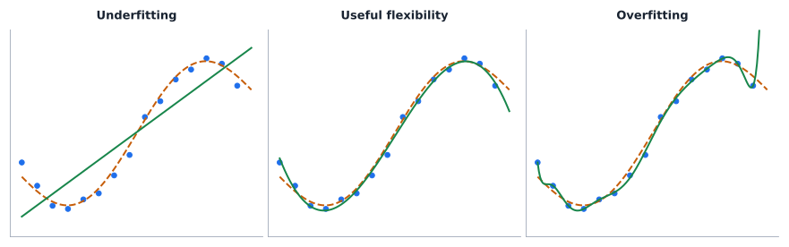

A flexible model can fit all observed points while performing poorly on new measurements. Training error alone cannot detect that.

## Bias–variance is a balance {.concept-slide}

<strong>High bias · low flexibility</strong>Misses the real trend: underfitting.

<strong>High variance · high flexibility</strong>Learns specific sample fluctuations: overfitting.

<strong>Lower future risk</strong>Appropriate complexity, representative data and regularization.

  

  
  
Arthur Samuel

  

  

  
  
John McCarthy

  

## Lab: polynomial complexity and double descent {.concept-slide}

A constructed, reproducible minimum-norm Legendre example

<label class="w12-control">model assessment<select id="complexMode"><option value="train" selected>training error only</option><option value="split">training and validation errors</option></select></label><label class="w12-control">polynomial degree = <strong id="degreeVal">4</strong><input id="degree" type="range" min="1" max="44" value="4" step="1"></label><button id="complexResplit" type="button" class="w12-btn">Change training sample</button>

Train MSE<strong id="complexTrain">—</strong>

Validation MSE<strong id="complexVal">—</strong>

14 training points; 120 independent validation points (20 displayed). Blue and purple vertical segments show residuals. Signal: cubic + oscillation + Gaussian noise. Minimum-norm Legendre fits can interpolate from degree 13. The two examples are deliberately selected; second descent is not guaranteed.

<svg id="complexitySvg" class="w12-svg" style="height: 16em" viewBox="0 0 900 490" aria-label="Overparameterized polynomial fit with training and validation losses"></svg>

## Why can loss fall again? {.concept-slide}

<strong>Near interpolation</strong>Model may become numerically unstable: a validation-error peak.

<strong>Overparameterized side</strong>Infinitely many interpolating functions can exist; the fitting rule selects one.

<strong>Implicit regularization</strong>The minimum-norm solution may generalize better in some settings.

Double descent does not replace the bias–variance idea, and adding parameters does not reliably improve future predictions.

## How do neural networks use predictors? {.concept-slide}

From regression to multilayer flexible mappings

<video class="w12-video" style="height: 16em" data-autoplay muted loop playsinline><source src="media/perceptron.mp4" type="video/mp4"></video>

## A network is a composition of small functions {.concept-slide}

The nonlinear activations matter

<strong>Input layer</strong>Features: metabolite abundance, age, treatment and so on.

<strong>Hidden layers</strong>Many neurons with learned weights and nonlinear transformations.

<strong>Output layer</strong>Class logits/probabilities or a continuous prediction, depending on task.

  

  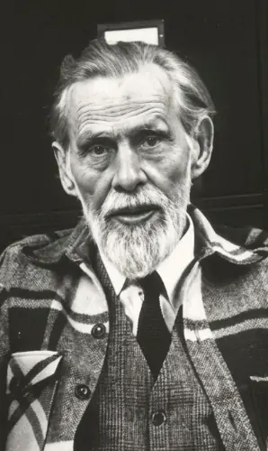
  
Warren S. McCulloch

  

  

  
  
Walter Pitts

  

  

  
  
Frank Rosenblatt

  

## Animation: feedforward neural network {.concept-slide}

<video class="w12-video" style="height: 20em" data-autoplay muted loop playsinline><source src="media/feedforward.mp4" type="video/mp4"></video>

## What makes a neural net flexible? {.concept-slide}

<strong>Weights and biases</strong>Parameters learned from labeled data.

<strong>Depth and width</strong>Hyperparameters determining capacity and possible function shapes.

<strong>Activation functions</strong>Nonlinearity enables curved and discontinuous-like decision boundaries.

<strong>Capacity ≠ validity</strong>A large model can learn artifacts as easily as meaningful signals.

## Training uses a loss function {.concept-slide}

Classification · compare truth and predicted probabilities

$L=-\sum_{k=1}^{K}\mathbf{1}\{Y=k\}\log \hat p_k$

<strong>Forward pass</strong>Compute predictions under current weights.

<strong>Loss</strong>Quantify prediction error on labeled examples.

<strong>Weight update</strong>Change parameters to reduce the training objective.

  

  
  
David Rumelhart

  

  

  
  
John Hopfield

  

## Animation: backpropagation {.concept-slide}

<video class="w12-video" style="height: 20em" data-autoplay muted loop playsinline><source src="media/backpropagation.mp4" type="video/mp4"></video>

## The famous handwritten-digit task {.concept-slide}

<video class="w12-video" style="height: 20em" data-autoplay muted loop playsinline><source src="media/MNISTdepiction.mp4" type="video/mp4"></video>

## Lab: draw a digit · run the real network {.concept-slide}

Works fully offline · browser inference using bundled weights

<canvas id="digitCanvas" width="280" height="280" aria-label="Draw a single white digit on the black canvas"></canvas>
<button class="w12-btn" type="button" id="digitPredict">Predict digit</button><button class="w12-btn secondary" type="button" id="digitClear">Clear</button>

Use mouse / finger to draw one digit

Resized 28 × 28 input
<canvas id="digitPixels" width="112" height="112" aria-label="Network input after preprocessing"></canvas>
Shows actual input pixels passed to the model.

Draw a digit

Demo only. Trained on an 8×8 handwritten-digits dataset, resampled to 28×28—not on MNIST. Test-set accuracy on that source does not guarantee comparable accuracy on hand-drawn inputs.

## What can an impressive digit demo prove? {.concept-slide}

<strong>It can prove</strong>A trained model can use learned pixel patterns for offline predictions.

<strong>It cannot prove</strong>That a medical model generalizes to unseen hospitals, instruments, patients or disease prevalences.

<strong>For real pharmacy use</strong>Require clinical endpoints, calibrated uncertainty, validation and regulatory considerations.

  

  
  
Geoffrey Hinton

  

  

  
  
Yann LeCun

  

  

  
  
Yoshua Bengio

  

## Back to the metabolomics example {.concept-slide}

200 patients · 2,500 metabolites · 3-year follow-up

<strong>Acquire</strong>Representative cohorts + trusted labels

<strong>Prepare</strong>QC, leakage-proof scaling, batch effects

<strong>Train</strong>Compare baseline and complex methods

<strong>Validate</strong>Independent patients and sites

A trustworthy model is one whose performance survives critical evaluation beyond the dataset on which it was developed.

## Question 1 · unsupervised or supervised? {.concept-slide}

Which statement describes PCA?

<button type="button" class="w12-choice" data-choice="A">A. It chooses axes with the highest separation of disease labels.</button><button type="button" class="w12-choice" data-choice="B">B. It chooses directions retaining maximal sample variance.</button><button type="button" class="w12-choice" data-choice="C">C. It assigns each patient a verified disease subtype.</button>
Choose one.

## Question 2 · preprocessing {.concept-slide}

Why could unscaled PCA be misleading for hemoglobin, weight and age?

<button type="button" class="w12-choice" data-choice="A">A. Scaling never changes principal components.</button><button type="button" class="w12-choice" data-choice="B">B. PCA is invariant to units and variance.</button><button type="button" class="w12-choice" data-choice="C">C. The variable with greater numerical variance can dominate the projected directions.</button>
Choose one.

## Question 3 · interpreting clusters {.concept-slide}

Which conclusion is justified after K-means identifies three clusters of metabolomic profiles?

<button type="button" class="w12-choice" data-choice="A">A. The three clusters are different Alzheimer’s subtypes.</button><button type="button" class="w12-choice" data-choice="B">B. The chosen algorithm found three groups under its assumptions; biological meaning needs validation.</button><button type="button" class="w12-choice" data-choice="C">C. The algorithm has therefore demonstrated treatment causality.</button>
Choose one.

## Question 4 · evaluation {.concept-slide}

What is a defensible use of the final test set?

<button type="button" class="w12-choice" data-choice="A">A. Evaluate a fully chosen pipeline once at the end.</button><button type="button" class="w12-choice" data-choice="B">B. Use it repeatedly to choose model depth and features.</button><button type="button" class="w12-choice" data-choice="C">C. Fit preprocessing on all patients before splitting.</button>
Choose one.

## Question 5 · generalization {.concept-slide}

A deep decision tree has nearly zero training error but high validation error. What is most plausible?

<button type="button" class="w12-choice" data-choice="A">A. It must be unbiased in future patients.</button><button type="button" class="w12-choice" data-choice="B">B. It cannot classify any observations.</button><button type="button" class="w12-choice" data-choice="C">C. It has probably overfit incidental training patterns.</button>
Choose one.

## Question 6 · real-world interpretation {.concept-slide}

A model recognizes handwritten digits with high accuracy on a held-out dataset. Which claim follows?

<button type="button" class="w12-choice" data-choice="A">A. It will necessarily diagnose disease with equal accuracy.</button><button type="button" class="w12-choice" data-choice="B">B. It has demonstrated prediction on its tested digit data, not clinical validity.</button><button type="button" class="w12-choice" data-choice="C">C. Its predictions prove which pixels cause the digit to be what it is.</button>
Choose one.

## One intellectual framework, twelve weeks {.concept-slide}

<strong>Probability</strong>Describe uncertainty

<strong>Inference</strong>Estimate from samples

<strong>Modeling</strong>Relate variables appropriately

<strong>Prediction</strong>Generalize to unseen data

The same principles persist as models grow more complex.

## The final course takeaway {.title-slide}

Statistics 101 · Graduate Pharmaceutical Studies

Good statistical thinking means knowing <strong>what the evidence supports, what remains uncertain, and when a confident model can still be wrong.</strong>

The goal was never to memorize a list of tests. <strong>It was to reason about scientific evidence.</strong>

